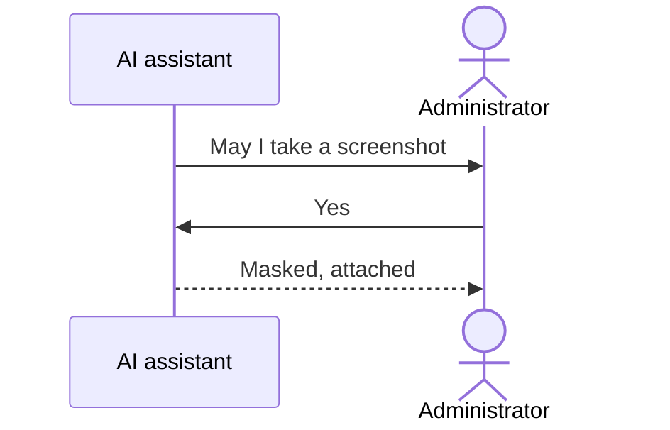

🏠 [Specs](../../../../README.md) › 🧩 [Functional capabilities](../../../README.md) ›
🛟 [F20 Hosted support assistant (hosted edition)](../../README.md) › 📝 [Use cases](../README.md) ›
📝 [Use cases: FL-F20-01 Talk it through](README.md) › 📝 UC-F20-03 Share screenshots when needed

# 📝 UC-F20-03 Share screenshots when needed

**Status:** ✅ specified

## Summary

The AI assistant asks before taking a screenshot of the customer's page, masks personal data and amounts, and attaches
it.

## Personas

- [U07 Administrator](../../../../01-users/personas/u07-administrator.md)

## Goal

Visual context with privacy.

## Trigger

Needed for diagnosis.

## Frequency

Some requests.

## Preconditions

- Consent.

## Postconditions

- Success: masked screenshot.
- Failure: none taken.

## Main flow

1. The AI assistant asks (S-F20-03).
2. The administrator agrees.
3. The screenshot is masked (BR-F20-06).
4. It is attached and kept for the period.

## Alternative flows

- 2a. Refuses: none.

## Error flows

- 3e. Masking fails: not kept.
- Any step: a service does not answer; the call is retried first (BR-F3-32), then the message follows the error pattern
  (D122) and what was typed stays on the screen.

## Business rules

- [BR-F20-06 Screenshots with consent, masked](../../business-rules/br-f20-06-screenshots-with-consent-and-masking.md)
- [BR-F20-07 Personal data and secrets masked](../../business-rules/br-f20-07-data-and-secrets-masked.md)

## Entities

- [E-F20-03 Screenshot](../../data/e-f20-03-screenshot.md)

## Permissions

Requester consents.

## Notifications

- None.

## Audit events

Screenshots.

## AI involvement

Masking.

## API, MCP and A2A exposure

Through T5 and T6 with the caller's rights (BR-F3-34).

## Screens

- [S-F20-03 Screenshots](../../screens/01-talk-it-through/s-f20-03-screenshots.md)

## Flowchart

See [FL-F20-01 Talk it through](../../flows/fl-f20-01-talk-it-through.md#flowchart).

## Sequence diagram

## Acceptance criteria

1. **Given** consent **when** taken **then** masked.
2. **Given** refusal **when** asked **then** none.
3. **Given** masking fails **when** checked **then** not kept.

## Non-functional notes

D408's targets ([Performance](../../../../05-non-functional/performance.md)): 95 % of screens within 1 second; lists
paged on the server, the first page within 1 second; reports within 5 seconds or in the background.

## Regulatory references

Support rules of the France country pack:
[CR-FR-199 Notifying a personal data breach](../../../../10-country-packs/france/data-protection/cr-fr-199-personal-data-breach-notification.md),
[CR-FR-169 NIS2 incident notification](../../../../10-country-packs/france/digital/cr-fr-169-nis2-incident-notification.md),
[CR-FR-049 Processors and transfers outside the EU](../../../../10-country-packs/france/data-protection/cr-fr-049-processors-and-transfers.md),
[CR-FR-056 People know they deal with an AI](../../../../10-country-packs/france/ai-and-recording/cr-fr-056-people-know-they-deal-with-an-ai.md),
[CR-FR-057 A person confirms what the AI does](../../../../10-country-packs/france/ai-and-recording/cr-fr-057-human-oversight.md),
[CR-FR-052 Personal data kept no longer than needed](../../../../10-country-packs/france/data-protection/cr-fr-052-storage-limitation.md),
[CR-FR-168 Cyber Resilience Act reporting](../../../../10-country-packs/france/digital/cr-fr-168-cyber-resilience-reporting.md).

## Related use cases

- [UC-F20-04 Diagnose on the cluster](../02-diagnose-and-fix/uc-f20-04-diagnose-on-the-cluster.md)

## Open questions

None.

---

⬅️ [UC-F20-02 Answer clarifying questions](uc-f20-02-answer-clarifying-questions.md) · ⬆️ [Up](README.md) ·
➡️ [UC-F20-04 Diagnose on the cluster](../02-diagnose-and-fix/uc-f20-04-diagnose-on-the-cluster.md)
