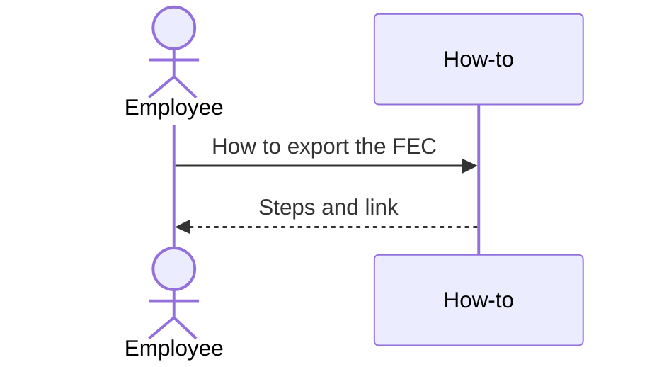

🏠 [Specs](../../../../README.md) › 🧩 [Functional capabilities](../../../README.md) ›
🛟 [F20 Hosted support assistant (hosted edition)](../../README.md) › 📝 [Use cases](../README.md) ›
📝 [Use cases: FL-F20-01 Talk it through](README.md) › 📝 UC-F20-12 Answer how-to questions from the documentation

# 📝 UC-F20-12 Answer how-to questions from the documentation

**Status:** ✅ specified

## Summary

Employees and administrators ask how-to questions answered from the documentation with links.

## Personas

- [U01 Employee](../../../../01-users/personas/u01-employee.md)
- [U07 Administrator](../../../../01-users/personas/u07-administrator.md)

## Goal

Self-help.

## Trigger

A question.

## Frequency

Daily.

## Preconditions

- None.

## Postconditions

- Success: answered.
- Failure: request opened.

## Main flow

1. They ask (S-F20-12).
2. The answer cites documentation.
3. Links open screens.
4. They rate.

## Alternative flows

- 1a. From the phone (UC-F20-27).

## Error flows

- 2e. Not documented: request.
- Any step: a service does not answer; the call is retried first (BR-F3-32), then the message follows the error pattern
  (D122) and what was typed stays on the screen.

## Business rules

- [BR-F20-02 Plain words first](../../business-rules/br-f20-02-plain-words-first.md)
- [BR-F20-09 The customer knows it is an AI](../../business-rules/br-f20-09-ai-disclosed.md)

## Entities

- [E-F20-02 Message](../../data/e-f20-02-message.md)

## Permissions

Everyone.

## Notifications

- None.

## Audit events

Questions.

## AI involvement

Answers.

## API, MCP and A2A exposure

Through T5 and T6 with the caller's rights (BR-F3-34).

## Screens

- [S-F20-12 How-to](../../screens/01-talk-it-through/s-f20-12-how-to.md)

## Flowchart

See [FL-F20-01 Talk it through](../../flows/fl-f20-01-talk-it-through.md#flowchart).

## Sequence diagram

## Acceptance criteria

1. **Given** a documented question **when** asked **then** steps and link.
2. **Given** undocumented **when** asked **then** request.
3. **Given** rated **when** rated **then** stored.

## Non-functional notes

D408's targets ([Performance](../../../../05-non-functional/performance.md)): 95 % of screens within 1 second; lists
paged on the server, the first page within 1 second; reports within 5 seconds or in the background.

## Regulatory references

Support rules of the France country pack:
[CR-FR-199 Notifying a personal data breach](../../../../10-country-packs/france/data-protection/cr-fr-199-personal-data-breach-notification.md),
[CR-FR-169 NIS2 incident notification](../../../../10-country-packs/france/digital/cr-fr-169-nis2-incident-notification.md),
[CR-FR-049 Processors and transfers outside the EU](../../../../10-country-packs/france/data-protection/cr-fr-049-processors-and-transfers.md),
[CR-FR-056 People know they deal with an AI](../../../../10-country-packs/france/ai-and-recording/cr-fr-056-people-know-they-deal-with-an-ai.md),
[CR-FR-057 A person confirms what the AI does](../../../../10-country-packs/france/ai-and-recording/cr-fr-057-human-oversight.md),
[CR-FR-052 Personal data kept no longer than needed](../../../../10-country-packs/france/data-protection/cr-fr-052-storage-limitation.md),
[CR-FR-168 Cyber Resilience Act reporting](../../../../10-country-packs/france/digital/cr-fr-168-cyber-resilience-reporting.md).

## Related use cases

- [UC-F20-27 Get help on a task from the phone](../07-employees-help/uc-f20-27-get-help-on-a-task-from-the-phone.md)

## Open questions

None.

---

⬅️ [UC-F20-11 Warn before customers notice](../03-incidents/uc-f20-11-warn-before-customers-notice.md) ·
⬆️ [Up](README.md) ·
➡️ [UC-F20-13 Restore data from a backup](../02-diagnose-and-fix/uc-f20-13-restore-data-from-a-backup.md)
