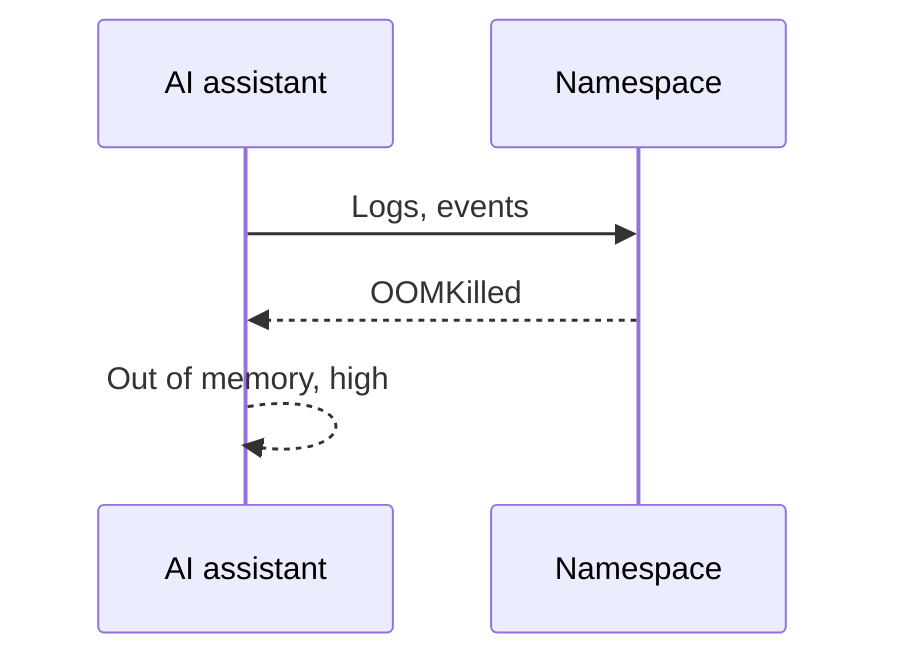

🏠 [Specs](../../../../README.md) › 🧩 [Functional capabilities](../../../README.md) ›
🛟 [F20 Hosted support assistant (hosted edition)](../../README.md) › 📝 [Use cases](../README.md) ›
📝 [Use cases: FL-F20-02 Diagnose and fix](README.md) › 📝 UC-F20-04 Diagnose on the cluster

# 📝 UC-F20-04 Diagnose on the cluster

**Status:** ✅ specified

## Summary

The hosting engineer's AI assistant reads the customer's namespace read-only, correlates events and finds the cause.

## Personas

- [U48 Hosting engineer](../../../../01-users/personas/u48-hosting-engineer.md)

## Goal

The cause found.

## Trigger

A request.

## Frequency

Most requests.

## Preconditions

- Namespace allowed (BR-F20-13).

## Postconditions

- Success: cause with confidence.
- Failure: escalated.

## Main flow

1. The AI assistant reads the namespace (S-F20-04) (BR-F20-03).
2. It masks data (BR-F20-07).
3. It correlates logs and events.
4. It states the cause and confidence.

## Alternative flows

- 1a. Health data namespace: excluded.

## Error flows

- 4e. Unknown: escalate.
- Any step: a service does not answer; the call is retried first (BR-F3-32), then the message follows the error pattern
  (D122) and what was typed stays on the screen.

## Business rules

- [BR-F20-03 Only the customer's own namespace](../../business-rules/br-f20-03-own-namespace-only.md)
- [BR-F20-07 Personal data and secrets masked](../../business-rules/br-f20-07-data-and-secrets-masked.md)
- [BR-F20-13 Health data out of the models' reach](../../business-rules/br-f20-13-health-data-out-of-reach.md)

## Entities

- [E-F20-04 Diagnosis](../../data/e-f20-04-diagnosis.md)
- [E-F20-05 Cluster reading](../../data/e-f20-05-cluster-reading.md)

## Permissions

Hosting engineer.

## Notifications

- None.

## Audit events

Resources read.

## AI involvement

Diagnosis.

## API, MCP and A2A exposure

Through T5 and T6 with the caller's rights (BR-F3-34).

## Screens

- [S-F20-04 Diagnosis](../../screens/02-diagnose-and-fix/s-f20-04-diagnosis.md)

## Flowchart

See [FL-F20-02 Diagnose and fix](../../flows/fl-f20-02-diagnose-and-fix.md#flowchart).

## Sequence diagram

## Acceptance criteria

1. **Given** OOMKilled **when** read **then** cause out of memory.
2. **Given** a health namespace **when** read **then** excluded.
3. **Given** unknown **when** found **then** escalated.

## Non-functional notes

D408's targets ([Performance](../../../../05-non-functional/performance.md)): 95 % of screens within 1 second; lists
paged on the server, the first page within 1 second; reports within 5 seconds or in the background.

## Regulatory references

Support rules of the France country pack:
[CR-FR-199 Notifying a personal data breach](../../../../10-country-packs/france/data-protection/cr-fr-199-personal-data-breach-notification.md),
[CR-FR-169 NIS2 incident notification](../../../../10-country-packs/france/digital/cr-fr-169-nis2-incident-notification.md),
[CR-FR-049 Processors and transfers outside the EU](../../../../10-country-packs/france/data-protection/cr-fr-049-processors-and-transfers.md),
[CR-FR-056 People know they deal with an AI](../../../../10-country-packs/france/ai-and-recording/cr-fr-056-people-know-they-deal-with-an-ai.md),
[CR-FR-057 A person confirms what the AI does](../../../../10-country-packs/france/ai-and-recording/cr-fr-057-human-oversight.md),
[CR-FR-052 Personal data kept no longer than needed](../../../../10-country-packs/france/data-protection/cr-fr-052-storage-limitation.md),
[CR-FR-168 Cyber Resilience Act reporting](../../../../10-country-packs/france/digital/cr-fr-168-cyber-resilience-reporting.md).

## Related use cases

- [UC-F20-05 Explain the cause simply](uc-f20-05-explain-the-cause-simply.md)

## Open questions

None.

---

⬅️ [UC-F20-03 Share screenshots when needed](../01-talk-it-through/uc-f20-03-share-screenshots-when-needed.md) ·
⬆️ [Up](README.md) · ➡️ [UC-F20-05 Explain the cause simply](uc-f20-05-explain-the-cause-simply.md)
