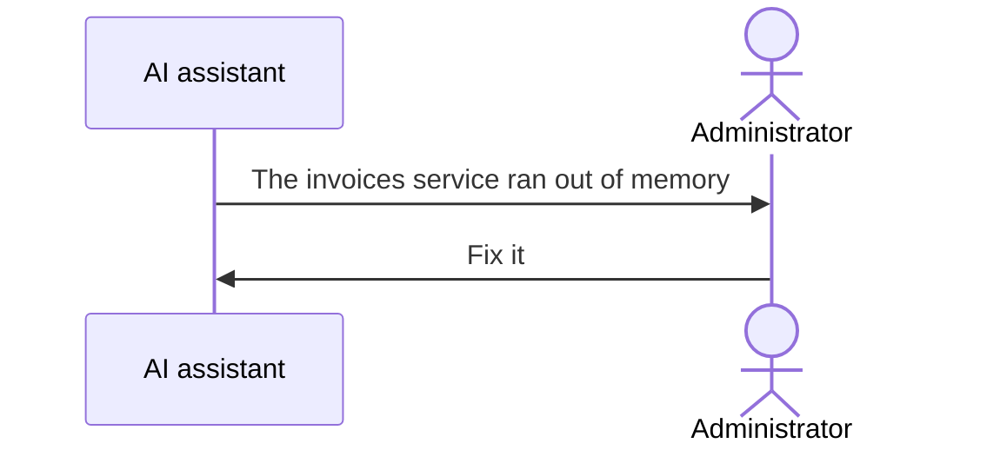

🏠 [Specs](../../../../README.md) › 🧩 [Functional capabilities](../../../README.md) ›
🛟 [F20 Hosted support assistant (hosted edition)](../../README.md) › 📝 [Use cases](../README.md) ›
📝 [Use cases: FL-F20-02 Diagnose and fix](README.md) › 📝 UC-F20-05 Explain the cause simply

# 📝 UC-F20-05 Explain the cause simply

**Status:** ✅ specified

## Summary

The AI assistant explains the cause to the administrator in plain words with details on demand and the next step.

## Personas

- [U07 Administrator](../../../../01-users/personas/u07-administrator.md)

## Goal

The customer understands.

## Trigger

Cause found.

## Frequency

Most requests.

## Preconditions

- Cause found.

## Postconditions

- Success: explained.
- Failure: escalated.

## Main flow

1. The AI assistant explains (S-F20-05).
2. Details on demand.
3. It says the next step.
4. The administrator agrees.

## Alternative flows

- 2a. Technical details asked.

## Error flows

- 4e. Customer disagrees: escalate.
- Any step: a service does not answer; the call is retried first (BR-F3-32), then the message follows the error pattern
  (D122) and what was typed stays on the screen.

## Business rules

- [BR-F20-02 Plain words first](../../business-rules/br-f20-02-plain-words-first.md)
- [BR-F20-08 Escalate when unsure](../../business-rules/br-f20-08-escalate-when-unsure.md)

## Entities

- [E-F20-02 Message](../../data/e-f20-02-message.md)
- [E-F20-04 Diagnosis](../../data/e-f20-04-diagnosis.md)

## Permissions

Requester.

## Notifications

- None.

## Audit events

Messages.

## AI involvement

Plain words.

## API, MCP and A2A exposure

Through T5 and T6 with the caller's rights (BR-F3-34).

## Screens

- [S-F20-05 Explanation](../../screens/02-diagnose-and-fix/s-f20-05-explanation.md)

## Flowchart

See [FL-F20-02 Diagnose and fix](../../flows/fl-f20-02-diagnose-and-fix.md#flowchart).

## Sequence diagram

## Acceptance criteria

1. **Given** a cause **when** explained **then** no jargon.
2. **Given** details asked **when** asked **then** shown.
3. **Given** disagreement **when** said **then** escalated.

## Non-functional notes

D408's targets ([Performance](../../../../05-non-functional/performance.md)): 95 % of screens within 1 second; lists
paged on the server, the first page within 1 second; reports within 5 seconds or in the background.

## Regulatory references

Support rules of the France country pack:
[CR-FR-199 Notifying a personal data breach](../../../../10-country-packs/france/data-protection/cr-fr-199-personal-data-breach-notification.md),
[CR-FR-169 NIS2 incident notification](../../../../10-country-packs/france/digital/cr-fr-169-nis2-incident-notification.md),
[CR-FR-049 Processors and transfers outside the EU](../../../../10-country-packs/france/data-protection/cr-fr-049-processors-and-transfers.md),
[CR-FR-056 People know they deal with an AI](../../../../10-country-packs/france/ai-and-recording/cr-fr-056-people-know-they-deal-with-an-ai.md),
[CR-FR-057 A person confirms what the AI does](../../../../10-country-packs/france/ai-and-recording/cr-fr-057-human-oversight.md),
[CR-FR-052 Personal data kept no longer than needed](../../../../10-country-packs/france/data-protection/cr-fr-052-storage-limitation.md),
[CR-FR-168 Cyber Resilience Act reporting](../../../../10-country-packs/france/digital/cr-fr-168-cyber-resilience-reporting.md).

## Related use cases

- [UC-F20-06 Propose a fix for a maintainer's yes](uc-f20-06-propose-a-fix-for-a-maintainer-s-yes.md)

## Open questions

None.

---

⬅️ [UC-F20-04 Diagnose on the cluster](uc-f20-04-diagnose-on-the-cluster.md) · ⬆️ [Up](README.md) ·
➡️ [UC-F20-06 Propose a fix for a maintainer's yes](uc-f20-06-propose-a-fix-for-a-maintainer-s-yes.md)
