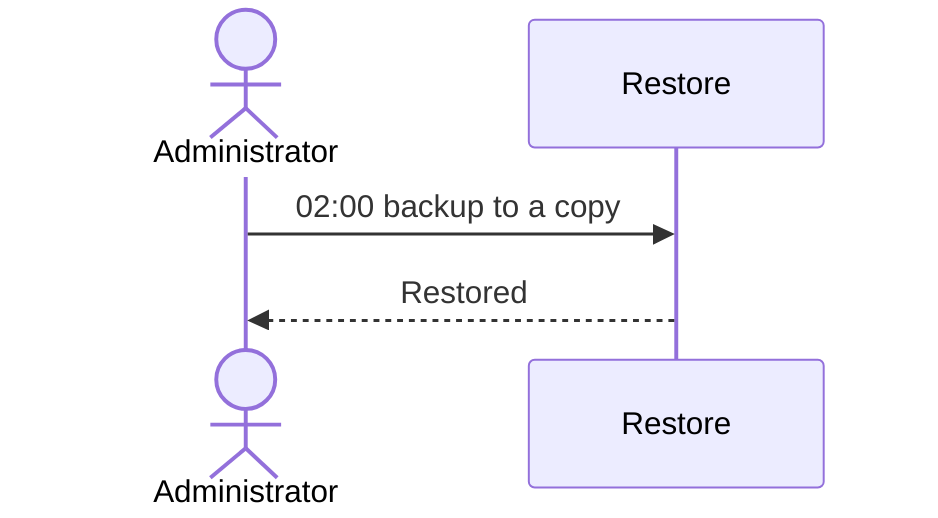

🏠 [Specs](../../../../README.md) › 🧩 [Functional capabilities](../../../README.md) ›
🛟 [F20 Hosted support assistant (hosted edition)](../../README.md) › 📝 [Use cases](../README.md) ›
📝 [Use cases: FL-F20-02 Diagnose and fix](README.md) › 📝 UC-F20-13 Restore data from a backup

# 📝 UC-F20-13 Restore data from a backup

**Status:** ✅ specified

## Summary

An administrator asks for a restore from a backup; a maintainer approves; it is restored and verified.

## Personas

- [U07 Administrator](../../../../01-users/personas/u07-administrator.md)
- [U48 Hosting engineer](../../../../01-users/personas/u48-hosting-engineer.md)

## Goal

Data back.

## Trigger

Data lost.

## Frequency

Rare.

## Preconditions

- Backups.

## Postconditions

- Success: restored.
- Failure: refused.

## Main flow

1. The administrator asks (S-F20-13).
2. The target is chosen (copy or live).
3. A maintainer approves.
4. Restored and verified.

## Alternative flows

- 2a. To a copy first.

## Error flows

- 3e. Refused.
- Any step: a service does not answer; the call is retried first (BR-F3-32), then the message follows the error pattern
  (D122) and what was typed stays on the screen.

## Business rules

- [BR-F20-04 Every fix needs a maintainer's yes](../../business-rules/br-f20-04-fixes-need-a-maintainer-yes.md)
- [BR-F20-05 Fixes are verified and reversible](../../business-rules/br-f20-05-fixes-are-verified-and-reversible.md)

## Entities

- [E-F20-06 Fix proposal](../../data/e-f20-06-fix-proposal.md)
- [E-F20-08 Restore](../../data/e-f20-08-restore.md)

## Permissions

Administrator asks; maintainer approves.

## Notifications

- Administrator.

## Audit events

Restores.

## AI involvement

None.

## API, MCP and A2A exposure

Through T5 and T6 with the caller's rights (BR-F3-34).

## Screens

- [S-F20-13 Restore](../../screens/02-diagnose-and-fix/s-f20-13-restore.md)

## Flowchart

See [FL-F20-02 Diagnose and fix](../../flows/fl-f20-02-diagnose-and-fix.md#flowchart).

## Sequence diagram

## Acceptance criteria

1. **Given** a backup **when** restored to a copy **then** live unchanged.
2. **Given** approved **when** restored **then** verified.
3. **Given** refused **when** refused **then** nothing.

## Non-functional notes

D408's targets ([Performance](../../../../05-non-functional/performance.md)): 95 % of screens within 1 second; lists
paged on the server, the first page within 1 second; reports within 5 seconds or in the background.

## Regulatory references

Support rules of the France country pack:
[CR-FR-199 Notifying a personal data breach](../../../../10-country-packs/france/data-protection/cr-fr-199-personal-data-breach-notification.md),
[CR-FR-169 NIS2 incident notification](../../../../10-country-packs/france/digital/cr-fr-169-nis2-incident-notification.md),
[CR-FR-049 Processors and transfers outside the EU](../../../../10-country-packs/france/data-protection/cr-fr-049-processors-and-transfers.md),
[CR-FR-056 People know they deal with an AI](../../../../10-country-packs/france/ai-and-recording/cr-fr-056-people-know-they-deal-with-an-ai.md),
[CR-FR-057 A person confirms what the AI does](../../../../10-country-packs/france/ai-and-recording/cr-fr-057-human-oversight.md),
[CR-FR-052 Personal data kept no longer than needed](../../../../10-country-packs/france/data-protection/cr-fr-052-storage-limitation.md),
[CR-FR-168 Cyber Resilience Act reporting](../../../../10-country-packs/france/digital/cr-fr-168-cyber-resilience-reporting.md).

## Related use cases

- [UC-F20-06 Propose a fix for a maintainer's yes](uc-f20-06-propose-a-fix-for-a-maintainer-s-yes.md)

## Open questions

None.

---

⬅️ [UC-F20-12](../01-talk-it-through/uc-f20-12-answer-how-to-questions-from-the-documentation.md) · ⬆️ [Up](README.md) ·
➡️ [UC-F20-14 Investigate slowness](uc-f20-14-investigate-slowness.md)
