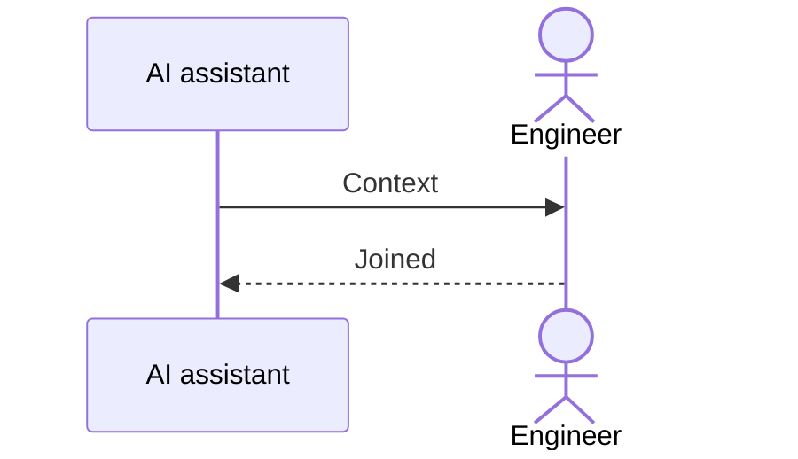

🏠 [Specs](../../../../README.md) › 🧩 [Functional capabilities](../../../README.md) ›
🛟 [F20 Hosted support assistant (hosted edition)](../../README.md) › 📝 [Use cases](../README.md) ›
📝 [Use cases: FL-F20-03 Incidents](README.md) › 📝 UC-F20-08 Escalate to an engineer

# 📝 UC-F20-08 Escalate to an engineer

**Status:** ✅ specified

## Summary

The request goes to a human engineer with the full context when unsure or asked.

## Personas

- [U48 Hosting engineer](../../../../01-users/personas/u48-hosting-engineer.md)

## Goal

Human help when needed.

## Trigger

Unsure or asked.

## Frequency

Some requests.

## Preconditions

- A request.

## Postconditions

- Success: engineer joins.
- Failure: none.

## Main flow

1. The AI assistant escalates (S-F20-08) (BR-F20-08).
2. An engineer joins.
3. The customer is told who and when.
4. The engineer resolves.

## Alternative flows

- 1a. Customer asks.

## Error flows

- 2e. No engineer free: time shown.
- Any step: a service does not answer; the call is retried first (BR-F3-32), then the message follows the error pattern
  (D122) and what was typed stays on the screen.

## Business rules

- [BR-F20-08 Escalate when unsure](../../business-rules/br-f20-08-escalate-when-unsure.md)

## Entities

- [E-F20-01 Support request](../../data/e-f20-01-support-request.md)
- [E-F20-07 Service incident](../../data/e-f20-07-service-incident.md)

## Permissions

Engineer.

## Notifications

- Customer.

## Audit events

Escalations.

## AI involvement

Hand-off.

## API, MCP and A2A exposure

Through T5 and T6 with the caller's rights (BR-F3-34).

## Screens

- [S-F20-08 Escalation](../../screens/03-incidents/s-f20-08-escalation.md)

## Flowchart

See [FL-F20-03 Incidents](../../flows/fl-f20-03-incidents.md#flowchart).

## Sequence diagram

## Acceptance criteria

1. **Given** unknown cause **when** escalated **then** context passed.
2. **Given** asked **when** asked **then** escalated.
3. **Given** urgent **when** escalated **then** within 1 hour.

## Non-functional notes

D408's targets ([Performance](../../../../05-non-functional/performance.md)): 95 % of screens within 1 second; lists
paged on the server, the first page within 1 second; reports within 5 seconds or in the background.

## Regulatory references

Support rules of the France country pack:
[CR-FR-199 Notifying a personal data breach](../../../../10-country-packs/france/data-protection/cr-fr-199-personal-data-breach-notification.md),
[CR-FR-169 NIS2 incident notification](../../../../10-country-packs/france/digital/cr-fr-169-nis2-incident-notification.md),
[CR-FR-049 Processors and transfers outside the EU](../../../../10-country-packs/france/data-protection/cr-fr-049-processors-and-transfers.md),
[CR-FR-056 People know they deal with an AI](../../../../10-country-packs/france/ai-and-recording/cr-fr-056-people-know-they-deal-with-an-ai.md),
[CR-FR-057 A person confirms what the AI does](../../../../10-country-packs/france/ai-and-recording/cr-fr-057-human-oversight.md),
[CR-FR-052 Personal data kept no longer than needed](../../../../10-country-packs/france/data-protection/cr-fr-052-storage-limitation.md),
[CR-FR-168 Cyber Resilience Act reporting](../../../../10-country-packs/france/digital/cr-fr-168-cyber-resilience-reporting.md).

## Related use cases

- [UC-F20-10 Handle a wide incident with a status page](uc-f20-10-handle-a-wide-incident-with-a-status-page.md)

## Open questions

None.

---

⬅️ [UC-F20-07 Apply and verify the fix](../02-diagnose-and-fix/uc-f20-07-apply-and-verify-the-fix.md) ·
⬆️ [Up](README.md) · ➡️ [UC-F20-09 Follow the request](../01-talk-it-through/uc-f20-09-follow-the-request.md)
