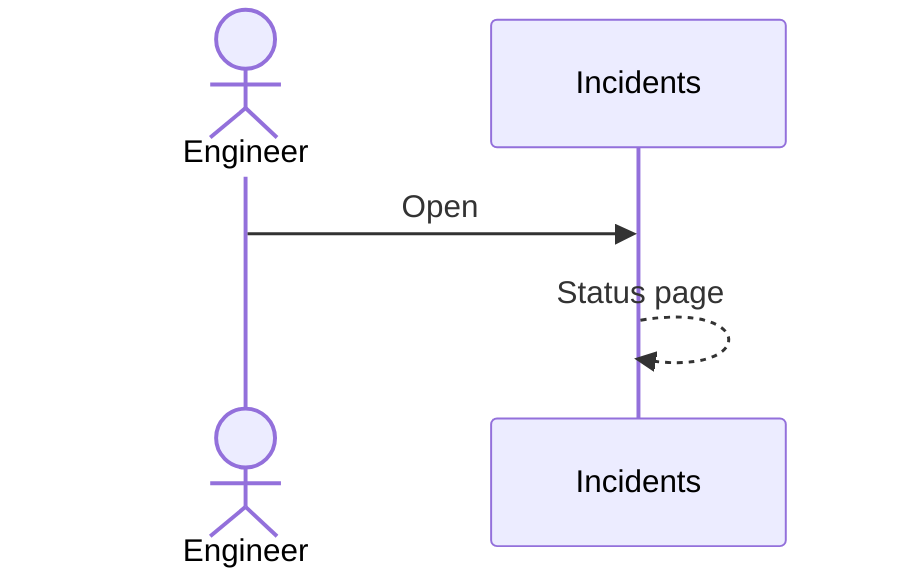

🏠 [Specs](../../../../README.md) › 🧩 [Functional capabilities](../../../README.md) ›
🛟 [F20 Hosted support assistant (hosted edition)](../../README.md) › 📝 [Use cases](../README.md) ›
📝 [Use cases: FL-F20-03 Incidents](README.md) › 📝 UC-F20-10 Handle a wide incident with a status page

# 📝 UC-F20-10 Handle a wide incident with a status page

**Status:** ✅ specified

## Summary

The hosting engineer handles an incident affecting many customers with a status page and notifications.

## Personas

- [U48 Hosting engineer](../../../../01-users/personas/u48-hosting-engineer.md)

## Goal

Customers informed.

## Trigger

Wide incident.

## Frequency

Rare.

## Preconditions

- Incident.

## Postconditions

- Success: resolved, report follows.
- Failure: escalated.

## Main flow

1. The engineer opens the incident (S-F20-28).
2. The status page updates (S-F20-10).
3. Customers are notified.
4. Resolved; the written report follows (UC-F20-23).

## Alternative flows

- 3a. NIS2 customers: facts (UC-F20-26).

## Error flows

- 2e. Status page down: email.
- Any step: a service does not answer; the call is retried first (BR-F3-32), then the message follows the error pattern
  (D122) and what was typed stays on the screen.

## Business rules

- [BR-F20-08 Escalate when unsure](../../business-rules/br-f20-08-escalate-when-unsure.md)
- [BR-F20-16 Written report after a major incident](../../business-rules/br-f20-16-written-report-after-a-major-incident.md)

## Entities

- [E-F20-07 Service incident](../../data/e-f20-07-service-incident.md)
- [E-F20-15 Incident report](../../data/e-f20-15-incident-report.md)

## Permissions

Engineer.

## Notifications

- Customers.

## Audit events

Incidents.

## AI involvement

None.

## API, MCP and A2A exposure

Through T5 and T6 with the caller's rights (BR-F3-34).

## Screens

- [S-F20-10 Status page](../../screens/03-incidents/s-f20-10-status-page.md)
- [S-F20-28 Incident handling](../../screens/03-incidents/s-f20-28-incident-handling.md)

## Flowchart

See [FL-F20-03 Incidents](../../flows/fl-f20-03-incidents.md#flowchart).

## Sequence diagram

## Acceptance criteria

1. **Given** an incident **when** opened **then** status page shows.
2. **Given** resolved **when** closed **then** report due.
3. **Given** NIS2 customers **when** affected **then** facts sent.

## Non-functional notes

D408's targets ([Performance](../../../../05-non-functional/performance.md)): 95 % of screens within 1 second; lists
paged on the server, the first page within 1 second; reports within 5 seconds or in the background.

## Regulatory references

Support rules of the France country pack:
[CR-FR-199 Notifying a personal data breach](../../../../10-country-packs/france/data-protection/cr-fr-199-personal-data-breach-notification.md),
[CR-FR-169 NIS2 incident notification](../../../../10-country-packs/france/digital/cr-fr-169-nis2-incident-notification.md),
[CR-FR-049 Processors and transfers outside the EU](../../../../10-country-packs/france/data-protection/cr-fr-049-processors-and-transfers.md),
[CR-FR-056 People know they deal with an AI](../../../../10-country-packs/france/ai-and-recording/cr-fr-056-people-know-they-deal-with-an-ai.md),
[CR-FR-057 A person confirms what the AI does](../../../../10-country-packs/france/ai-and-recording/cr-fr-057-human-oversight.md),
[CR-FR-052 Personal data kept no longer than needed](../../../../10-country-packs/france/data-protection/cr-fr-052-storage-limitation.md),
[CR-FR-168 Cyber Resilience Act reporting](../../../../10-country-packs/france/digital/cr-fr-168-cyber-resilience-reporting.md).

## Related use cases

- [UC-F20-23 Send the written incident report](../06-after-an-incident/uc-f20-23-send-the-written-incident-report.md)

## Open questions

None.

---

⬅️ [UC-F20-09 Follow the request](../01-talk-it-through/uc-f20-09-follow-the-request.md) · ⬆️ [Up](README.md) ·
➡️ [UC-F20-11 Warn before customers notice](uc-f20-11-warn-before-customers-notice.md)
