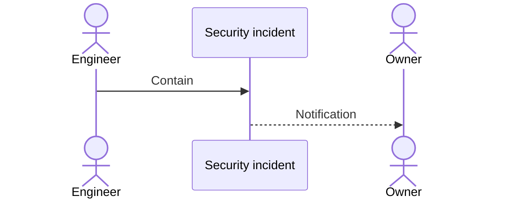

🏠 [Specs](../../../../README.md) › 🧩 [Functional capabilities](../../../README.md) ›
🛟 [F20 Hosted support assistant (hosted edition)](../../README.md) › 📝 [Use cases](../README.md) ›
📝 [Use cases: FL-F20-03 Incidents](README.md) › 📝 UC-F20-15 Handle a security incident or breach

# 📝 UC-F20-15 Handle a security incident or breach

**Status:** ✅ specified

## Summary

The hosting engineer and the owner handle a security incident or breach by the book.

## Personas

- [U48 Hosting engineer](../../../../01-users/personas/u48-hosting-engineer.md)
- [U13 Owner](../../../../01-users/personas/u13-owner.md)

## Goal

Breach contained and notified.

## Trigger

Suspected breach.

## Frequency

Rare.

## Preconditions

- Suspicion.

## Postconditions

- Success: notified.
- Failure: escalated.

## Main flow

1. Escalate at once (S-F20-15).
2. Contain.
3. Document (BR-F20-10).
4. Notify the customer as processor; the customer notifies (CR-FR-199).

## Alternative flows

- 4a. NIS2 facts too.

## Error flows

- 2e. Not contained: escalate.
- Any step: a service does not answer; the call is retried first (BR-F3-32), then the message follows the error pattern
  (D122) and what was typed stays on the screen.

## Business rules

- [BR-F20-10 Breaches handled by the book](../../business-rules/br-f20-10-breaches-handled-by-the-book.md)
- [BR-F20-08 Escalate when unsure](../../business-rules/br-f20-08-escalate-when-unsure.md)
- [BR-F20-01 Support follows the country pack](../../business-rules/br-f20-01-support-follows-the-country-pack.md)
- [BR-F20-19 NIS2 facts on time](../../business-rules/br-f20-19-nis2-facts-on-time.md)

## Entities

- [E-F20-07 Service incident](../../data/e-f20-07-service-incident.md)
- [E-F20-09 Breach record](../../data/e-f20-09-breach-record.md)
- [E-F20-17 NIS2 fact sheet](../../data/e-f20-17-nis2-fact-sheet.md)

## Permissions

Engineer; owner.

## Notifications

- Owner.

## Audit events

Breach record.

## AI involvement

None.

## API, MCP and A2A exposure

Through T5 and T6 with the caller's rights (BR-F3-34).

## Screens

- [S-F20-15 Security incident](../../screens/03-incidents/s-f20-15-security-incident.md)

## Flowchart

See [FL-F20-03 Incidents](../../flows/fl-f20-03-incidents.md#flowchart).

## Sequence diagram

## Acceptance criteria

1. **Given** a breach **when** found **then** owner told at once.
2. **Given** 120 people **when** documented **then** recorded.
3. **Given** NIS2 **when** declared **then** facts sent.

## Non-functional notes

D408's targets ([Performance](../../../../05-non-functional/performance.md)): 95 % of screens within 1 second; lists
paged on the server, the first page within 1 second; reports within 5 seconds or in the background.

## Regulatory references

Support rules of the France country pack:
[CR-FR-199 Notifying a personal data breach](../../../../10-country-packs/france/data-protection/cr-fr-199-personal-data-breach-notification.md),
[CR-FR-169 NIS2 incident notification](../../../../10-country-packs/france/digital/cr-fr-169-nis2-incident-notification.md),
[CR-FR-049 Processors and transfers outside the EU](../../../../10-country-packs/france/data-protection/cr-fr-049-processors-and-transfers.md),
[CR-FR-056 People know they deal with an AI](../../../../10-country-packs/france/ai-and-recording/cr-fr-056-people-know-they-deal-with-an-ai.md),
[CR-FR-057 A person confirms what the AI does](../../../../10-country-packs/france/ai-and-recording/cr-fr-057-human-oversight.md),
[CR-FR-052 Personal data kept no longer than needed](../../../../10-country-packs/france/data-protection/cr-fr-052-storage-limitation.md),
[CR-FR-168 Cyber Resilience Act reporting](../../../../10-country-packs/france/digital/cr-fr-168-cyber-resilience-reporting.md).

## Related use cases

- [UC-F20-26 Give the facts for a NIS2 notification](../06-after-an-incident/uc-f20-26-give-the-facts-for-a-nis2-notification.md)

## Open questions

None.

---

⬅️ [UC-F20-14 Investigate slowness](../02-diagnose-and-fix/uc-f20-14-investigate-slowness.md) · ⬆️ [Up](README.md) ·
➡️ [UC-F20-16](../04-govern-the-assistant/uc-f20-16-rate-the-help-and-review-quality.md)
