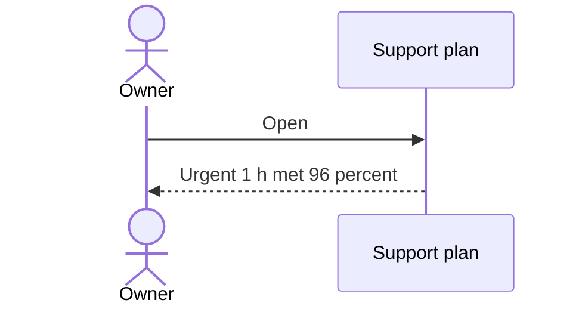

🏠 [Specs](../../../../README.md) › 🧩 [Functional capabilities](../../../README.md) ›
🛟 [F20 Hosted support assistant (hosted edition)](../../README.md) › 📝 [Use cases](../README.md) ›
📝 [Use cases: FL-F20-04 Govern the AI assistant](README.md) › 📝 UC-F20-19 Choose a support plan and see its times

# 📝 UC-F20-19 Choose a support plan and see its times

**Status:** ✅ specified

## Summary

The owner sees the single hosted offer's support times and the targets met, with any service credit.

## Personas

- [U13 Owner](../../../../01-users/personas/u13-owner.md)

## Goal

Know the support promised and delivered.

## Trigger

Review.

## Frequency

Monthly.

## Preconditions

- Hosted.

## Postconditions

- Success: read.
- Failure: none.

## Main flow

1. Open (S-F20-19).
2. See times (BR-F20-11).
3. See targets met.
4. See credits (UC-F20-24).

## Alternative flows

- 2a. Self-hosted subscription.

## Error flows

- 1e. None.
- Any step: a service does not answer; the call is retried first (BR-F3-32), then the message follows the error pattern
  (D122) and what was typed stays on the screen.

## Business rules

- [BR-F20-11 Response times per support plan](../../business-rules/br-f20-11-response-times-per-plan.md)
- [BR-F20-17 Service credits for missed targets](../../business-rules/br-f20-17-service-credits-for-missed-targets.md)

## Entities

- [E-F20-12 Support plan](../../data/e-f20-12-support-plan.md)
- [E-F20-16 Service credit](../../data/e-f20-16-service-credit.md)

## Permissions

Owner.

## Notifications

- Credits.

## Audit events

None.

## AI involvement

None.

## API, MCP and A2A exposure

Through T5 and T6 with the caller's rights (BR-F3-34).

## Screens

- [S-F20-19 Support plans](../../screens/04-govern-the-assistant/s-f20-19-support-plans.md)

## Flowchart

See [FL-F20-04 Govern the AI assistant](../../flows/fl-f20-04-govern-the-assistant.md#flowchart).

## Sequence diagram

## Acceptance criteria

1. **Given** 1 hour urgent **when** shown **then** met share.
2. **Given** missed **when** shown **then** credit.
3. **Given** self-hosted **when** shown **then** subscription.

## Non-functional notes

D408's targets ([Performance](../../../../05-non-functional/performance.md)): 95 % of screens within 1 second; lists
paged on the server, the first page within 1 second; reports within 5 seconds or in the background.

## Regulatory references

Support rules of the France country pack:
[CR-FR-199 Notifying a personal data breach](../../../../10-country-packs/france/data-protection/cr-fr-199-personal-data-breach-notification.md),
[CR-FR-169 NIS2 incident notification](../../../../10-country-packs/france/digital/cr-fr-169-nis2-incident-notification.md),
[CR-FR-049 Processors and transfers outside the EU](../../../../10-country-packs/france/data-protection/cr-fr-049-processors-and-transfers.md),
[CR-FR-056 People know they deal with an AI](../../../../10-country-packs/france/ai-and-recording/cr-fr-056-people-know-they-deal-with-an-ai.md),
[CR-FR-057 A person confirms what the AI does](../../../../10-country-packs/france/ai-and-recording/cr-fr-057-human-oversight.md),
[CR-FR-052 Personal data kept no longer than needed](../../../../10-country-packs/france/data-protection/cr-fr-052-storage-limitation.md),
[CR-FR-168 Cyber Resilience Act reporting](../../../../10-country-packs/france/digital/cr-fr-168-cyber-resilience-reporting.md).

## Related use cases

- [UC-F20-24 Credit missed service-level targets](../06-after-an-incident/uc-f20-24-credit-missed-service-level-targets.md)

## Open questions

None.

---

⬅️ [UC-F20-18 Mask personal data and secrets](uc-f20-18-mask-personal-data-and-secrets.md) · ⬆️ [Up](README.md) ·
➡️ [UC-F20-20 Export a support conversation](uc-f20-20-export-a-support-conversation.md)
