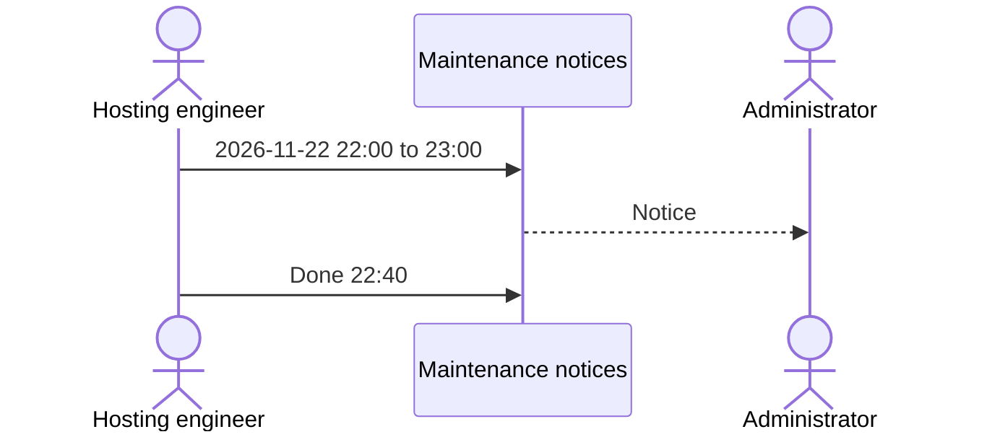

🏠 [Specs](../../../../README.md) › 🧩 [Functional capabilities](../../../README.md) ›
🛟 [F20 Hosted support assistant (hosted edition)](../../README.md) › 📝 [Use cases](../README.md) ›
📝 [Use cases: FL-F20-05 Maintenance and releases](README.md) › 📝 UC-F20-21 Announce planned maintenance

# 📝 UC-F20-21 Announce planned maintenance

**Status:** ✅ specified

## Summary

The hosting engineer plans a maintenance window, and SimpleERP announces it ahead to each concerned customer's
administrator and owner with its window and expected effect.

## Personas

- [U48 Hosting engineer](../../../../01-users/personas/u48-hosting-engineer.md)
- [U07 Administrator](../../../../01-users/personas/u07-administrator.md), who is told
- [U13 Owner](../../../../01-users/personas/u13-owner.md), who is told

## Goal

No interruption surprises a customer.

## Trigger

Maintenance needed.

## Frequency

A few times a year.

## Preconditions

- The window is outside customers' business hours.

## Postconditions

- Success: notice sent and maintenance done in its window.
- Failure: overrun reported.

## Main flow

1. The engineer opens Maintenance notices (S-F20-21) and plans the window and effect.
2. SimpleERP checks the notice delay (BR-F20-14).
3. Administrators and owners are told; the banner shows in their SimpleERP.
4. The maintenance runs; the notice shows "running".
5. Done: the notice closes.

## Alternative flows

- 1a. Urgent security fix: announced as urgent, shorter delay.

## Error flows

- 4e. Overrun: the notice updates and the status page opens.
- 2e. Delay too short: refused.
- Any step: a service does not answer; the call is retried first (BR-F3-32), then the message follows the error pattern
  (D122) and what was typed stays on the screen.

## Business rules

- [BR-F20-14 Maintenance announced ahead](../../business-rules/br-f20-14-maintenance-announced-ahead.md)

## Entities

- [E-F20-13 Maintenance notice](../../data/e-f20-13-maintenance-notice.md)

## Permissions

Hosting engineer plans; customers read.

## Notifications

- Administrators and owners at once and the day before.

## Audit events

Notices.

## AI involvement

The AI assistant answers "is there maintenance tonight" from the notices.

## API, MCP and A2A exposure

Through the API (T5) and as AI assistant tools (T6), with the caller's rights (BR-F3-34).

## Screens

- [S-F20-21 Maintenance notices](../../screens/05-maintenance-and-releases/s-f20-21-maintenance-notices.md)

## Flowchart

See [FL-F20-05 Maintenance and releases](../../flows/fl-f20-05-maintenance-and-releases.md#flowchart).

## Sequence diagram

## Acceptance criteria

1. **Given** a window on 2026-11-22 planned on 2026-11-14 **when** saved **then** administrators and owners are told.
2. **Given** a window 2 days ahead without security reason **when** saved **then** it is refused.
3. **Given** an overrun to 23:30 **when** it happens **then** the notice updates.

## Non-functional notes

D408's targets ([Performance](../../../../05-non-functional/performance.md)): 95 % of screens within 1 second; lists
paged on the server, the first page within 1 second; reports within 5 seconds or in the background.

## Regulatory references

None.

## Related use cases

- [UC-F20-22 Read the release notes of an upgrade](uc-f20-22-read-the-release-notes-of-an-upgrade.md)
- [UC-F20-10 Handle a wide incident with a status page](../03-incidents/uc-f20-10-handle-a-wide-incident-with-a-status-page.md)

## Open questions

None.

---

⬅️ [UC-F20-20 Export a support conversation](../04-govern-the-assistant/uc-f20-20-export-a-support-conversation.md) ·
⬆️ [Up](README.md) ·
➡️ [UC-F20-22 Read the release notes of an upgrade](uc-f20-22-read-the-release-notes-of-an-upgrade.md)
