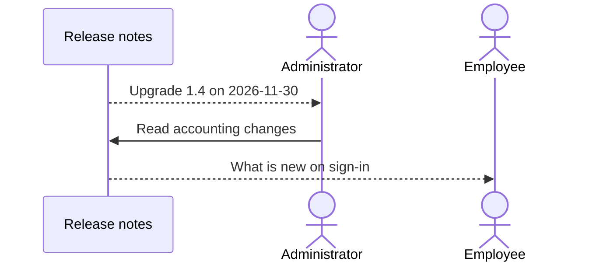

🏠 [Specs](../../../../README.md) › 🧩 [Functional capabilities](../../../README.md) ›
🛟 [F20 Hosted support assistant (hosted edition)](../../README.md) › 📝 [Use cases](../README.md) ›
📝 [Use cases: FL-F20-05 Maintenance and releases](README.md) › 📝 UC-F20-22 Read the release notes of an upgrade

# 📝 UC-F20-22 Read the release notes of an upgrade

**Status:** ✅ specified

## Summary

Administrators and employees read the release notes of an upgrade in plain words, by capability and role, before it
reaches them, and a short "what is new" on first sign-in after it.

## Personas

- [U07 Administrator](../../../../01-users/personas/u07-administrator.md)
- [U01 Employee](../../../../01-users/personas/u01-employee.md)

## Goal

Users know what changed for them.

## Trigger

An upgrade published.

## Frequency

Each upgrade.

## Preconditions

- Notes published (BR-F20-15).

## Postconditions

- Success: notes read.
- Failure: none.

## Main flow

1. The administrator is told of the upgrade and its date.
2. They open Release notes (S-F20-22), filtered on the company's capabilities.
3. The upgrade reaches the company.
4. An employee signs in and sees "what is new" for their role.

## Alternative flows

- 4a. The employee turns it off.

## Error flows

- 3e. Upgrade rolled back: notes withdrawn.
- Any step: a service does not answer; the call is retried first (BR-F3-32), then the message follows the error pattern
  (D122) and what was typed stays on the screen.

## Business rules

- [BR-F20-15 Release notes before each upgrade](../../business-rules/br-f20-15-release-notes-before-each-upgrade.md)

## Entities

- [E-F20-14 Upgrade release note](../../data/e-f20-14-upgrade-release-note.md)

## Permissions

Everyone reads notes for their capabilities.

## Notifications

- Administrators before the upgrade.

## Audit events

None.

## AI involvement

The AI assistant answers "what changed in accounting".

## API, MCP and A2A exposure

Through the API (T5) and as AI assistant tools (T6), with the caller's rights (BR-F3-34).

## Screens

- [S-F20-22 Release notes](../../screens/05-maintenance-and-releases/s-f20-22-release-notes.md)

## Flowchart

See [FL-F20-05 Maintenance and releases](../../flows/fl-f20-05-maintenance-and-releases.md#flowchart).

## Sequence diagram

## Acceptance criteria

1. **Given** upgrade 1.4 **when** published **then** administrators see notes before 2026-11-30.
2. **Given** an accountant **when** signing in **then** "what is new" shows accounting items.
3. **Given** a rollback **when** done **then** the notes are withdrawn.

## Non-functional notes

D408's targets ([Performance](../../../../05-non-functional/performance.md)): 95 % of screens within 1 second; lists
paged on the server, the first page within 1 second; reports within 5 seconds or in the background.

## Regulatory references

None.

## Related use cases

- [UC-F20-21 Announce planned maintenance](uc-f20-21-announce-planned-maintenance.md)

## Open questions

None.

---

⬅️ [UC-F20-21 Announce planned maintenance](uc-f20-21-announce-planned-maintenance.md) · ⬆️ [Up](README.md) ·
➡️ [UC-F20-23 Send the written incident report](../06-after-an-incident/uc-f20-23-send-the-written-incident-report.md)
