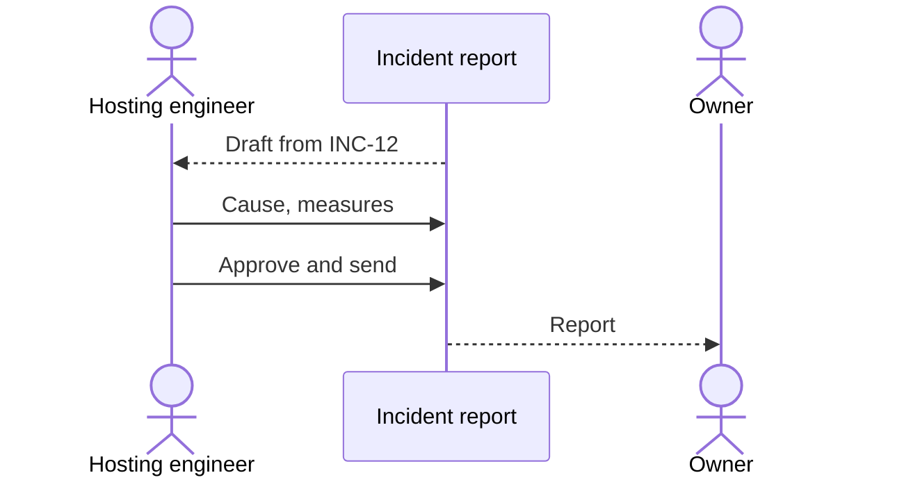

🏠 [Specs](../../../../README.md) › 🧩 [Functional capabilities](../../../README.md) ›
🛟 [F20 Hosted support assistant (hosted edition)](../../README.md) › 📝 [Use cases](../README.md) ›
📝 [Use cases: FL-F20-06 After an incident](README.md) › 📝 UC-F20-23 Send the written incident report

# 📝 UC-F20-23 Send the written incident report

**Status:** ✅ specified

## Summary

After an incident affecting customers, the hosting engineer drafts the written report with the AI assistant, a
maintainer approves it, and it is sent to each affected customer within the delay.

## Personas

- [U48 Hosting engineer](../../../../01-users/personas/u48-hosting-engineer.md)
- [U13 Owner](../../../../01-users/personas/u13-owner.md), who receives it

## Goal

Customers have the facts of the incident in writing.

## Trigger

An incident closed (UC-F20-10).

## Frequency

After each incident affecting customers.

## Preconditions

- The incident is closed.

## Postconditions

- Success: report sent within the delay.
- Failure: late, the owner told.

## Main flow

1. The incident closes; simple-ERP drafts the report from its timeline (S-F20-23).
2. The engineer completes the cause and the measures.
3. A maintainer approves (BR-F20-16).
4. Each affected customer's owner receives it.

## Alternative flows

- 2a. Security investigation: a second report follows.

## Error flows

- 3e. Cause missing: not approved.
- Any step: a service does not answer; the call is retried first (BR-F3-32), then the message follows the error pattern
  (D122) and what was typed stays on the screen.

## Business rules

- [BR-F20-16 Written report after a major incident](../../business-rules/br-f20-16-written-report-after-a-major-incident.md)

## Entities

- [E-F20-15 Incident report](../../data/e-f20-15-incident-report.md)
- [E-F20-07 Service incident](../../data/e-f20-07-service-incident.md)

## Permissions

Engineer drafts; maintainer approves; owners read.

## Notifications

- Affected owners when sent.

## Audit events

Drafts, approval, sending.

## AI involvement

The AI assistant drafts from the timeline; people approve.

## API, MCP and A2A exposure

Through the API (T5) and as AI assistant tools (T6), with the caller's rights (BR-F3-34).

## Screens

- [S-F20-23 Incident report](../../screens/06-after-an-incident/s-f20-23-incident-report.md)

## Flowchart

See [FL-F20-06 After an incident](../../flows/fl-f20-06-after-an-incident.md#flowchart).

## Sequence diagram

## Acceptance criteria

1. **Given** INC-12 from 09:00 to 09:40 on 2026-11-20 **when** sent on 2026-11-25 **then** 40 owners receive it.
2. **Given** no cause **when** approving **then** refused.
3. **Given** an incident affecting no customer **when** closed **then** no report.

## Non-functional notes

D408's targets ([Performance](../../../../05-non-functional/performance.md)): 95 % of screens within 1 second; lists
paged on the server, the first page within 1 second; reports within 5 seconds or in the background.

## Regulatory references

None.

## Related use cases

- [UC-F20-10 Handle a wide incident with a status page](../03-incidents/uc-f20-10-handle-a-wide-incident-with-a-status-page.md)
- [UC-F20-24 Credit missed service-level targets](uc-f20-24-credit-missed-service-level-targets.md)
- [UC-F20-26 Give the facts for a NIS2 notification](uc-f20-26-give-the-facts-for-a-nis2-notification.md)

## Open questions

None.

---

⬅️ [UC-F20-22](../05-maintenance-and-releases/uc-f20-22-read-the-release-notes-of-an-upgrade.md) · ⬆️ [Up](README.md) ·
➡️ [UC-F20-24 Credit missed service-level targets](uc-f20-24-credit-missed-service-level-targets.md)
