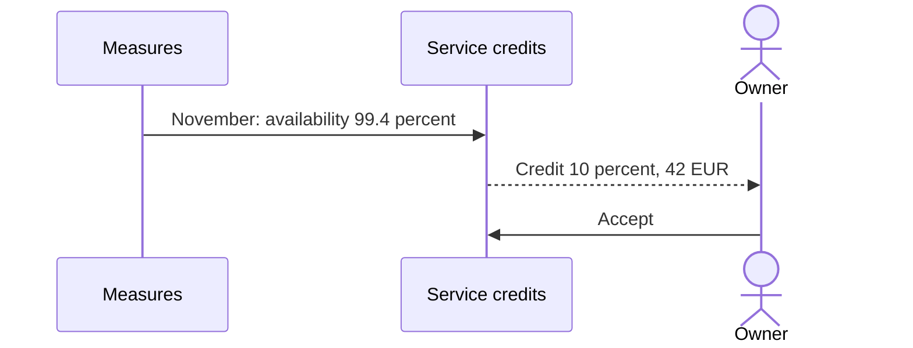

🏠 [Specs](../../../../README.md) › 🧩 [Functional capabilities](../../../README.md) ›
🛟 [F20 Hosted support assistant (hosted edition)](../../README.md) › 📝 [Use cases](../README.md) ›
📝 [Use cases: FL-F20-06 After an incident](README.md) › 📝 UC-F20-24 Credit missed service-level targets

# 📝 UC-F20-24 Credit missed service-level targets

**Status:** ✅ specified

## Summary

At the month's end SimpleERP measures each hosted customer's availability and human answer times against the published
targets, and missed targets are credited on the next invoice.

## Personas

- [U13 Owner](../../../../01-users/personas/u13-owner.md)
- [U05 Accounting](../../../../01-users/personas/u05-accounting.md), who books the credit note

## Goal

Missed targets have a consequence.

## Trigger

The month's end.

## Frequency

Monthly.

## Preconditions

- Targets published (BR-F20-11).

## Postconditions

- Success: credits issued.
- Failure: disputes handled.

## Main flow

1. The month ends; SimpleERP measures each target (S-F20-24).
2. Missed targets give a credit (BR-F20-17).
3. The owner sees the credit and the measures.
4. A credit note reduces the next invoice; accounting books it.

## Alternative flows

- 3a. The owner disputes: the engineer checks.

## Error flows

- 2e. Planned maintenance counted by mistake: removed.
- Any step: a service does not answer; the call is retried first (BR-F3-32), then the message follows the error pattern
  (D122) and what was typed stays on the screen.

## Business rules

- [BR-F20-17 Service credits for missed targets](../../business-rules/br-f20-17-service-credits-for-missed-targets.md)

## Entities

- [E-F20-16 Service credit](../../data/e-f20-16-service-credit.md)
- [E-F20-12 Support plan](../../data/e-f20-12-support-plan.md)

## Permissions

Owner reads and disputes; accounting books.

## Notifications

- The owner when a credit is computed.

## Audit events

Measures, credits, disputes.

## AI involvement

None.

## API, MCP and A2A exposure

Through the API (T5) and as AI assistant tools (T6), with the caller's rights (BR-F3-34).

## Screens

- [S-F20-24 Service credits](../../screens/06-after-an-incident/s-f20-24-service-credits.md)

## Flowchart

See [FL-F20-06 After an incident](../../flows/fl-f20-06-after-an-incident.md#flowchart).

## Sequence diagram

## Acceptance criteria

1. **Given** availability 99.4 % against 99.5 % **when** November ends **then** a 10 % credit is computed.
2. **Given** 6 missed targets **when** computed **then** the credit is 50 %.
3. **Given** announced maintenance **when** measured **then** it is not counted.

## Non-functional notes

D408's targets ([Performance](../../../../05-non-functional/performance.md)): 95 % of screens within 1 second; lists
paged on the server, the first page within 1 second; reports within 5 seconds or in the background.

## Regulatory references

[CR-FR-200 Credit notes](../../../../10-country-packs/france/invoicing/cr-fr-200-credit-notes.md).

## Related use cases

- [UC-F20-19 Choose a support plan and see its times](../04-govern-the-assistant/uc-f20-19-choose-a-support-plan-and-see-its-times.md)
- [UC-F20-23 Send the written incident report](uc-f20-23-send-the-written-incident-report.md)

## Open questions

None.

---

⬅️ [UC-F20-23 Send the written incident report](uc-f20-23-send-the-written-incident-report.md) · ⬆️ [Up](README.md) ·
➡️ [UC-F20-25 Get support in French or English](../07-employees-help/uc-f20-25-get-support-in-french-or-english.md)
