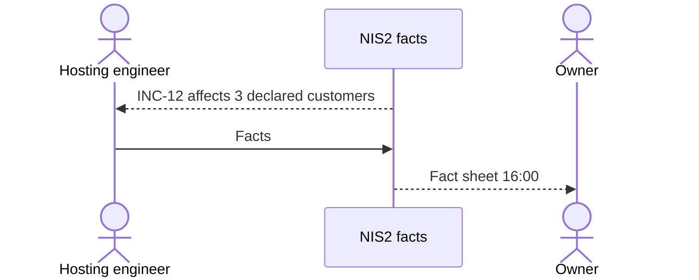

🏠 [Specs](../../../../README.md) › 🧩 [Functional capabilities](../../../README.md) ›
🛟 [F20 Hosted support assistant (hosted edition)](../../README.md) › 📝 [Use cases](../README.md) ›
📝 [Use cases: FL-F20-06 After an incident](README.md) › 📝 UC-F20-26 Give the facts for a NIS2 notification

# 📝 UC-F20-26 Give the facts for a NIS2 notification

**Status:** ✅ specified

## Summary

For customers that declared themselves subject to NIS2, the hosting engineer sends, after an incident affecting them, a
fact sheet with what they need for their own notification, then updates.

## Personas

- [U13 Owner](../../../../01-users/personas/u13-owner.md)
- [U48 Hosting engineer](../../../../01-users/personas/u48-hosting-engineer.md)

## Goal

Customers meet their NIS2 duties with facts from their host.

## Trigger

An incident affecting a NIS2 customer.

## Frequency

Rare.

## Preconditions

- The customer declared it is subject.

## Postconditions

- Success: fact sheet within the delay.
- Failure: late, escalated.

## Main flow

1. An incident affects a declared customer; simple-ERP opens a fact sheet (S-F20-25).
2. The engineer fills start, nature, services, data and measures.
3. It is sent to the owner within the delay (BR-F20-19).
4. Updates follow until the final report (UC-F20-23).

## Alternative flows

- 1a. The owner declares the company subject in its settings.

## Error flows

- 2e. A fact missing: not sent until completed.
- Any step: a service does not answer; the call is retried first (BR-F3-32), then the message follows the error pattern
  (D122) and what was typed stays on the screen.

## Business rules

- [BR-F20-19 NIS2 facts on time](../../business-rules/br-f20-19-nis2-facts-on-time.md)

## Entities

- [E-F20-17 NIS2 fact sheet](../../data/e-f20-17-nis2-fact-sheet.md)

## Permissions

Engineer writes; owner reads.

## Notifications

- The owner at sending and at each update.

## Audit events

Sheets and updates.

## AI involvement

Draft from the timeline.

## API, MCP and A2A exposure

Through the API (T5) and as AI assistant tools (T6), with the caller's rights (BR-F3-34).

## Screens

- [S-F20-25 NIS2 facts](../../screens/06-after-an-incident/s-f20-25-nis2-facts.md)

## Flowchart

See [FL-F20-06 After an incident](../../flows/fl-f20-06-after-an-incident.md#flowchart).

## Sequence diagram

## Acceptance criteria

1. **Given** an outage at 09:00 on 2026-11-20 **when** it affects the transport example company declared subject
   **then** the fact sheet is sent before 09:00 the next day.
2. **Given** a company not declared **when** affected **then** no fact sheet.
3. **Given** services missing **when** sending **then** refused.

## Non-functional notes

D408's targets ([Performance](../../../../05-non-functional/performance.md)): 95 % of screens within 1 second; lists
paged on the server, the first page within 1 second; reports within 5 seconds or in the background.

## Regulatory references

[CR-FR-169](../../../../10-country-packs/france/digital/cr-fr-169-nis2-incident-notification.md).

## Related use cases

- [UC-F20-23 Send the written incident report](uc-f20-23-send-the-written-incident-report.md)
- [UC-F20-15 Handle a security incident or breach](../03-incidents/uc-f20-15-handle-a-security-incident-or-breach.md)

## Open questions

None.

---

⬅️ [UC-F20-25 Get support in French or English](../07-employees-help/uc-f20-25-get-support-in-french-or-english.md) ·
⬆️ [Up](README.md) ·
➡️ [UC-F20-27 Get help on a task from the phone](../07-employees-help/uc-f20-27-get-help-on-a-task-from-the-phone.md)
