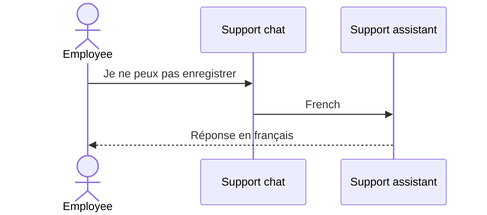

🏠 [Specs](../../../../README.md) › 🧩 [Functional capabilities](../../../README.md) ›
🛟 [F20 Hosted support assistant (hosted edition)](../../README.md) › 📝 [Use cases](../README.md) ›
📝 [Use cases: FL-F20-07 Employees' help](README.md) › 📝 UC-F20-25 Get support in French or English

# 📝 UC-F20-25 Get support in French or English

**Status:** ✅ specified

## Summary

The user gets the AI assistant's and the engineers' answers in French or English, as they write or choose.

## Personas

- [U01 Employee](../../../../01-users/personas/u01-employee.md)
- [U07 Administrator](../../../../01-users/personas/u07-administrator.md)

## Goal

Help in the user's language.

## Trigger

A support message.

## Frequency

Each request.

## Preconditions

- None.

## Postconditions

- Success: answers in French or English.
- Failure: English with a line saying so.

## Main flow

1. The user writes in French in the support chat (S-F20-01).
2. SimpleERP detects the language (BR-F20-18).
3. The AI assistant answers in French.
4. An engineer who joins sees a translation and writes in French or with a translation.

## Alternative flows

- 1a. The user chose English in their profile.

## Error flows

- 2e. Italian: English answer with a line saying so.
- Any step: a service does not answer; the call is retried first (BR-F3-32), then the message follows the error pattern
  (D122) and what was typed stays on the screen.

## Business rules

- [BR-F20-18 Support in French or English](../../business-rules/br-f20-18-support-in-french-or-english.md)

## Entities

- [E-F20-02 Message](../../data/e-f20-02-message.md)

## Permissions

As the request.

## Notifications

- None.

## Audit events

Language.

## AI involvement

Translation.

## API, MCP and A2A exposure

Through the API (T5) and as AI assistant tools (T6), with the caller's rights (BR-F3-34).

## Screens

- [S-F20-01 Support chat](../../screens/01-talk-it-through/s-f20-01-support-chat.md)

## Flowchart

See [FL-F20-07 Employees' help](../../flows/fl-f20-07-employees-help.md#flowchart).

## Sequence diagram

## Acceptance criteria

1. **Given** a message in French **when** answered **then** French.
2. **Given** English chosen **when** answered **then** English.
3. **Given** Italian **when** answered **then** English with a line saying so.

## Non-functional notes

D408's targets ([Performance](../../../../05-non-functional/performance.md)): 95 % of screens within 1 second; lists
paged on the server, the first page within 1 second; reports within 5 seconds or in the background.

## Regulatory references

None.

## Related use cases

- [UC-F20-01 Report a problem in plain words](../01-talk-it-through/uc-f20-01-report-a-problem-in-plain-words.md)
- [UC-F20-27 Get help on a task from the phone](uc-f20-27-get-help-on-a-task-from-the-phone.md)

## Open questions

None.

---

⬅️ [UC-F20-24](../06-after-an-incident/uc-f20-24-credit-missed-service-level-targets.md) · ⬆️ [Up](README.md) ·
➡️ [UC-F20-26](../06-after-an-incident/uc-f20-26-give-the-facts-for-a-nis2-notification.md)
