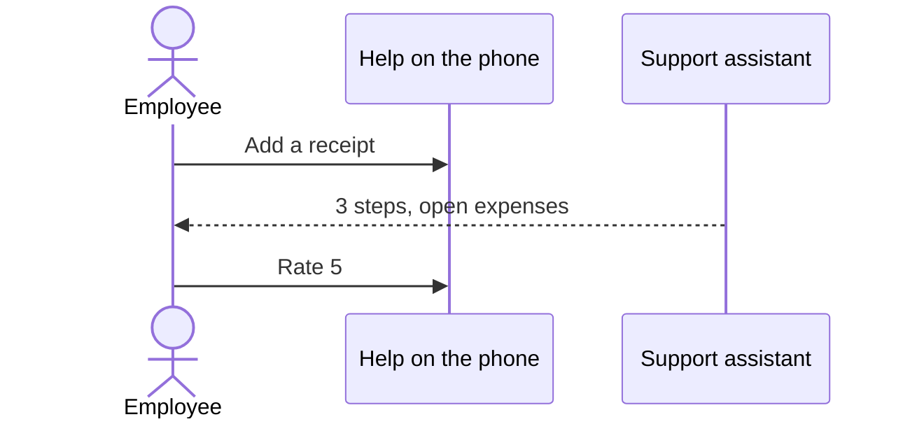

🏠 [Specs](../../../../README.md) › 🧩 [Functional capabilities](../../../README.md) ›
🛟 [F20 Hosted support assistant (hosted edition)](../../README.md) › 📝 [Use cases](../README.md) ›
📝 [Use cases: FL-F20-07 Employees' help](README.md) › 📝 UC-F20-27 Get help on a task from the phone

# 📝 UC-F20-27 Get help on a task from the phone

**Status:** ✅ specified

## Summary

An employee asks for help on a task from their phone and receives step-by-step answers from the documentation, with
links that open the right screen.

## Personas

- [U01 Employee](../../../../01-users/personas/u01-employee.md)

## Goal

The employee finishes the task without calling anyone.

## Trigger

A question while working.

## Frequency

A few a month per employee.

## Preconditions

- Signed in on the phone.

## Postconditions

- Success: task done.
- Failure: a request to a person.

## Main flow

1. The employee opens Help on the phone (S-F20-26).
2. They ask "how do I add a receipt to my expense".
3. The AI assistant answers in steps from the documentation (UC-F20-12).
4. A link opens the right screen.
5. The employee rates the answer.

## Alternative flows

- 3a. Not in the documentation: a request is opened.

## Error flows

- 1e. Offline: the question is queued (D182).
- Any step: a service does not answer; the call is retried first (BR-F3-32), then the message follows the error pattern
  (D122) and what was typed stays on the screen.

## Business rules

- [BR-F20-02 Plain words first](../../business-rules/br-f20-02-plain-words-first.md)
- [BR-F20-09 The customer knows it is an AI](../../business-rules/br-f20-09-ai-disclosed.md)

## Entities

- [E-F20-02 Message](../../data/e-f20-02-message.md)

## Permissions

Employee, their own.

## Notifications

- The employee when a queued question is answered.

## Audit events

Questions.

## AI involvement

Answers from the documentation; says it is an AI.

## API, MCP and A2A exposure

Through the API (T5) and as AI assistant tools (T6), with the caller's rights (BR-F3-34).

## Screens

- [S-F20-26 Help on the phone](../../screens/07-employees-help/s-f20-26-help-on-the-phone.md)

## Flowchart

See [FL-F20-07 Employees' help](../../flows/fl-f20-07-employees-help.md#flowchart).

## Sequence diagram

## Acceptance criteria

1. **Given** "how do I add a receipt" **when** asked **then** 3 steps and a link to the expense screen.
2. **Given** offline **when** asked **then** queued and answered later.
3. **Given** not documented **when** asked **then** a request opens.

## Non-functional notes

D408's targets ([Performance](../../../../05-non-functional/performance.md)): 95 % of screens within 1 second; lists
paged on the server, the first page within 1 second; reports within 5 seconds or in the background.

## Regulatory references

None.

## Related use cases

- [UC-F20-12 Answer how-to questions from the documentation](../01-talk-it-through/uc-f20-12-answer-how-to-questions-from-the-documentation.md)
- [UC-F20-28 Report something broken from the screen](uc-f20-28-report-something-broken-from-the-screen.md)

## Open questions

None.

---

⬅️ [UC-F20-26](../06-after-an-incident/uc-f20-26-give-the-facts-for-a-nis2-notification.md) · ⬆️ [Up](README.md) ·
➡️ [UC-F20-28 Report something broken from the screen](uc-f20-28-report-something-broken-from-the-screen.md)
