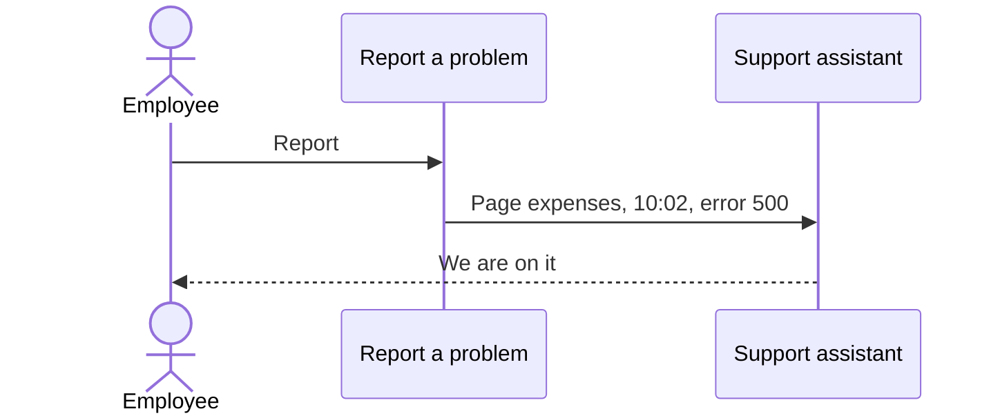

🏠 [Specs](../../../../README.md) › 🧩 [Functional capabilities](../../../README.md) ›
🛟 [F20 Hosted support assistant (hosted edition)](../../README.md) › 📝 [Use cases](../README.md) ›
📝 [Use cases: FL-F20-07 Employees' help](README.md) › 📝 UC-F20-28 Report something broken from the screen

# 📝 UC-F20-28 Report something broken from the screen

**Status:** ✅ specified

## Summary

An employee reports a problem from the screen where it happened with one action; the request carries the page, the time
and the last steps, so the AI assistant can diagnose without questions.

## Personas

- [U01 Employee](../../../../01-users/personas/u01-employee.md)

## Goal

Problems reported in seconds, with the context.

## Trigger

Something fails on a screen.

## Frequency

Occasional.

## Preconditions

- Signed in.

## Postconditions

- Success: request with context.
- Failure: none.

## Main flow

1. A save fails; the employee chooses "Report a problem" (S-F20-27).
2. SimpleERP fills the page, time, error and last steps.
3. The employee adds a sentence and agrees to a masked screenshot (BR-F20-06).
4. The request reaches the AI assistant, which diagnoses (UC-F20-04).

## Alternative flows

- 3a. No screenshot.

## Error flows

- 2e. The error is known (incident open): the employee is told and linked to the status.
- Any step: a service does not answer; the call is retried first (BR-F3-32), then the message follows the error pattern
  (D122) and what was typed stays on the screen.

## Business rules

- [BR-F20-06 Screenshots with consent, masked](../../business-rules/br-f20-06-screenshots-with-consent-and-masking.md)
- [BR-F20-07 Personal data and secrets masked](../../business-rules/br-f20-07-data-and-secrets-masked.md)

## Entities

- [E-F20-01 Support request](../../data/e-f20-01-support-request.md)
- [E-F20-03 Screenshot](../../data/e-f20-03-screenshot.md)

## Permissions

Employee.

## Notifications

- The employee on status changes.

## Audit events

Request with context.

## AI involvement

Diagnosis by the AI assistant.

## API, MCP and A2A exposure

Through the API (T5) and as AI assistant tools (T6), with the caller's rights (BR-F3-34).

## Screens

- [S-F20-27 Report a problem](../../screens/07-employees-help/s-f20-27-report-a-problem.md)

## Flowchart

See [FL-F20-07 Employees' help](../../flows/fl-f20-07-employees-help.md#flowchart).

## Sequence diagram

## Acceptance criteria

1. **Given** a failed save at 10:02 **when** reported **then** the request holds the page, time and error.
2. **Given** a known incident **when** reported **then** the status is shown.
3. **Given** a screenshot **when** attached **then** masked.

## Non-functional notes

D408's targets ([Performance](../../../../05-non-functional/performance.md)): 95 % of screens within 1 second; lists
paged on the server, the first page within 1 second; reports within 5 seconds or in the background.

## Regulatory references

None.

## Related use cases

- [UC-F20-27 Get help on a task from the phone](uc-f20-27-get-help-on-a-task-from-the-phone.md)
- [UC-F20-04 Diagnose on the cluster](../02-diagnose-and-fix/uc-f20-04-diagnose-on-the-cluster.md)

## Open questions

None.

---

⬅️ [UC-F20-27 Get help on a task from the phone](uc-f20-27-get-help-on-a-task-from-the-phone.md) · ⬆️ [Up](README.md) ·
➡️ [UC-F20-29](../08-engineers-sharing-and-reports/uc-f20-29-book-a-call-with-an-engineer.md)
