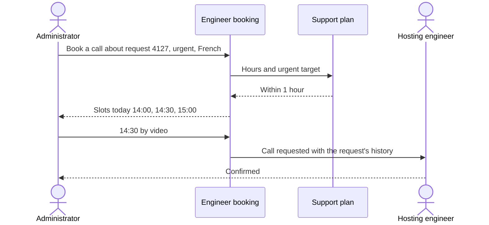

🏠 [Specs](../../../../README.md) › 🧩 [Functional capabilities](../../../README.md) ›
🛟 [F20 Hosted support assistant (hosted edition)](../../README.md) › 📝 [Use cases](../README.md) ›
📝 [Use cases: FL-F20-08 Engineers, screen sharing, reports and languages](README.md) ›
📝 UC-F20-29 Book a call with an engineer

# 📝 UC-F20-29 Book a call with an engineer

**Status:** ✅ specified

## Summary

An administrator who needs a person on the phone books a call with a hosting engineer from the hosted support assistant:
for a request the AI assistant could not close, or for a question that is easier said than typed. The slots offered are
only those the support plan allows, in the language the administrator chooses, and the call is linked to the request and
its full history.

## Personas

- [U07 Administrator](../../../../01-users/personas/u07-administrator.md)
- [U48 Hosting engineer](../../../../01-users/personas/u48-hosting-engineer.md)

## Goal

The administrator talks to a person at a time the plan promises, who already knows the problem.

## Trigger

The AI assistant offers a call after an escalation ([UC-F20-08](../03-incidents/uc-f20-08-escalate-to-an-engineer.md)),
or the administrator opens the booking screen.

## Frequency

One to three calls a month per company on a business plan; more during an incident.

## Preconditions

- The company has a support plan with calls ([E-F20-12 Support plan](../../data/e-f20-12-support-plan.md)).
- The support request exists or the administrator describes the topic in a few words
  ([E-F20-01 Support request](../../data/e-f20-01-support-request.md)).

## Postconditions

- **Succeeded:** the call is saved ([E-F20-19 Engineer call](../../data/e-f20-19-engineer-call.md)) with its slot, its
  language, its engineer and its link to the request; both sides get the invitation; after the call the engineer records
  a short summary on the request.
- **Failed:** no call is booked; the screen says whether the plan's calls are used up or no slot is free before the
  promised time.

## Main flow

1. The administrator opens the engineer booking screen
   ([S-F20-29](../../screens/08-engineers-sharing-and-reports/s-f20-29-engineer-booking.md)), which shows the plan, the
   calls left this month and the service hours.
2. The administrator picks the request or states the topic, the urgency and the language among those supported
   ([BR-F20-23](../../business-rules/br-f20-23-service-times-are-the-same-in-every-supported-language.md)).
3. SimpleERP offers the first free slots inside the plan's hours and no later than the plan's target for that urgency
   ([BR-F20-20](../../business-rules/br-f20-20-calls-follow-the-plans-times.md)).
4. The administrator picks a slot and a way to talk (video or phone); the call is saved as Requested and the engineer on
   duty is notified.
5. The engineer confirms the slot, reads the request's full history and, at the time, holds the call.
6. The engineer records what was said and decided on the request; the call becomes Held and counts in the month.

## Alternative flows

- 3a. The call is urgent: the screen offers the next free time within the plan's urgent target and, if none, the
  engineer calls back at once ([UC-F20-08](../03-incidents/uc-f20-08-escalate-to-an-engineer.md)).
- 4a. The administrator changes the slot at least one working hour before it: the call is moved with no charge to the
  month's count.
- 6a. The engineer needs to see the screen: they ask for a time-limited access
  ([UC-F20-30](uc-f20-30-share-the-screen-or-a-time-limited-view.md)).

## Error flows

- 3e. The plan's calls are used up: the administrator may ask for an extra call at the plan's price or wait for the next
  month.
- 5e. The administrator does not come within 15 minutes: the call becomes Missed and counts in the month.
- 5e. The engineer is ill: the call is moved to another engineer at the same time, or the administrator chooses another
  slot.
- Any step: a service does not answer; the call is retried first
  ([BR-F3-32](../../../f03-assistant/business-rules/br-f03-32-retry-before-an-error.md)), then the message follows the
  error pattern ([D122](../../../../06-decisions/ux/d122-error-message-standard.md)) and what the user typed stays on
  the screen.

## Business rules

- [BR-F20-20](../../business-rules/br-f20-20-calls-follow-the-plans-times.md)
- [BR-F20-11](../../business-rules/br-f20-11-response-times-per-plan.md)
- [BR-F20-18](../../business-rules/br-f20-18-support-in-french-or-english.md)
- [BR-F20-08 Escalate when unsure](../../business-rules/br-f20-08-escalate-when-unsure.md)

## Entities

- [E-F20-19 Engineer call](../../data/e-f20-19-engineer-call.md): created, changed
- [E-F20-01 Support request](../../data/e-f20-01-support-request.md): read, the request the call is about
- [E-F20-12 Support plan](../../data/e-f20-12-support-plan.md): read, the plan's hours and calls
- [E-F20-04 Diagnosis](../../data/e-f20-04-diagnosis.md): read, the diagnosis shared with the engineer

## Permissions

The administrator books and moves calls. The hosting engineer confirms and holds them. The owner reads the
calls and the calls left.

## Notifications

The administrator, by email and in the app: the call is confirmed, moved or missed. The hosting engineer: a call is
requested, with the request's summary.

## Audit events

Each call requested, confirmed, moved, cancelled, held or missed, with who and when, and the summary the engineer
recorded.

## AI involvement

No AI step of its own. The AI assistant may open the screen and prefill it from the user's words; the user checks and
confirms ([BR-F3-07](../../../f03-assistant/business-rules/br-f03-07-no-deletes-no-irreversible-acts.md)).

## API, MCP and A2A exposure

T5 operations of the capability for the personas above: create, read, update and list. The MCP tool of the
capability may read and propose, never confirm alone. No A2A skill.

## Screens

- [S-F20-29](../../screens/08-engineers-sharing-and-reports/s-f20-29-engineer-booking.md)

## Flowchart

See
[FL-F20-08 Engineers, screen sharing, reports and languages](../../flows/fl-f20-08-engineers-sharing-and-reports.md#flowchart).

## Sequence diagram

## Acceptance criteria

1. **Given** a plan with working-day hours **when** the administrator asks for a Saturday slot **then** no Saturday slot
   is offered.
2. **Given** an urgent request and a 1-hour target **when** slots are offered **then** the first slot is within the hour
   or the engineer calls back at once.
3. **Given** a plan with 2 calls a month and 2 held **when** a third is asked **then** an extra call at the plan's price
   or the next month is offered.
4. **Given** an administrator who does not come in 15 minutes **when** the time passes **then** the call is Missed and
   counted.

## Non-functional notes

The screen answers within 2 seconds for 10,000 records; every change is audited.

## Regulatory references

The call is part of the support promised by the plan and its published times
([BR-F20-11](../../business-rules/br-f20-11-response-times-per-plan.md)); recording of the call needs an announcement
([CR-FR-059](../../../../10-country-packs/france/ai-and-recording/cr-fr-059-recordings-are-announced.md)) and is off
unless both sides agree. The engineer sees only the customer's own request and namespace readings.

## Related use cases

- [UC-F20-30](uc-f20-30-share-the-screen-or-a-time-limited-view.md)
- [UC-F20-08 Escalate to an engineer](../03-incidents/uc-f20-08-escalate-to-an-engineer.md)
- [UC-F20-19](../04-govern-the-assistant/uc-f20-19-choose-a-support-plan-and-see-its-times.md)
- [UC-F20-30](uc-f20-30-share-the-screen-or-a-time-limited-view.md)
- [UC-F20-25](../07-employees-help/uc-f20-25-get-support-in-french-or-english.md)
- [UC-F20-32 Get support in more languages](uc-f20-32-get-support-in-more-languages.md)

## Open questions

None.

---

⬅️ [UC-F20-28](../07-employees-help/uc-f20-28-report-something-broken-from-the-screen.md) · ⬆️ [Up](README.md) ·
➡️ [UC-F20-30 Share the screen or a time-limited view](uc-f20-30-share-the-screen-or-a-time-limited-view.md)
