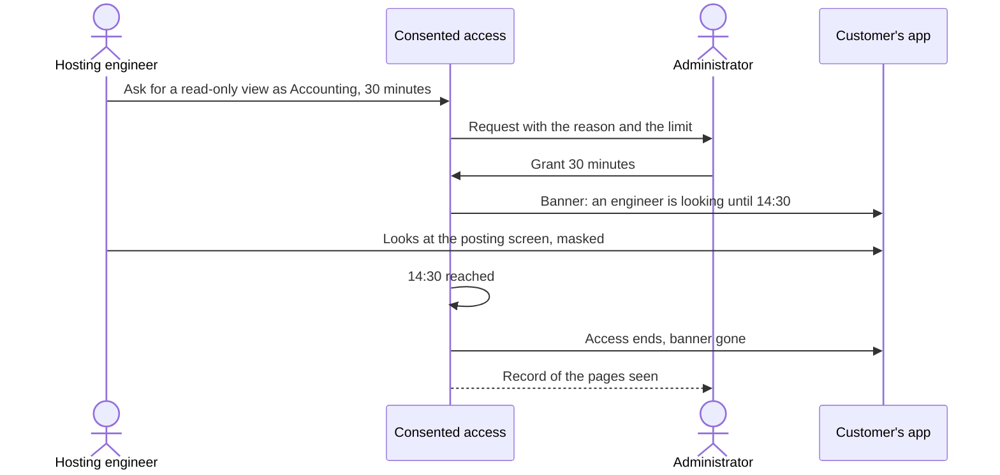

🏠 [Specs](../../../../README.md) › 🧩 [Functional capabilities](../../../README.md) ›
🛟 [F20 Hosted support assistant (hosted edition)](../../README.md) › 📝 [Use cases](../README.md) ›
📝 [Use cases: FL-F20-08 Engineers, screen sharing, reports and languages](README.md) ›
📝 UC-F20-30 Share the screen or a time-limited view

# 📝 UC-F20-30 Share the screen or a time-limited view

**Status:** ✅ specified

## Summary

When an engineer needs to see what the customer sees, the customer's administrator decides whether to let them: either
the administrator shares their own screen during a call, or grants a read-only view of the app as a chosen role for a
limited time. Each access has a scope, a time limit, a visible banner and a full record, and it ends by itself at its
limit.

## Personas

- [U07 Administrator](../../../../01-users/personas/u07-administrator.md)
- [U48 Hosting engineer](../../../../01-users/personas/u48-hosting-engineer.md)

## Goal

The engineer sees the problem, the customer stays in charge of who sees what and for how long, and nothing stays open
after the work.

## Trigger

An engineer asks for access during a call or on a request, or the administrator offers it.

## Frequency

A few times a month per company at most; one access lasts an hour or less in most cases.

## Preconditions

- A support request or a call exists ([E-F20-01 Support request](../../data/e-f20-01-support-request.md),
  [E-F20-19 Engineer call](../../data/e-f20-19-engineer-call.md)).
- The administrator of the company is available to consent.

## Postconditions

- **Succeeded:** the access is saved ([E-F20-20 Access grant](../../data/e-f20-20-access-grant.md)) with its scope, its
  limit, its consent and its end; nothing is changed in the company's data; the record lists what was seen.
- **Failed:** no access is opened; the engineer works from the namespace readings and the conversation only.

## Main flow

1. The engineer asks for access on the consented access screen
   ([S-F20-30](../../screens/08-engineers-sharing-and-reports/s-f20-30-consented-access.md)), stating why, which kind
   (screen share or read-only view) and the time needed.
2. The administrator reads the request: the engineer, the reason, the scope and the limit (30 minutes by default, 4
   hours at most), and grants it, cuts the time or refuses.
3. For a screen share, the administrator shares their own window during the call and can stop at any time; for a
   read-only view, the engineer opens the app as the chosen role, with personal data masked
   ([BR-F20-07](../../business-rules/br-f20-07-data-and-secrets-masked.md)).
4. A banner shows on the customer's side for the whole access: who is looking, since when and until when, with a Stop
   button.
5. At the limit the access ends by itself; the engineer sees nothing more and the record is closed with the pages seen
   ([BR-F20-21](../../business-rules/br-f20-21-access-ends-at-its-time-limit-and-is-audited.md)).
6. If a change is needed, the engineer proposes a fix that waits for a maintainer's yes
   ([UC-F20-06](../02-diagnose-and-fix/uc-f20-06-propose-a-fix-for-a-maintainer-s-yes.md)); the access never changes
   data.

## Alternative flows

- 2a. The administrator grants less than asked (a shorter time): the access is granted with the shorter limit.
- 3a. The engineer needs more time: they ask again, and the administrator grants a second access; the first one is not
  extended.
- 5a. The administrator stops the access early: it ends at once, with the reason Revoked.

## Error flows

- 2e. The administrator does not answer: the request lapses after 30 minutes and the engineer is told.
- 3e. The read-only view would show health data of a namespace that is excluded: it is refused and an engineer follows
  the HDS rule ([BR-F20-13](../../business-rules/br-f20-13-health-data-out-of-reach.md)).
- 5e. The engineer tries to continue after the limit: the view shows that the access expired and nothing more is shown.
- Any step: a service does not answer; the call is retried first
  ([BR-F3-32](../../../f03-assistant/business-rules/br-f03-32-retry-before-an-error.md)), then the message follows the
  error pattern ([D122](../../../../06-decisions/ux/d122-error-message-standard.md)) and what the user typed stays on
  the screen.

## Business rules

- [BR-F20-21](../../business-rules/br-f20-21-access-ends-at-its-time-limit-and-is-audited.md)
- [BR-F20-03](../../business-rules/br-f20-03-own-namespace-only.md)
- [BR-F20-04](../../business-rules/br-f20-04-fixes-need-a-maintainer-yes.md)
- [BR-F20-07](../../business-rules/br-f20-07-data-and-secrets-masked.md)

## Entities

- [E-F20-20 Access grant](../../data/e-f20-20-access-grant.md): created, changed, ended
- [E-F20-19 Engineer call](../../data/e-f20-19-engineer-call.md): read, the call the access belongs to
- [E-F20-11 Assistant policy](../../data/e-f20-11-assistant-policy.md): read, the rights and masking rules
- [E-F20-01 Support request](../../data/e-f20-01-support-request.md): read, the request
- [E-F1-26 Act-as session](../../../f01-administration/data/e-f01-26-act-as-session.md): read, the F1 act-as session
  this one never replaces

## Permissions

The administrator of the company grants, shortens, refuses and stops. The hosting engineer asks and looks.
The owner reads the record of every access.

## Notifications

The administrator, in the app and by email: an engineer asks for access. The owner: an access was granted, with its
record afterwards.

## Audit events

Each request, grant, refusal, start, stop and expiry with who and when; each page seen during a read-only view; each
screen share's start and end.

## AI involvement

No AI step of its own. The AI assistant may open the screen and prefill it from the user's words; the user checks and
confirms ([BR-F3-07](../../../f03-assistant/business-rules/br-f03-07-no-deletes-no-irreversible-acts.md)).

## API, MCP and A2A exposure

T5 operations of the capability for the personas above: create, read, update and list. The MCP tool of the
capability may read and propose, never confirm alone. No A2A skill.

## Screens

- [S-F20-30](../../screens/08-engineers-sharing-and-reports/s-f20-30-consented-access.md)

## Flowchart

See
[FL-F20-08 Engineers, screen sharing, reports and languages](../../flows/fl-f20-08-engineers-sharing-and-reports.md#flowchart).

## Sequence diagram

## Acceptance criteria

1. **Given** an engineer who asks for 6 hours **when** the request is made **then** it is refused: the longest is 4
   hours.
2. **Given** a granted access of 30 minutes **when** the time is reached **then** the access ends by itself and the
   engineer sees nothing more.
3. **Given** a read-only view **when** an engineer looks at a screen **then** personal data and secrets are masked and
   the page is in the record.
4. **Given** an access in progress **when** the administrator presses Stop **then** it ends at once with the reason
   Revoked.

## Non-functional notes

The screen answers within 2 seconds for 10,000 records; every change is audited.

## Regulatory references

Looking at a customer's system needs the customer's explicit consent, for a stated purpose and a limited
time, under the processor terms already agreed
([CR-FR-049](../../../../10-country-packs/france/data-protection/cr-fr-049-processors-and-transfers.md)); what an
engineer sees is kept to what is needed
([CR-FR-052](../../../../10-country-packs/france/data-protection/cr-fr-052-storage-limitation.md)) and every access is
recorded. The France-pack rule on remote access consent is written later.

## Related use cases

- [UC-F20-29 Book a call with an engineer](uc-f20-29-book-a-call-with-an-engineer.md)
- [UC-F20-31 Read the monthly health report](uc-f20-31-read-the-monthly-health-report.md)
- [UC-F20-29 Book a call with an engineer](uc-f20-29-book-a-call-with-an-engineer.md)
- [UC-F20-17](../04-govern-the-assistant/uc-f20-17-control-and-audit-the-assistant-s-rights.md)
- [UC-F20-18](../04-govern-the-assistant/uc-f20-18-mask-personal-data-and-secrets.md)
- [UC-F20-06](../02-diagnose-and-fix/uc-f20-06-propose-a-fix-for-a-maintainer-s-yes.md)
- [UC-F20-13](../02-diagnose-and-fix/uc-f20-13-restore-data-from-a-backup.md)
- [UC-F1-27](../../../f01-administration/use-cases/15-security-and-group-data/uc-f01-27-act-as-a-user-with-consent.md)

## Open questions

None.

---

⬅️ [UC-F20-29 Book a call with an engineer](uc-f20-29-book-a-call-with-an-engineer.md) · ⬆️ [Up](README.md) ·
➡️ [UC-F20-31 Read the monthly health report](uc-f20-31-read-the-monthly-health-report.md)
