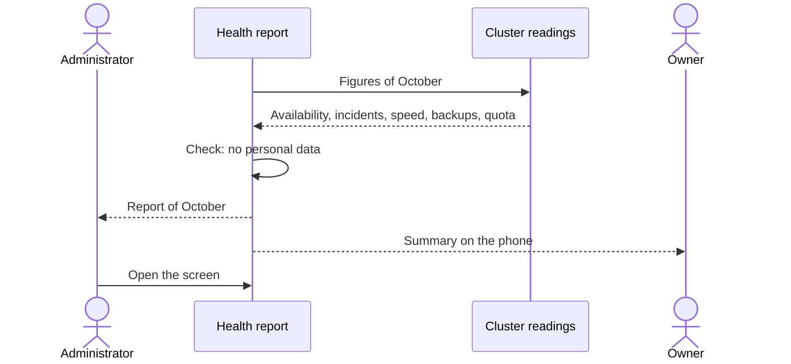

🏠 [Specs](../../../../README.md) › 🧩 [Functional capabilities](../../../README.md) ›
🛟 [F20 Hosted support assistant (hosted edition)](../../README.md) › 📝 [Use cases](../README.md) ›
📝 [Use cases: FL-F20-08 Engineers, screen sharing, reports and languages](README.md) ›
📝 UC-F20-31 Read the monthly health report

# 📝 UC-F20-31 Read the monthly health report

**Status:** ✅ specified

## Summary

Each month the hosted support assistant sends the administrator and the owner a short health report of the company's
hosted environment: availability, incidents, speed, backups, storage and quota, the support times met and what to do
next. It holds figures only, never the names or data of any person.

## Personas

- [U07 Administrator](../../../../01-users/personas/u07-administrator.md)
- [U13 Owner](../../../../01-users/personas/u13-owner.md)

## Goal

The owner knows in two minutes whether the hosted service did its job, what it cost them in downtime and what to
improve, without reading logs.

## Trigger

The first working day of each month, or the administrator opens the last report.

## Frequency

Monthly.

## Preconditions

- The company's namespace has a month of readings and incidents
  ([E-F20-05 Cluster reading](../../data/e-f20-05-cluster-reading.md),
  [E-F20-07 Service incident](../../data/e-f20-07-service-incident.md)).
- The company's support plan sets the targets the report compares with
  ([E-F20-12 Support plan](../../data/e-f20-12-support-plan.md)).

## Postconditions

- **Succeeded:** the report is saved ([E-F20-21 Health report](../../data/e-f20-21-health-report.md)) with its figures
  and its advice, passed the check that it holds no personal data, and sent to the administrator and the owner.
- **Failed:** the report is held; an engineer sees what the check found and the report is sent after the fix.

## Main flow

1. On the first working day SimpleERP builds the month's figures from the cluster readings, the incidents and the
   support requests of the company.
2. SimpleERP checks that nothing in the report names or identifies a person (names, emails, addresses, tokens) and
   holds it if something does ([BR-F20-22](../../business-rules/br-f20-22-reports-contain-no-personal-data.md)).
3. The administrator and the owner receive it by email with a link; the administrator opens the health report screen
   ([S-F20-31](../../screens/08-engineers-sharing-and-reports/s-f20-31-health-report.md)).
4. The screen shows availability against the plan, the incidents of the month with their duration, the speed, the last
   backup and the last restore test, the storage and quota used, and the requests answered within the plan's times.
5. The report lists up to five pieces of advice in plain words (storage nearly full, a slow report, an unused module
   that costs money).
6. The owner reads the one-page summary on a phone and may ask the AI assistant a question about it.

## Alternative flows

- 3a. A target was missed: the report names the missed target and the service credit due
  ([UC-F20-24](../06-after-an-incident/uc-f20-24-credit-missed-service-level-targets.md)).
- 5a. Nothing needs attention: the report says so in one line.
- 6a. The administrator asks for the same report for an earlier month: it is shown from the archive.

## Error flows

- 1e. Readings are missing for some days: the report says which days and does not guess.
- 2e. The check finds a name in an incident's text: the report is held and an engineer edits the text.
- 3e. The email cannot be delivered: the report stays on the screen and the administrator is told in the app.
- Any step: a service does not answer; the call is retried first
  ([BR-F3-32](../../../f03-assistant/business-rules/br-f03-32-retry-before-an-error.md)), then the message follows the
  error pattern ([D122](../../../../06-decisions/ux/d122-error-message-standard.md)) and what the user typed stays on
  the screen.

## Business rules

- [BR-F20-22](../../business-rules/br-f20-22-reports-contain-no-personal-data.md)
- [BR-F20-11](../../business-rules/br-f20-11-response-times-per-plan.md)
- [BR-F20-13](../../business-rules/br-f20-13-health-data-out-of-reach.md)
- [BR-F20-17](../../business-rules/br-f20-17-service-credits-for-missed-targets.md)

## Entities

- [E-F20-21 Health report](../../data/e-f20-21-health-report.md): created, changed
- [E-F20-05 Cluster reading](../../data/e-f20-05-cluster-reading.md): read, the month's cluster readings
- [E-F20-07 Service incident](../../data/e-f20-07-service-incident.md): read, the incidents of the month
- [E-F20-15 Incident report](../../data/e-f20-15-incident-report.md): read, the written incident reports
- [E-F20-16 Service credit](../../data/e-f20-16-service-credit.md): read, the service credits

## Permissions

The administrator and the owner read the reports of their company. The hosting engineer reads them all and edits a held
one. Accounting reads the credits.

## Notifications

The administrator and the owner, by email: the report of the month, in their language. A held report: the hosting
engineer.

## Audit events

Each report built, checked, held, sent and opened, with the check's result; each edit of a held report.

## AI involvement

The AI assistant writes the advice from the figures and says so; it sees only the report's figures, never the company's
data, and an engineer may edit the advice before sending
([BR-F20-09 The customer knows it is an AI](../../business-rules/br-f20-09-ai-disclosed.md)).

## API, MCP and A2A exposure

T5 operations of the capability for the personas above: create, read, update and list. The MCP tool of the
capability may read and propose, never confirm alone. No A2A skill.

## Screens

- [S-F20-31](../../screens/08-engineers-sharing-and-reports/s-f20-31-health-report.md)

## Flowchart

See
[FL-F20-08 Engineers, screen sharing, reports and languages](../../flows/fl-f20-08-engineers-sharing-and-reports.md#flowchart).

## Sequence diagram

## Acceptance criteria

1. **Given** a month with 99.7 percent availability and a 99.9 percent target **when** the report is built **then** it
   names the missed target and the credit due.
2. **Given** a report that holds an email address **when** the check runs **then** the report is held and not sent.
3. **Given** a month with readings missing on 3 days **when** the report is built **then** it says which days are
   missing.
4. **Given** a sent report **when** the owner opens the link on a phone **then** a one-page summary is shown.

## Non-functional notes

The screen answers within 2 seconds for 10,000 records; every change is audited.

## Regulatory references

The report is built from technical measures and holds no personal data, so it is not a new processing of
people's data ([CR-FR-050](../../../../10-country-packs/france/data-protection/cr-fr-050-privacy-by-design.md)); a
company with health data gets figures only ([BR-F20-13](../../business-rules/br-f20-13-health-data-out-of-reach.md)).
Service credits follow [BR-F20-17](../../business-rules/br-f20-17-service-credits-for-missed-targets.md).

## Related use cases

- [UC-F20-30](uc-f20-30-share-the-screen-or-a-time-limited-view.md)
- [UC-F20-32 Get support in more languages](uc-f20-32-get-support-in-more-languages.md)
- [UC-F20-23](../06-after-an-incident/uc-f20-23-send-the-written-incident-report.md)
- [UC-F20-24](../06-after-an-incident/uc-f20-24-credit-missed-service-level-targets.md)
- [UC-F20-19](../04-govern-the-assistant/uc-f20-19-choose-a-support-plan-and-see-its-times.md)
- [UC-F20-14 Investigate slowness](../02-diagnose-and-fix/uc-f20-14-investigate-slowness.md)
- [UC-F22-15](../../../f22-unified-cost-management/use-cases/05-billing/uc-f22-15-see-the-hosted-quota-and-units-billed.md)

## Open questions

None.

---

⬅️ [UC-F20-30 Share the screen or a time-limited view](uc-f20-30-share-the-screen-or-a-time-limited-view.md) ·
⬆️ [Up](README.md) · ➡️ [UC-F20-32 Get support in more languages](uc-f20-32-get-support-in-more-languages.md)
