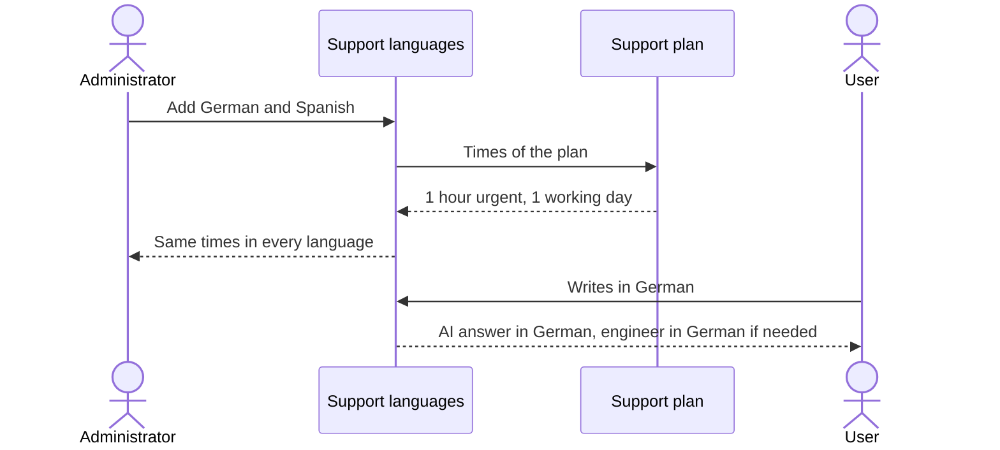

🏠 [Specs](../../../../README.md) › 🧩 [Functional capabilities](../../../README.md) ›
🛟 [F20 Hosted support assistant (hosted edition)](../../README.md) › 📝 [Use cases](../README.md) ›
📝 [Use cases: FL-F20-08 Engineers, screen sharing, reports and languages](README.md) ›
📝 UC-F20-32 Get support in more languages

# 📝 UC-F20-32 Get support in more languages

**Status:** ✅ specified

## Summary

The administrator chooses the support languages of the company among the languages the hosted support assistant supports
beyond French and English, and sees the same response and resolution times for each. A language is offered only when the
engineers' rota covers it during the plan's hours; the AI assistant and the engineers then answer in it.

## Personas

- [U07 Administrator](../../../../01-users/personas/u07-administrator.md)

## Goal

Staff who are more at ease in another language get support in it, at the same speed as everyone else.

## Trigger

The administrator opens the support languages screen, or a user writes to support in a language that is not yet chosen.

## Frequency

Once at set-up, then when the team changes.

## Preconditions

- The company has a support plan with its times ([E-F20-12 Support plan](../../data/e-f20-12-support-plan.md)).
- The company's languages are set ([E-F21-16](../../../f21-onboarding-and-modules/data/e-f21-16-language-setting.md)).

## Postconditions

- **Succeeded:** the company's support languages are saved; each user is answered in their own language when it is
  listed; the times shown for each language equal the plan's.
- **Failed:** the language is not added; the screen says the rota does not cover it and keeps English with a note.

## Main flow

1. The administrator opens the support languages screen
   ([S-F20-32](../../screens/08-engineers-sharing-and-reports/s-f20-32-support-languages.md)), which lists the languages
   the support team covers, with the hours each is covered.
2. The administrator ticks the languages the company wants; the screen shows, for each, the first answer and resolution
   times, which are the plan's
   ([BR-F20-23](../../business-rules/br-f20-23-service-times-are-the-same-in-every-supported-language.md)).
3. SimpleERP saves the choice; the AI assistant and the engineers answer each user in the user's own language when it
   is listed ([BR-F20-18](../../business-rules/br-f20-18-support-in-french-or-english.md)).
4. A user writes in a listed language; the AI assistant answers at once in it and an engineer who speaks it takes over
   when needed.
5. A user writes in a language that is not listed: the answer comes in English and says so, with the times of the plan.
6. The administrator sees each month how many requests came in each language and whether the times were met.

## Alternative flows

- 2a. The administrator wants a language the rota does not cover: it is listed as not yet supported and the company may
  ask to be told when it is.
- 4a. A user's language differs from the company's: the user's own language setting wins
  [BR-F21-15](../../../f21-onboarding-and-modules/business-rules/br-f21-15-languages-per-company-and-per-user.md).
- 6a. Times are missed in one language: the credit rules of the plan apply as for any request
  ([UC-F20-24](../06-after-an-incident/uc-f20-24-credit-missed-service-level-targets.md)).

## Error flows

- 4e. No engineer who speaks the language is on duty at the plan's hour: the request goes to the nearest engineer with a
  translated reading marked as translated, within the same time.
- 5e. The AI assistant is unsure of the language: it asks the user which language to use.
- 2e. A language leaves the supported list: the companies that chose it are told in advance and fall back to English
  with a note.
- Any step: a service does not answer; the call is retried first
  ([BR-F3-32](../../../f03-assistant/business-rules/br-f03-32-retry-before-an-error.md)), then the message follows the
  error pattern ([D122](../../../../06-decisions/ux/d122-error-message-standard.md)) and what the user typed stays on
  the screen.

## Business rules

- [BR-F20-23](../../business-rules/br-f20-23-service-times-are-the-same-in-every-supported-language.md)
- [BR-F20-18](../../business-rules/br-f20-18-support-in-french-or-english.md)
- [BR-F20-11](../../business-rules/br-f20-11-response-times-per-plan.md)
- [BR-F21-15](../../../f21-onboarding-and-modules/business-rules/br-f21-15-languages-per-company-and-per-user.md)

## Entities

- [E-F20-12 Support plan](../../data/e-f20-12-support-plan.md): read, the plan's times
- [E-F20-01 Support request](../../data/e-f20-01-support-request.md): read, the language of each request
- [E-F21-16](../../../f21-onboarding-and-modules/data/e-f21-16-language-setting.md): read, the language settings

## Permissions

The administrator chooses the company's support languages. Every user is answered in their own language when it is
listed. The owner reads the monthly figures by language.

## Notifications

The administrator, in the app: a chosen language lost its coverage, or a new language is available.

## Audit events

Each change of the company's support languages, each language added or removed from the supported list, and each request
answered in a fallback language.

## AI involvement

The AI assistant answers in the user's language and says it is an AI in that language
([BR-F20-09 The customer knows it is an AI](../../business-rules/br-f20-09-ai-disclosed.md)); it tells a user when it
falls back to English.

## API, MCP and A2A exposure

T5 operations of the capability for the personas above: create, read, update and list. The MCP tool of the
capability may read and propose, never confirm alone. No A2A skill.

## Screens

- [S-F20-32](../../screens/08-engineers-sharing-and-reports/s-f20-32-support-languages.md)

## Flowchart

See
[FL-F20-08 Engineers, screen sharing, reports and languages](../../flows/fl-f20-08-engineers-sharing-and-reports.md#flowchart).

## Sequence diagram

## Acceptance criteria

1. **Given** a company that adds German **when** the screen is saved **then** the times shown for German are the plan's
   times.
2. **Given** a user who writes in a listed language **when** they send a message **then** the AI assistant answers in
   it.
3. **Given** a user who writes in an unlisted language **when** they send a message **then** the answer is in English
   and says so.
4. **Given** a language the rota stops covering **when** the change takes effect **then** the companies that chose it
   are told in advance.

## Non-functional notes

The screen answers within 2 seconds for 10,000 records; every change is audited.

## Regulatory references

The company's staff are answered in their own language where the offer can promise it; the AI disclosure is
given in that language
[CR-FR-056](../../../../10-country-packs/france/ai-and-recording/cr-fr-056-people-know-they-deal-with-an-ai.md).
Languages and their catalogue are data, not text in the pages.

## Related use cases

- [UC-F20-31 Read the monthly health report](uc-f20-31-read-the-monthly-health-report.md)
- [UC-F20-25](../07-employees-help/uc-f20-25-get-support-in-french-or-english.md)
- [UC-F20-19](../04-govern-the-assistant/uc-f20-19-choose-a-support-plan-and-see-its-times.md)
- [UC-F20-24](../06-after-an-incident/uc-f20-24-credit-missed-service-level-targets.md)
- [UC-F21-24](../../../f21-onboarding-and-modules/use-cases/01-first-run/uc-f21-24-choose-the-companys-and-each-users-language.md)
- [UC-F20-29 Book a call with an engineer](uc-f20-29-book-a-call-with-an-engineer.md)

## Open questions

None.

---

⬅️ [UC-F20-31 Read the monthly health report](uc-f20-31-read-the-monthly-health-report.md) · ⬆️ [Up](README.md)
