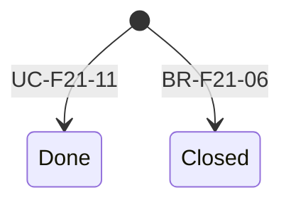

🏠 [Specs](../../../README.md) › 🧩 [Functional capabilities](../../README.md) ›
🧭 [F21 Onboarding and module activation](../README.md) › 🗃️ [Data](README.md) › 🗃️ E-F21-01 Onboarding progress

# 🗃️ E-F21-01 Onboarding progress

**Status:** ✅ specified

## Purpose

Each step's state.

## Fields

| Name | Type | Required | Validation | Default | Example | Personal data | Custom fields |
|---|---|---|---|---|---|---|---|
| company, step, state, answered by | records | yes | BR-F21-06 | to do | Acme, identity, done, owner | no | no |

## Relations

As its use cases.

## Lifecycle

## Indexes and search

By number, date, partner.

## Retention

Kept for the period of its kind of record in the country pack (D293), or else its kind's default in the
[retention schedule](../../../05-non-functional/data-retention.md).

## Audit

Every change.

## Import and export

CSV, FEC where relevant.

## Used by

- [UC-F21-01](../use-cases/01-first-run/uc-f21-01-start-the-first-run-guide.md)
- [UC-F21-11](../use-cases/02-modules/uc-f21-11-follow-a-module-s-short-guide.md)
- [UC-F21-12](../use-cases/01-first-run/uc-f21-12-ask-the-assistant-at-any-step.md)
- [UC-F21-14](../use-cases/04-learn-and-improve/uc-f21-14-follow-the-checklist-and-resume-later.md)
- [UC-F21-25 Onboard on the phone as an employee](../use-cases/04-learn-and-improve/uc-f21-25-onboard-on-the-phone-as-an-employee.md)

## Open questions

None.

---

⬆️ [Up](README.md) · ➡️ [E-F21-02 Company profile](e-f21-02-company-profile.md)
