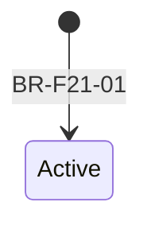

🏠 [Specs](../../../README.md) › 🧩 [Functional capabilities](../../README.md) ›
🧭 [F21 Onboarding and module activation](../README.md) › 🗃️ [Data](README.md) › 🗃️ E-F21-02 Company profile

# 🗃️ E-F21-02 Company profile

**Status:** ✅ specified

## Purpose

Sector, size, country, sites.

## Fields

| Name | Type | Required | Validation | Default | Example | Personal data | Custom fields |
|---|---|---|---|---|---|---|---|
| sector, size, country | records | yes | BR-F21-01 | - | home care, 25, FR | no | no |

## Relations

As its use cases.

## Lifecycle

## Indexes and search

By number, date, partner.

## Retention

Kept for the period of its kind of record in the country pack (D293), or else its kind's default in the
[retention schedule](../../../05-non-functional/data-retention.md).

## Audit

Every change.

## Import and export

CSV, FEC where relevant.

## Used by

- [UC-F21-02](../use-cases/01-first-run/uc-f21-02-describe-the-company.md)
- [UC-F21-07](../use-cases/01-first-run/uc-f21-07-set-the-company-identity-vat-and-bank.md)

## Open questions

None.

---

⬅️ [E-F21-01 Onboarding progress](e-f21-01-onboarding-progress.md) · ⬆️ [Up](README.md) ·
➡️ [E-F21-03 Set-up template](e-f21-03-set-up-template.md)
