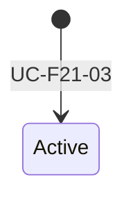

🏠 [Specs](../../../README.md) › 🧩 [Functional capabilities](../../README.md) ›
🧭 [F21 Onboarding and module activation](../README.md) › 🗃️ [Data](README.md) › 🗃️ E-F21-03 Set-up template

# 🗃️ E-F21-03 Set-up template

**Status:** ✅ specified

## Purpose

A sector or provider template.

## Fields

| Name | Type | Required | Validation | Default | Example | Personal data | Custom fields |
|---|---|---|---|---|---|---|---|
| name, modules, settings | records | yes | - | - | home care, F6+F9+F13 | no | no |

## Relations

As its use cases.

## Lifecycle

## Indexes and search

By number, date, partner.

## Retention

Kept for the period of its kind of record in the country pack (D293), or else its kind's default in the
[retention schedule](../../../05-non-functional/data-retention.md).

## Audit

Every change.

## Import and export

CSV, FEC where relevant.

## Used by

- [UC-F21-03](../use-cases/01-first-run/uc-f21-03-pick-a-sector-template.md)
- [UC-F21-19](../use-cases/04-learn-and-improve/uc-f21-19-reuse-a-set-up-for-several-clients.md)

## Open questions

None.

---

⬅️ [E-F21-02 Company profile](e-f21-02-company-profile.md) · ⬆️ [Up](README.md) ·
➡️ [E-F21-04 Module activation](e-f21-04-module-activation.md)
