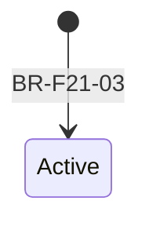

🏠 [Specs](../../../README.md) › 🧩 [Functional capabilities](../../README.md) ›
🧭 [F21 Onboarding and module activation](../README.md) › 🗃️ [Data](README.md) › 🗃️ E-F21-05 Module dependency

# 🗃️ E-F21-05 Module dependency

**Status:** ✅ specified

## Purpose

What a module needs.

## Fields

| Name | Type | Required | Validation | Default | Example | Personal data | Custom fields |
|---|---|---|---|---|---|---|---|
| module, needs | records | yes | BR-F21-03 | - | F10, F6 | no | no |

## Relations

As its use cases.

## Lifecycle

## Indexes and search

By number, date, partner.

## Retention

Kept for the period of its kind of record in the country pack (D293), or else its kind's default in the
[retention schedule](../../../05-non-functional/data-retention.md).

## Audit

Every change.

## Import and export

CSV, FEC where relevant.

## Used by

- [UC-F21-05](../use-cases/02-modules/uc-f21-05-understand-a-module-s-dependencies.md)

## Open questions

None.

---

⬅️ [E-F21-04 Module activation](e-f21-04-module-activation.md) · ⬆️ [Up](README.md) ·
➡️ [E-F21-06 Invitation](e-f21-06-invitation.md)
