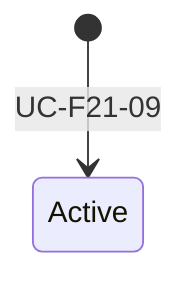

🏠 [Specs](../../../README.md) › 🧩 [Functional capabilities](../../README.md) ›
🧭 [F21 Onboarding and module activation](../README.md) › 🗃️ [Data](README.md) › 🗃️ E-F21-07 Import job

# 🗃️ E-F21-07 Import job

**Status:** ✅ specified

## Purpose

An import and its checks.

## Fields

| Name | Type | Required | Validation | Default | Example | Personal data | Custom fields |
|---|---|---|---|---|---|---|---|
| file, kind, rows, errors | records | yes | - | - | customers.csv, customers, 412, 0 | no | no |

## Relations

As its use cases.

## Lifecycle

## Indexes and search

By number, date, partner.

## Retention

Kept for the period of its kind of record in the country pack (D293), or else its kind's default in the
[retention schedule](../../../05-non-functional/data-retention.md).

## Audit

Every change.

## Import and export

CSV, FEC where relevant.

## Used by

- [UC-F21-09](../use-cases/03-team-and-data/uc-f21-09-import-existing-data.md)
- [UC-F21-21 Migrate from a named tool](../use-cases/05-migration-from-another-tool/uc-f21-21-migrate-from-a-named-tool.md)

## Open questions

None.

---

⬅️ [E-F21-06 Invitation](e-f21-06-invitation.md) · ⬆️ [Up](README.md) ·
➡️ [E-F21-08 Connection](e-f21-08-connection.md)
