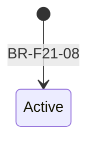

🏠 [Specs](../../../README.md) › 🧩 [Functional capabilities](../../README.md) ›
🧭 [F21 Onboarding and module activation](../README.md) › 🗃️ [Data](README.md) › 🗃️ E-F21-09 Demo data set

# 🗃️ E-F21-09 Demo data set

**Status:** ✅ specified

## Purpose

Demo records and their mark.

## Fields

| Name | Type | Required | Validation | Default | Example | Personal data | Custom fields |
|---|---|---|---|---|---|---|---|
| company, loaded, cleared | records | yes | BR-F21-08 | - | Acme, 2026-11-12, - | no | no |

## Relations

As its use cases.

## Lifecycle

## Indexes and search

By number, date, partner.

## Retention

Kept for the period of its kind of record in the country pack (D293), or else its kind's default in the
[retention schedule](../../../05-non-functional/data-retention.md).

## Audit

Every change.

## Import and export

CSV, FEC where relevant.

## Used by

- [UC-F21-13](../use-cases/04-learn-and-improve/uc-f21-13-try-with-demo-data-then-clear-it.md)

## Open questions

None.

---

⬅️ [E-F21-08 Connection](e-f21-08-connection.md) · ⬆️ [Up](README.md) · ➡️ [E-F21-10 Tour](e-f21-10-tour.md)
