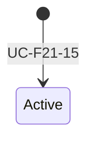

🏠 [Specs](../../../README.md) › 🧩 [Functional capabilities](../../README.md) ›
🧭 [F21 Onboarding and module activation](../README.md) › 🗃️ [Data](README.md) › 🗃️ E-F21-10 Tour

# 🗃️ E-F21-10 Tour

**Status:** ✅ specified

## Purpose

An interactive tour.

## Fields

| Name | Type | Required | Validation | Default | Example | Personal data | Custom fields |
|---|---|---|---|---|---|---|---|
| screen, steps, version | records | yes | - | - | invoices, 6, 3.0 | no | no |

## Relations

As its use cases.

## Lifecycle

## Indexes and search

By number, date, partner.

## Retention

Kept for the period of its kind of record in the country pack (D293), or else its kind's default in the
[retention schedule](../../../05-non-functional/data-retention.md).

## Audit

Every change.

## Import and export

CSV, FEC where relevant.

## Used by

- [UC-F21-15](../use-cases/04-learn-and-improve/uc-f21-15-take-an-interactive-tour-of-a-screen.md)
- [UC-F21-17](../use-cases/04-learn-and-improve/uc-f21-17-welcome-an-employee-at-first-sign-in.md)

## Open questions

None.

---

⬅️ [E-F21-09 Demo data set](e-f21-09-demo-data-set.md) · ⬆️ [Up](README.md) ·
➡️ [E-F21-11 Legal check item](e-f21-11-legal-check-item.md)
