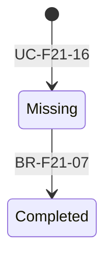

🏠 [Specs](../../../README.md) › 🧩 [Functional capabilities](../../README.md) ›
🧭 [F21 Onboarding and module activation](../README.md) › 🗃️ [Data](README.md) › 🗃️ E-F21-11 Legal check item

# 🗃️ E-F21-11 Legal check item

**Status:** ✅ specified

## Purpose

A country-pack set-up item.

## Fields

| Name | Type | Required | Validation | Default | Example | Personal data | Custom fields |
|---|---|---|---|---|---|---|---|
| rule, state | records | yes | BR-F21-07 | - | e-invoicing, missing | no | no |

## Relations

As its use cases.

## Lifecycle

## Indexes and search

By number, date, partner.

## Retention

Kept for the period of its kind of record in the country pack (D293), or else its kind's default in the
[retention schedule](../../../05-non-functional/data-retention.md).

## Audit

Every change.

## Import and export

CSV, FEC where relevant.

## Used by

- [UC-F21-16](../use-cases/01-first-run/uc-f21-16-check-the-legal-set-up.md)

## Open questions

None.

---

⬅️ [E-F21-10 Tour](e-f21-10-tour.md) · ⬆️ [Up](README.md) · ➡️ [E-F21-12 Provider set-up](e-f21-12-provider-set-up.md)
