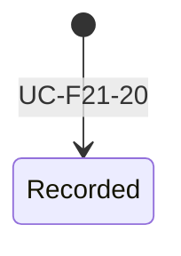

🏠 [Specs](../../../README.md) › 🧩 [Functional capabilities](../../README.md) ›
🧭 [F21 Onboarding and module activation](../README.md) › 🗃️ [Data](README.md) › 🗃️ E-F21-13 Onboarding figure

# 🗃️ E-F21-13 Onboarding figure

**Status:** ✅ specified

## Purpose

Time to first invoice and drop-offs.

## Fields

| Name | Type | Required | Validation | Default | Example | Personal data | Custom fields |
|---|---|---|---|---|---|---|---|
| sector, step, companies, median time | records | yes | BR-F21-11 | - | home care, import, 40, 2 h | no | no |

## Relations

As its use cases.

## Lifecycle

## Indexes and search

By number, date, partner.

## Retention

Kept for the period of its kind of record in the country pack (D293), or else its kind's default in the
[retention schedule](../../../05-non-functional/data-retention.md).

## Audit

Every change.

## Import and export

CSV, FEC where relevant.

## Used by

- [UC-F21-20](../use-cases/04-learn-and-improve/uc-f21-20-measure-onboarding-and-drop-offs.md)

## Open questions

None.

---

⬅️ [E-F21-12 Provider set-up](e-f21-12-provider-set-up.md) · ⬆️ [Up](README.md) ·
➡️ [E-F21-14 Migration source](e-f21-14-migration-source.md)
