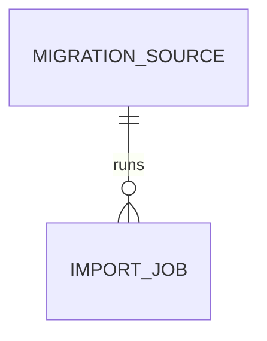
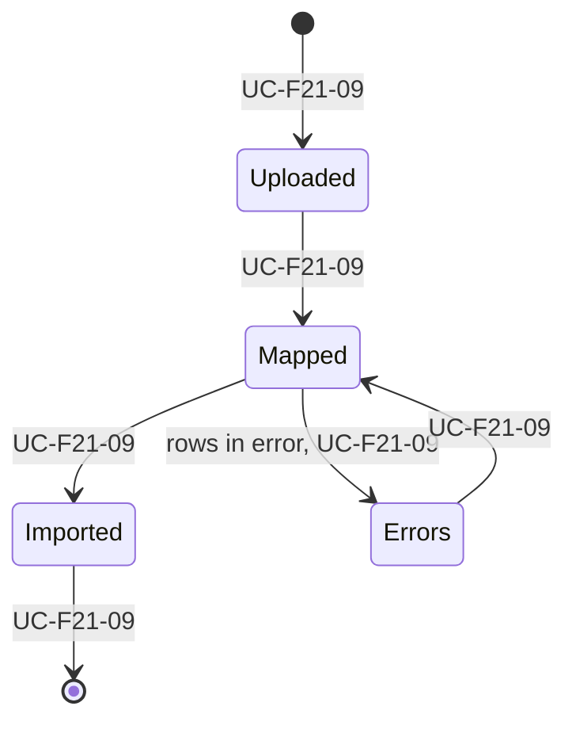

🏠 [Specs](../../../README.md) › 🧩 [Functional capabilities](../../README.md) ›
🧭 [F21 Onboarding and module activation](../README.md) › 🗃️ [Data](README.md) › 🗃️ E-F21-14 Migration source

# 🗃️ E-F21-14 Migration source

**Status:** ✅ specified

## Purpose

The old tool a company comes from, the files exported from it and the mapping used.

## Fields

| Name | Type | Required | Validation | Default | Example | Personal data | Custom fields |
|---|---|---|---|---|---|---|---|
| tool | choice | yes | supported tools | - | EBP | no | no |
| version | text | no | - | - | 2024 | no | no |
| files | list | yes | the tool's exports | - | customers.csv, articles.csv, FEC | no | no |
| mapping | list | yes | ready, edited | ready | ready | no | no |
| rows | number | yes | - | - | 1 240 | no | no |
| errors | number | yes | - | 0 | 3 | no | no |

## Relations

## Lifecycle

## Indexes and search

By tool and date.

## Retention

Files deleted 90 days after the import; the mapping kept.

## Audit

Every creation and change, with who, when, the old and the new value.

## Import and export

CSV and JSON export through the API (T5); no bulk import.

## Used by

- [UC-F21-21 Migrate from a named tool](../use-cases/05-migration-from-another-tool/uc-f21-21-migrate-from-a-named-tool.md)
- [UC-F21-09 Import existing data](../use-cases/03-team-and-data/uc-f21-09-import-existing-data.md)

## Open questions

None.

---

⬅️ [E-F21-13 Onboarding figure](e-f21-13-onboarding-figure.md) · ⬆️ [Up](README.md) ·
➡️ [E-F21-15 Opening balance check](e-f21-15-opening-balance-check.md)
