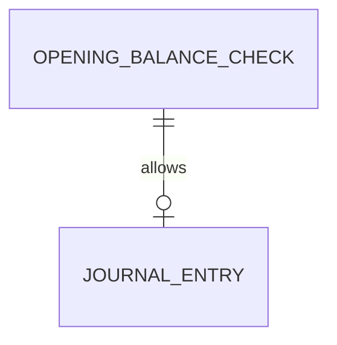
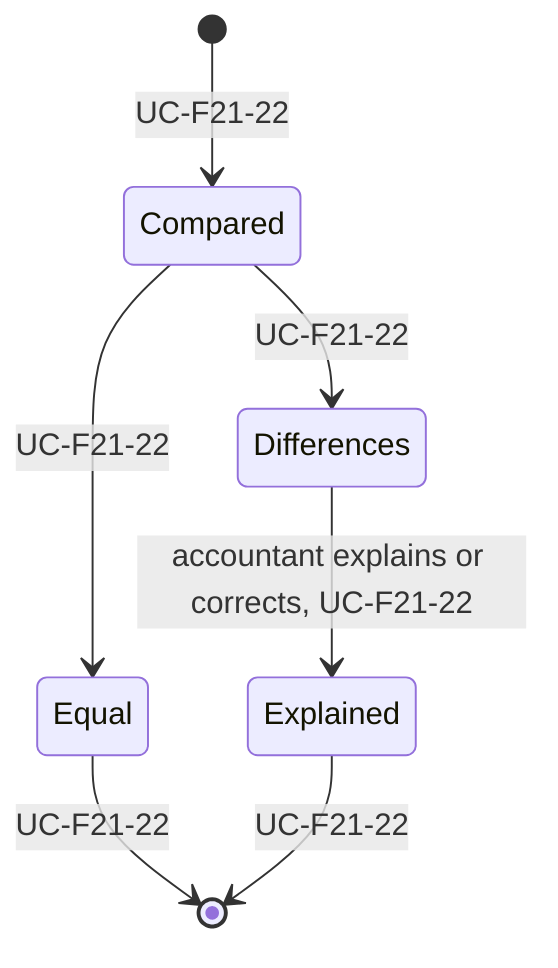

🏠 [Specs](../../../README.md) › 🧩 [Functional capabilities](../../README.md) ›
🧭 [F21 Onboarding and module activation](../README.md) › 🗃️ [Data](README.md) › 🗃️ E-F21-15 Opening balance check

# 🗃️ E-F21-15 Opening balance check

**Status:** ✅ specified

## Purpose

The comparison of the opening balances with the previous year's FEC.

## Fields

| Name | Type | Required | Validation | Default | Example | Personal data | Custom fields |
|---|---|---|---|---|---|---|---|
| FEC file | file | yes | a valid FEC | - | FEC-2025.txt | no | no |
| accounts compared | number | yes | - | - | 186 | no | no |
| differences | list | no | account, amounts, reason | - | 512: 40.00, bank fees | no | no |
| state | choice | yes | equal, differences, explained | - | explained | no | no |

## Relations

## Lifecycle

## Indexes and search

By company and year.

## Retention

[CR-FR-002](../../../10-country-packs/france/accounting/cr-fr-002-accounting-records-kept-ten-years.md).

## Audit

Every creation and change, with who, when, the old and the new value.

## Import and export

CSV and JSON export through the API (T5); no bulk import.

## Used by

- [UC-F21-22 Check opening balances against last year's FEC](../use-cases/05-migration-from-another-tool/uc-f21-22-check-opening-balances-against-last-years-fec.md)

## Open questions

None.

---

⬅️ [E-F21-14 Migration source](e-f21-14-migration-source.md) · ⬆️ [Up](README.md) ·
➡️ [E-F21-16 Language setting](e-f21-16-language-setting.md)
