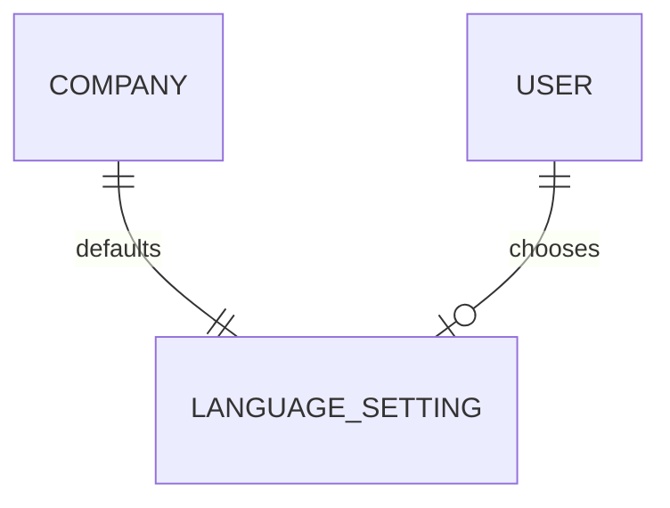
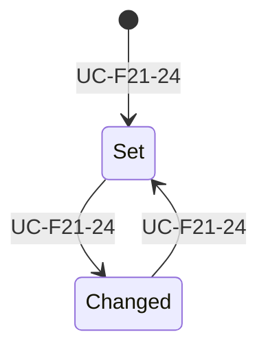

🏠 [Specs](../../../README.md) › 🧩 [Functional capabilities](../../README.md) ›
🧭 [F21 Onboarding and module activation](../README.md) › 🗃️ [Data](README.md) › 🗃️ E-F21-16 Language setting

# 🗃️ E-F21-16 Language setting

**Status:** ✅ specified

## Purpose

The company's default language and each user's interface language.

## Fields

| Name | Type | Required | Validation | Default | Example | Personal data | Custom fields |
|---|---|---|---|---|---|---|---|
| scope | choice | yes | company, user | - | user | no | no |
| language | choice | yes | languages of T10 | company default | en | no | no |

## Relations

## Lifecycle

## Indexes and search

By user.

## Retention

As the company or user.

## Audit

Every creation and change, with who, when, the old and the new value.

## Import and export

CSV and JSON export through the API (T5); no bulk import.

## Used by

- [UC-F21-24 Choose the company's and each user's language](../use-cases/01-first-run/uc-f21-24-choose-the-companys-and-each-users-language.md)

## Open questions

None.

---

⬅️ [E-F21-15 Opening balance check](e-f21-15-opening-balance-check.md) · ⬆️ [Up](README.md) ·
➡️ [E-F21-17 Migration guide](e-f21-17-migration-guide.md)
