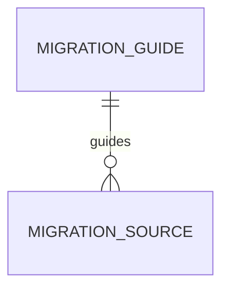
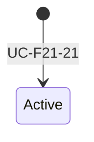

🏠 [Specs](../../../README.md) › 🧩 [Functional capabilities](../../README.md) ›
🧭 [F21 Onboarding and module activation](../README.md) › 🗃️ [Data](README.md) › 🗃️ E-F21-17 Migration guide

# 🗃️ E-F21-17 Migration guide

**Status:** ✅ specified

## Purpose

The migration guide the flow charts name with the words "guide"
([FL-F21-05](../flows/fl-f21-05-migration-from-another-tool.md)). A guide shows, for one tool a company used before, how
to export each file from it, so that SimpleERP reads them with the tool's ready mapping (BR-F21-12). The owner decided
to create it ([D516](../../../06-decisions/foundations/d516-naming-rules-and-the-seven-classes-of-names.md)); its fields
are derived from the specifications and confirmed by the owner (D572).

## Fields

| Name | Type | Required | Validation | Default | Example | Personal data | Custom fields |
|---|---|---|---|---|---|---|---|
| title | text | yes | not empty | - | From EBP to SimpleERP | no | no |
| tool | choice | yes | a supported tool (BR-F21-12) | - | EBP | no | no |
| supported versions | text | no | - | - | 2022 to 2025 | no | no |
| files | list | yes | one entry per file to export, with how to export it from the tool | - | customers.csv, articles.csv, FEC | no | no |
| data covered | list | yes | customers, suppliers, products, open invoices, balances (BR-F21-12) | - | customers, products | no | no |
| state | choice | yes | Active | Active | Active | no | no |

Derived from [UC-F21-21](../use-cases/05-migration-from-another-tool/uc-f21-21-migrate-from-a-named-tool.md) (the tool
picked, how to export each file, the unsupported version that falls back to the generic import),
[BR-F21-12](../business-rules/br-f21-12-migrations-read-the-old-tools-known-formats.md) (the tools and the data of the
ready mapping), the list view [S-F21-L17](../screens/00-lists/s-f21-l17-migration-guides.md) (title and state) and the
screen [S-F21-21 Migration](../screens/05-migration-from-another-tool/s-f21-21-migration.md) ("EBP: how to export (4
files)").

## Relations

- [E-F21-14 Migration source](e-f21-14-migration-source.md): the files a company exported as the guide shows, read with
  the tool's ready mapping.
- [E-F21-07 Import job](e-f21-07-import-job.md): the import those files run, through the migration source.

## Lifecycle

## Indexes and search

By tool; searched on the title. The list view sorts on the title and the state and filters on the state
([S-F21-L17](../screens/00-lists/s-f21-l17-migration-guides.md)).

## Retention

As the other records of its capability.

## Audit

Every change, as the other records of its capability.

## Import and export

CSV and JSON export through the API (T5) of the fields the user may see; no bulk import.

## Used by

- [UC-F21-21 Migrate from a named tool](../use-cases/05-migration-from-another-tool/uc-f21-21-migrate-from-a-named-tool.md)

## Open questions

None.

---

⬅️ [E-F21-16 Language setting](e-f21-16-language-setting.md) · ⬆️ [Up](README.md) ·
➡️ [E-F21-18 Module guide](e-f21-18-module-guide.md)
