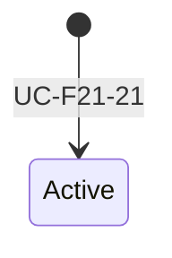

🏠 [Specs](../../../README.md) › 🧩 [Functional capabilities](../../README.md) ›
🧭 [F21 Onboarding and module activation](../README.md) › 🗃️ [Data](README.md) › 🗃️ E-F21-17 Migration guide

# 🗃️ E-F21-17 Migration guide

**Status:** 🔄 waiting for the owner

## Purpose

(Proposed) The migration guide the flow charts name with the words "guide"
([FL-F21-05](../flows/fl-f21-05-migration-from-another-tool.md)). The owner decided to create it
([D516](../../../06-decisions/foundations/d516-naming-rules-and-the-seven-classes-of-names.md)); what it holds waits for
the owner's confirmation.

## Fields

(Proposed) To define with the owner: the flow charts name the record, not its fields.

## Relations

(Proposed) To define with the owner, from the use cases below.

## Lifecycle

## Indexes and search

(Proposed) To define with the owner.

## Retention

(Proposed) As the other records of its capability, to confirm with the owner.

## Audit

(Proposed) Every change, as the other records of its capability.

## Import and export

(Proposed) To define with the owner.

## Used by

- [UC-F21-21 Migrate from a named tool](../use-cases/05-migration-from-another-tool/uc-f21-21-migrate-from-a-named-tool.md)

## Open questions

(Proposed) Its fields, relations and states wait for the owner (waiting list, step 36e).

---

⬅️ [E-F21-16 Language setting](e-f21-16-language-setting.md) · ⬆️ [Up](README.md) ·
➡️ [E-F21-18 Module guide](e-f21-18-module-guide.md)
