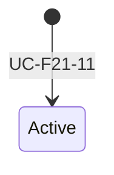

🏠 [Specs](../../../README.md) › 🧩 [Functional capabilities](../../README.md) ›
🧭 [F21 Onboarding and module activation](../README.md) › 🗃️ [Data](README.md) › 🗃️ E-F21-18 Module guide

# 🗃️ E-F21-18 Module guide

**Status:** 🔄 waiting for the owner

## Purpose

(Proposed) The module guide the flow charts name with the words "Module guide"
([FL-F21-02](../flows/fl-f21-02-modules.md)). The owner decided to create it
([D516](../../../06-decisions/foundations/d516-naming-rules-and-the-seven-classes-of-names.md)); what it holds waits for
the owner's confirmation.

## Fields

(Proposed) To define with the owner: the flow charts name the record, not its fields.

## Relations

(Proposed) To define with the owner, from the use cases below.

## Lifecycle

## Indexes and search

(Proposed) To define with the owner.

## Retention

(Proposed) As the other records of its capability, to confirm with the owner.

## Audit

(Proposed) Every change, as the other records of its capability.

## Import and export

(Proposed) To define with the owner.

## Used by

- [UC-F21-11 Follow a module's short guide](../use-cases/02-modules/uc-f21-11-follow-a-module-s-short-guide.md)

## Open questions

(Proposed) Its fields, relations and states wait for the owner (waiting list, step 36e).

---

⬅️ [E-F21-17 Migration guide](e-f21-17-migration-guide.md) · ⬆️ [Up](README.md) ·
➡️ [E-F21-19 Expert session](e-f21-19-expert-session.md)
