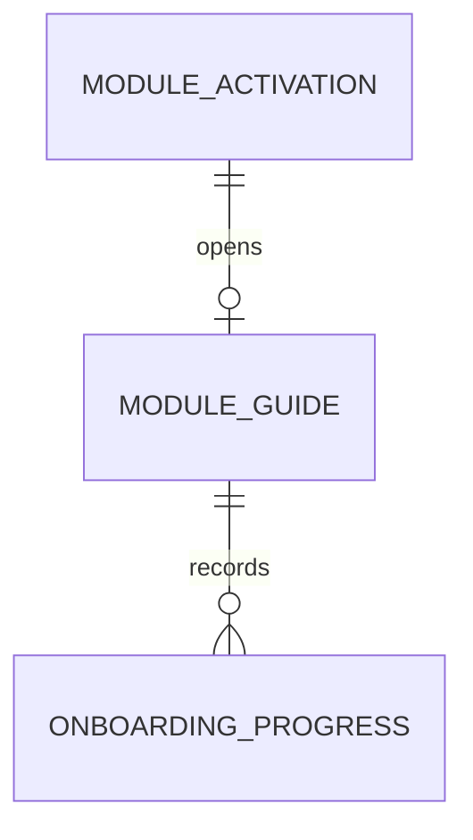
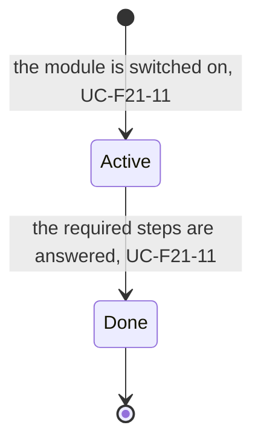

🏠 [Specs](../../../README.md) › 🧩 [Functional capabilities](../../README.md) ›
🧭 [F21 Onboarding and module activation](../README.md) › 🗃️ [Data](README.md) › 🗃️ E-F21-18 Module guide

# 🗃️ E-F21-18 Module guide

**Status:** ✅ specified

## Purpose

The module guide the flow charts name with the words "Module guide" ([FL-F21-02](../flows/fl-f21-02-modules.md)). A
guide is the short set of questions the administrator answers once a module is on, required steps first, so that the
module is ready (BR-F21-07). The owner decided to create it
([D516](../../../06-decisions/foundations/d516-naming-rules-and-the-seven-classes-of-names.md)); its fields are derived
from the specifications and confirmed by the owner (D572).

## Fields

| Name | Type | Required | Validation | Default | Example | Personal data | Custom fields |
|---|---|---|---|---|---|---|---|
| title | text | yes | not empty | the module's name and "set-up" | Point of sale · set-up | no | no |
| module | link | yes | a module switched on (E-F21-04) | - | Point of sale | no | no |
| steps | list | yes | each a question with why it matters and an example for the company's sector (BR-F21-05) | - | Which shops? Which payment methods? Print receipts? | no | no |
| required | yes or no, per step | yes | a step the law needs is required and cannot be skipped (BR-F21-07) | no | Which payment methods?: yes | no | no |
| state | choice | yes | Active, Done | Active | Done | no | no |

Derived from [UC-F21-11](../use-cases/02-modules/uc-f21-11-follow-a-module-s-short-guide.md) (the questions answered,
required steps first, optional ones skipped, resumed when left),
[BR-F21-05](../business-rules/br-f21-05-plain-words-with-examples.md) and
[BR-F21-07](../business-rules/br-f21-07-required-steps-before-first-document.md), the list view
[S-F21-L18](../screens/00-lists/s-f21-l18-module-guides.md) (title and state) and the screen
[S-F21-11 Module guide](../screens/02-modules/s-f21-11-module-guide.md) (done guides read-only).

## Relations

- [E-F21-04 Module activation](e-f21-04-module-activation.md): the module switched on, whose guide opens.
- [E-F21-01 Onboarding progress](e-f21-01-onboarding-progress.md): each step answered, by whom, so that a guide left
  half-way resumes.

## Lifecycle

A guide left half-way stays Active and resumes at the next step. Done guides are read-only (S-F21-11).

## Indexes and search

By module and state; searched on the title. The list view sorts on the title and the state and filters on the state
([S-F21-L18](../screens/00-lists/s-f21-l18-module-guides.md)).

## Retention

As the other records of its capability.

## Audit

Every change, as the other records of its capability.

## Import and export

CSV and JSON export through the API (T5) of the fields the user may see; no bulk import.

## Used by

- [UC-F21-11 Follow a module's short guide](../use-cases/02-modules/uc-f21-11-follow-a-module-s-short-guide.md)

## Open questions

The list view [S-F21-L18](../screens/00-lists/s-f21-l18-module-guides.md) and the state table of
[S-F21-11](../screens/02-modules/s-f21-11-module-guide.md) show only the state Active, while UC-F21-11 and S-F21-11
name done guides.

---

⬅️ [E-F21-17 Migration guide](e-f21-17-migration-guide.md) · ⬆️ [Up](README.md) ·
➡️ [E-F21-19 Expert session](e-f21-19-expert-session.md)
