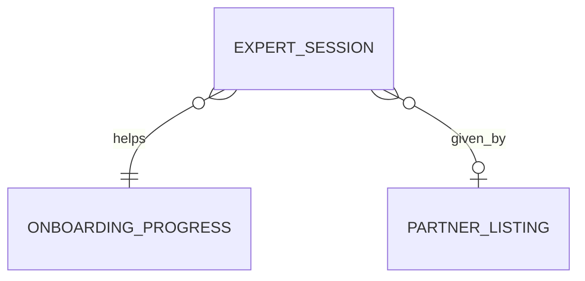
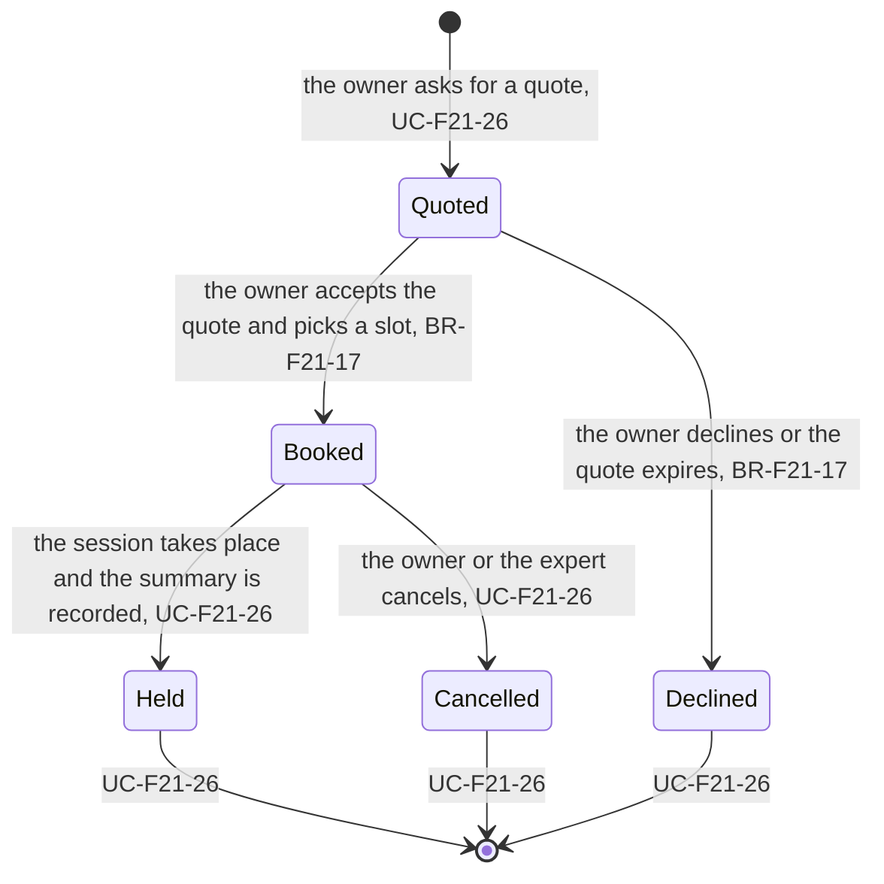

🏠 [Specs](../../../README.md) › 🧩 [Functional capabilities](../../README.md) ›
🧭 [F21 Onboarding and module activation](../README.md) › 🗃️ [Data](README.md) › 🗃️ E-F21-19 Expert session

# 🗃️ E-F21-19 Expert session

**Status:** ✅ specified

## Purpose

One session with an implementation expert, from its quote to its summary
([D540](../../../06-decisions/f21-onboarding-and-modules/d540-benchmark-gaps-f21-onboarding-and-modules.md)). It differs
from the onboarding progress ([E-F21-01 Onboarding progress](e-f21-01-onboarding-progress.md)), which follows the
company's own steps: the session is one piece of human help inside them.

## Fields

| Name | Type | Required | Validation | Default | Example | Personal data | Custom fields |
|---|---|---|---|---|---|---|---|
| topic | set-up, import, migration, training, go-live | yes | one of the five | - | import | no | no |
| expert | person of the team or of a partner | yes | a listed expert | - | Camille R. | yes | no |
| language | language | yes | a language the expert covers | - | French | no | no |
| scope | text | yes | at most 500 characters | - | Import of customers from a spreadsheet | no | no |
| length | minutes | yes | 30 to 240 | 60 | 90 | no | no |
| price | amount excluding VAT | yes | 0 when included | - | 240 EUR | no | no |
| quote valid until | date | no | 14 days after the quote | - | 2026-11-28 | no | no |
| slot | date and time | no | an expert's free time | - | 2026-11-19 10:00 | no | no |
| summary | text | no | required to become Held | - | Customers imported, 12 to review | no | no |
| state | Quoted, Booked, Declined, Held, Cancelled | yes | the lifecycle below | Quoted | Booked | no | no |
| owner | user | yes | a user of the company | the creator | Claire P. | yes | no |

## Relations

- [E-F21-01 Onboarding progress](e-f21-01-onboarding-progress.md)
- [E-F14-24 Partner listing](../../f14-plugin-store/data/e-f14-24-partner-listing.md)
- [E-F21-02 Company profile](e-f21-02-company-profile.md)

## Lifecycle

## Indexes and search

By company, topic, expert, state, slot and price.

## Retention

Kept with the company's invoices, 10 years, when paid
([CR-FR-002](../../../10-country-packs/france/accounting/cr-fr-002-accounting-records-kept-ten-years.md)); a declined
quote is erased after 12 months.

## Audit

Every quote, acceptance, booking, move, cancellation and session held, with the price shown.

## Import and export

No import. The sessions of a year are exported as a CSV for accounting.

## Used by

- [UC-F21-26](../use-cases/06-experts-cutover-and-parallel-run/uc-f21-26-book-an-implementation-expert.md)

## Open questions

None.

---

⬅️ [E-F21-18 Module guide](e-f21-18-module-guide.md) · ⬆️ [Up](README.md) ·
➡️ [E-F21-20 Cutover plan](e-f21-20-cutover-plan.md)
