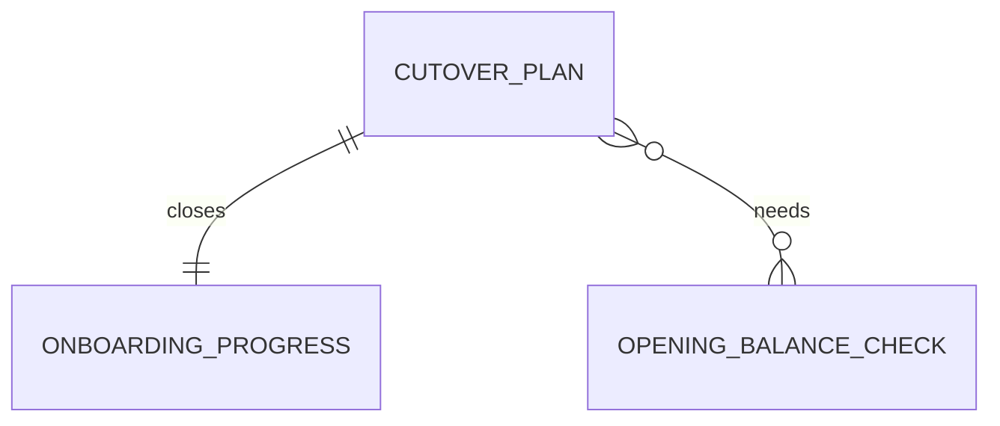
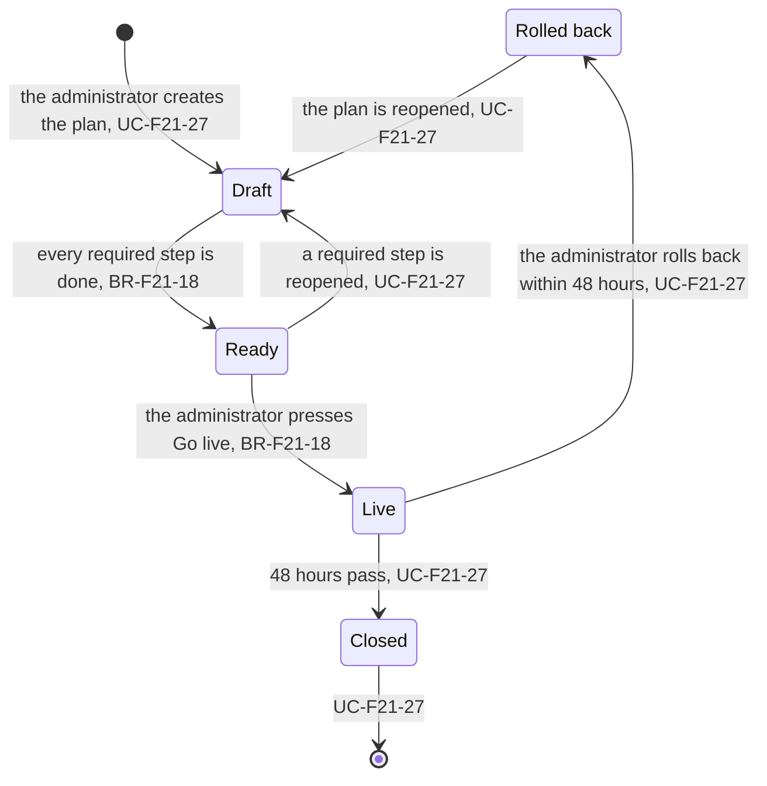

🏠 [Specs](../../../README.md) › 🧩 [Functional capabilities](../../README.md) ›
🧭 [F21 Onboarding and module activation](../README.md) › 🗃️ [Data](README.md) › 🗃️ E-F21-20 Cutover plan

# 🗃️ E-F21-20 Cutover plan

**Status:** ✅ specified

## Purpose

The cutover plan of a company: the go-live date, the checklist with owners and sign-offs, the rollback point and the
result ([D540](../../../06-decisions/f21-onboarding-and-modules/d540-benchmark-gaps-f21-onboarding-and-modules.md)). It
differs from the onboarding progress ([E-F21-01 Onboarding progress](e-f21-01-onboarding-progress.md)), which follows
the first-run guide: the cutover plan is the last, dated step of it. Its rollback point restores the company's data,
unlike the rollback of one plugin version
([E-F14-20 Rollback point](../../f14-plugin-store/data/e-f14-20-rollback-point.md)).

## Fields

| Name | Type | Required | Validation | Default | Example | Personal data | Custom fields |
|---|---|---|---|---|---|---|---|
| go-live at | date and time | yes | in the future while Draft | - | 2027-01-04 07:00 | no | no |
| modules | list of modules | yes | modules switched on | - | Accounting, Sales | no | no |
| steps | list of step, owner, due date, required | yes | at least the required steps | - | 9 steps | no | no |
| step states | open, done, signed off | yes | one per step | open | 7 done | no | no |
| old tool | migration source (E-F21-14) | no | a source of the company | - | Old invoicing tool | no | no |
| rollback point | date and time | no | set at go-live | - | 2027-01-04 07:00 | no | no |
| went live at | date and time | no | set at go-live | - | 2027-01-04 07:02 | no | no |
| signed off by | external accountant | no | the accountant of the company | - | Marie L. | yes | no |
| state | Draft, Ready, Live, Rolled back, Closed | yes | the lifecycle below | Draft | Ready | no | no |
| owner | user | yes | a user of the company | the creator | Claire P. | yes | no |

## Relations

- [E-F21-01 Onboarding progress](e-f21-01-onboarding-progress.md)
- [E-F21-14 Migration source](e-f21-14-migration-source.md)
- [E-F21-15 Opening balance check](e-f21-15-opening-balance-check.md)
- [E-F21-07 Import job](e-f21-07-import-job.md)

## Lifecycle

## Indexes and search

By company, go-live date, state and step owner.

## Retention

Kept for the life of the company as part of its onboarding record.

## Audit

Every plan, step change, sign-off, go-live, rollback and closing.

## Import and export

No import. The plan is exported as a PDF checklist for the company's records.

## Used by

- [UC-F21-27](../use-cases/06-experts-cutover-and-parallel-run/uc-f21-27-run-the-go-live-cutover.md)

## Open questions

None.

---

⬅️ [E-F21-19 Expert session](e-f21-19-expert-session.md) · ⬆️ [Up](README.md) ·
➡️ [E-F21-21 Parallel run](e-f21-21-parallel-run.md)
