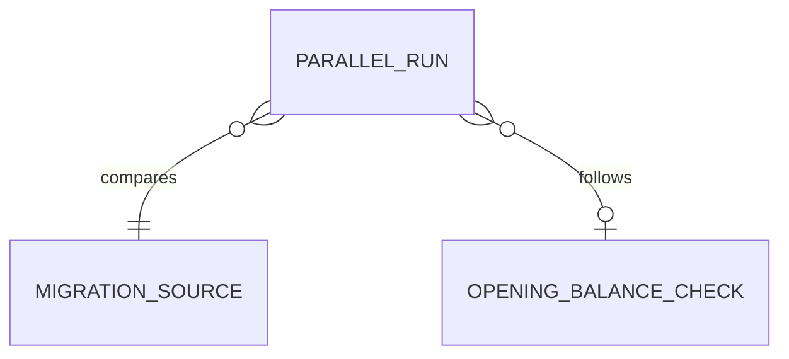
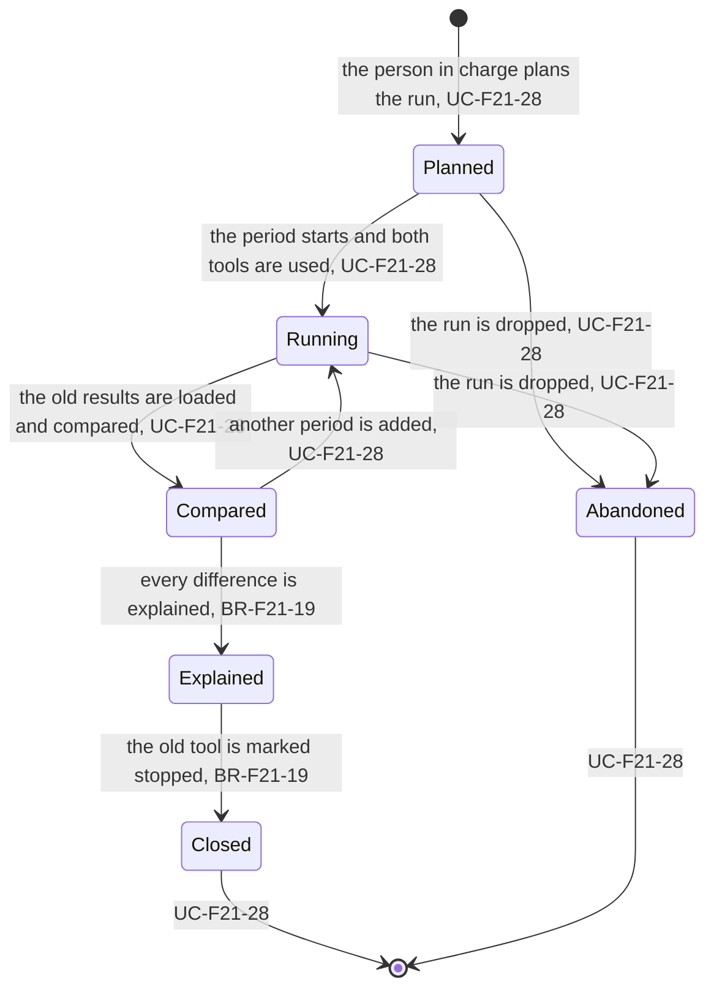

🏠 [Specs](../../../README.md) › 🧩 [Functional capabilities](../../README.md) ›
🧭 [F21 Onboarding and module activation](../README.md) › 🗃️ [Data](README.md) › 🗃️ E-F21-21 Parallel run

# 🗃️ E-F21-21 Parallel run

**Status:** ✅ specified

## Purpose

A period in which the old tool and simple-ERP are run side by side on the same transactions, with the figures compared
and the differences explained
([D540](../../../06-decisions/f21-onboarding-and-modules/d540-benchmark-gaps-f21-onboarding-and-modules.md)). It differs
from the opening balance check ([E-F21-15 Opening balance check](e-f21-15-opening-balance-check.md)), which compares
balances at one date: a parallel run compares a whole period of activity.

## Fields

| Name | Type | Required | Validation | Default | Example | Personal data | Custom fields |
|---|---|---|---|---|---|---|---|
| area | accounting, payroll, sales | yes | one of the three | - | accounting | no | no |
| period | month | yes | a closed month | - | 2026-10 | no | no |
| old tool | migration source (E-F21-14) | yes | a source of the company | - | Old invoicing tool | no | no |
| tolerance | amount | yes | 0 or more | 0.50 EUR | 0.50 EUR | no | no |
| measures | list of measure, old figure, new figure | no | loaded from the export | - | 42 measures | no | no |
| differences | number | no | computed | 0 | 3 | no | no |
| explained | number | no | 0 to the differences | 0 | 1 | no | no |
| old tool stopped on | date | no | set when explained | - | 2027-01-04 | no | no |
| state | Planned, Running, Compared, Explained, Closed, Abandoned | yes | the lifecycle below | Planned | Running | no | no |
| owner | user | yes | a user of the company | the creator | Claire P. | yes | no |

## Relations

- [E-F21-14 Migration source](e-f21-14-migration-source.md)
- [E-F21-15 Opening balance check](e-f21-15-opening-balance-check.md)
- [E-F21-07 Import job](e-f21-07-import-job.md)

## Lifecycle

## Indexes and search

By company, area, period, old tool, state and number of differences.

## Retention

Kept with the records of the year the period belongs to, 10 years for accounting
([CR-FR-002](../../../10-country-packs/france/accounting/cr-fr-002-accounting-records-kept-ten-years.md)).

## Audit

Every run, export loaded, difference, explanation, acceptance, correction and stopping.

## Import and export

Import: the old tool's export (CSV or the old tool's known format). Export: the comparison as a PDF report
for the accountant.

## Used by

- [UC-F21-28](../use-cases/06-experts-cutover-and-parallel-run/uc-f21-28-run-old-and-new-tools-in-parallel.md)

## Open questions

None.

---

⬅️ [E-F21-20 Cutover plan](e-f21-20-cutover-plan.md) · ⬆️ [Up](README.md)
