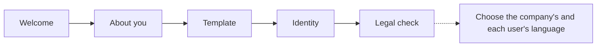

🏠 [Specs](../../../README.md) › 🧩 [Functional capabilities](../../README.md) ›
🧭 [F21 Onboarding and module activation](../README.md) › 🔀 [Flows](README.md) › 🔀 FL-F21-01 First run

# 🔀 FL-F21-01 First run

**Status:** ✅ specified

## Summary

Covers UC-F21-01, UC-F21-02, UC-F21-03, UC-F21-07, UC-F21-12, UC-F21-16.

## Personas

- [U13 Owner](../../../01-users/personas/u13-owner.md)
- [U01 Employee](../../../01-users/personas/u01-employee.md)

## Flowchart

## Sequence diagram

See each use case.

## Steps

| Step | Persona | Screen | Use case | What happens |
|---|---|---|---|---|
| 1 | U13 | [S-F21-01](../screens/01-first-run/s-f21-01-welcome.md) | [UC-F21-01](../use-cases/01-first-run/uc-f21-01-start-the-first-run-guide.md) | Start the first-run guide |
| 2 | U13 | [S-F21-02](../screens/01-first-run/s-f21-02-about-you.md) | [UC-F21-02](../use-cases/01-first-run/uc-f21-02-describe-the-company.md) | Describe the company |
| 3 | U13 | [S-F21-03](../screens/01-first-run/s-f21-03-templates.md) | [UC-F21-03](../use-cases/01-first-run/uc-f21-03-pick-a-sector-template.md) | Pick a sector template |
| 4 | U13 | [S-F21-07](../screens/01-first-run/s-f21-07-identity.md) | [UC-F21-07](../use-cases/01-first-run/uc-f21-07-set-the-company-identity-vat-and-bank.md) | Set the company identity, VAT and bank |
| 5 | U13 | [S-F21-12](../screens/01-first-run/s-f21-12-guide-assistant.md) | [UC-F21-12](../use-cases/01-first-run/uc-f21-12-ask-the-assistant-at-any-step.md) | Ask the AI assistant at any step |
| 6 | U13 | [S-F21-16](../screens/01-first-run/s-f21-16-legal-check.md) | [UC-F21-16](../use-cases/01-first-run/uc-f21-16-check-the-legal-set-up.md) | Check the legal set-up |
| 7 | U13, U01 | [S-F21-24](../screens/01-first-run/s-f21-24-languages.md) | [UC-F21-24](../use-cases/01-first-run/uc-f21-24-choose-the-companys-and-each-users-language.md) | Choose the company's and each user's language |

### Entities and screens

| Entity | States in this flow | Shown at step and screen | Aggregated view |
|---|---|---|---|
| [E-F21-02 Company profile](../data/e-f21-02-company-profile.md) | Active | 2 [S-F21-02](../screens/01-first-run/s-f21-02-about-you.md); 4 [S-F21-07](../screens/01-first-run/s-f21-07-identity.md) | Company profiles |
| [E-F21-03 Set-up template](../data/e-f21-03-set-up-template.md) | Active | 3 [S-F21-03](../screens/01-first-run/s-f21-03-templates.md) | Set-up templates |
| [E-F1-01 Company](../../f01-administration/data/e-f01-01-company.md) | In setup, Active | Shown elsewhere: [S-F1-10 Client companies](../../f01-administration/screens/08-provider-and-client-companies/s-f01-10-client-companies.md) | Companies |
| [E-F21-11 Legal check item](../data/e-f21-11-legal-check-item.md) | Missing, Completed | 6 [S-F21-16](../screens/01-first-run/s-f21-16-legal-check.md) | Legal check items |
| [E-F21-16 Language setting](../data/e-f21-16-language-setting.md) | Set, Changed | 7 [S-F21-24](../screens/01-first-run/s-f21-24-languages.md) | Language settings |
| [E-F18-17 Sector template](../../f18-hosted-websites-and-domains/data/e-f18-17-sector-template.md) | Published, Updated | Shown elsewhere: [S-F18-25 Sector templates](../../f18-hosted-websites-and-domains/screens/06-content-and-search/s-f18-25-sector-templates.md) | Sector templates |

## Errors

As each use case.

## Images

Every step and error, for each persona taking part, in light and dark mode (D120). Steps are numbered as in the Steps
table; E rows are the error cases.

| Step | Persona | Device | Light | Dark |
|---|---|---|---|---|
| 1 | U13 | desktop | [light](../images/01-first-run/u13-owner/1-welcome-desktop-light.png) | [dark](../images/01-first-run/u13-owner/1-welcome-desktop-dark.png) |
| 1 | U13 | phone | [light](../images/01-first-run/u13-owner/1-welcome-phone-light.png) | [dark](../images/01-first-run/u13-owner/1-welcome-phone-dark.png) |
| 2 | U13 | desktop | [light](../images/01-first-run/u13-owner/2-company-desktop-light.png) | [dark](../images/01-first-run/u13-owner/2-company-desktop-dark.png) |
| 2 | U13 | phone | [light](../images/01-first-run/u13-owner/2-company-phone-light.png) | [dark](../images/01-first-run/u13-owner/2-company-phone-dark.png) |
| 3 | U13 | desktop | [light](../images/01-first-run/u13-owner/3-template-desktop-light.png) | [dark](../images/01-first-run/u13-owner/3-template-desktop-dark.png) |
| 3 | U13 | phone | [light](../images/01-first-run/u13-owner/3-template-phone-light.png) | [dark](../images/01-first-run/u13-owner/3-template-phone-dark.png) |
| 4 | U13 | desktop | [light](../images/01-first-run/u13-owner/4-identity-desktop-light.png) | [dark](../images/01-first-run/u13-owner/4-identity-desktop-dark.png) |
| 4 | U13 | phone | [light](../images/01-first-run/u13-owner/4-identity-phone-light.png) | [dark](../images/01-first-run/u13-owner/4-identity-phone-dark.png) |
| 5 | U13 | desktop | [light](../images/01-first-run/u13-owner/5-assistant-desktop-light.png) | [dark](../images/01-first-run/u13-owner/5-assistant-desktop-dark.png) |
| 5 | U13 | phone | [light](../images/01-first-run/u13-owner/5-assistant-phone-light.png) | [dark](../images/01-first-run/u13-owner/5-assistant-phone-dark.png) |
| 6 | U13 | desktop | [light](../images/01-first-run/u13-owner/6-legal-check-desktop-light.png) | [dark](../images/01-first-run/u13-owner/6-legal-check-desktop-dark.png) |
| 6 | U13 | phone | [light](../images/01-first-run/u13-owner/6-legal-check-phone-light.png) | [dark](../images/01-first-run/u13-owner/6-legal-check-phone-dark.png) |
| E1 | U13 | desktop | [light](../images/01-first-run/u13-owner/e1-number-not-found-desktop-light.png) | [dark](../images/01-first-run/u13-owner/e1-number-not-found-desktop-dark.png) |
| E1 | U13 | phone | [light](../images/01-first-run/u13-owner/e1-number-not-found-phone-light.png) | [dark](../images/01-first-run/u13-owner/e1-number-not-found-phone-dark.png) |
| 7 | U13 | desktop | [light](../images/01-first-run/u13-owner/7-languages-desktop-light.png) | [dark](../images/01-first-run/u13-owner/7-languages-desktop-dark.png) |
| 7 | U13 | phone | [light](../images/01-first-run/u13-owner/7-languages-phone-light.png) | [dark](../images/01-first-run/u13-owner/7-languages-phone-dark.png) |
| 7 | U01 | desktop | [light](../images/01-first-run/u01-employee/7-languages-desktop-light.png) | [dark](../images/01-first-run/u01-employee/7-languages-desktop-dark.png) |
| 7 | U01 | phone | [light](../images/01-first-run/u01-employee/7-languages-phone-light.png) | [dark](../images/01-first-run/u01-employee/7-languages-phone-dark.png) |

## Open questions

None.

---

⬆️ [Up](README.md) · ➡️ [FL-F21-02 Modules](fl-f21-02-modules.md)
