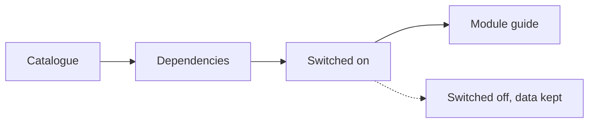

🏠 [Specs](../../../README.md) › 🧩 [Functional capabilities](../../README.md) ›
🧭 [F21 Onboarding and module activation](../README.md) › 🔀 [Flows](README.md) › 🔀 FL-F21-02 Modules

# 🔀 FL-F21-02 Modules

**Status:** ✅ specified

## Summary

Covers UC-F21-04, UC-F21-05, UC-F21-06, UC-F21-11, UC-F21-18.

## Personas

- [U07 Administrator](../../../01-users/personas/u07-administrator.md)
- [U13 Owner](../../../01-users/personas/u13-owner.md)

## Flowchart

## Sequence diagram

See each use case.

## Steps

| Step | Persona | Screen | Use case | What happens |
|---|---|---|---|---|
| 1 | U07, U13 | [S-F21-04](../screens/02-modules/s-f21-04-modules.md) | [UC-F21-04](../use-cases/02-modules/uc-f21-04-switch-modules-on-in-one-click.md) | Switch modules on in one click |
| 2 | U07 | [S-F21-05](../screens/02-modules/s-f21-05-dependencies.md) | [UC-F21-05](../use-cases/02-modules/uc-f21-05-understand-a-module-s-dependencies.md) | Understand a module's dependencies |
| 3 | U07 | [S-F21-06](../screens/02-modules/s-f21-06-switch-off.md) | [UC-F21-06](../use-cases/02-modules/uc-f21-06-switch-a-module-off-and-keep-its-data.md) | Switch a module off and keep its data |
| 4 | U07 | [S-F21-11](../screens/02-modules/s-f21-11-module-guide.md) | [UC-F21-11](../use-cases/02-modules/uc-f21-11-follow-a-module-s-short-guide.md) | Follow a module's short guide |
| 5 | U13 | [S-F21-18](../screens/02-modules/s-f21-18-prices.md) | [UC-F21-18](../use-cases/02-modules/uc-f21-18-see-what-each-module-costs-in-the-hosted-edition.md) | See what each module costs in the hosted edition |

### Entities and screens

| Entity | States in this flow | Shown at step and screen | Aggregated view |
|---|---|---|---|
| [E-F21-04 Module activation](../data/e-f21-04-module-activation.md) | On | 1 [S-F21-04](../screens/02-modules/s-f21-04-modules.md); 2 [S-F21-05](../screens/02-modules/s-f21-05-dependencies.md); 3 [S-F21-06](../screens/02-modules/s-f21-06-switch-off.md); 4 [S-F21-11](../screens/02-modules/s-f21-11-module-guide.md); 5 [S-F21-18](../screens/02-modules/s-f21-18-prices.md) | Module activations |
| [E-F21-05 Module dependency](../data/e-f21-05-module-dependency.md) | Active | 2 [S-F21-05](../screens/02-modules/s-f21-05-dependencies.md) | Module dependencies |
| [E-F21-18 Module guide](../data/e-f21-18-module-guide.md) | Active | 4 [S-F21-11](../screens/02-modules/s-f21-11-module-guide.md) | Module guides |

## Errors

As each use case.

## Images

Every step and error, for each persona taking part, in light and dark mode (D120). Steps are numbered as in the Steps
table; E rows are the error cases.

| Step | Persona | Device | Light | Dark |
|---|---|---|---|---|
| 1 | U07 | desktop | [light](../images/02-modules/u07-administrator/1-catalogue-desktop-light.png) | [dark](../images/02-modules/u07-administrator/1-catalogue-desktop-dark.png) |
| 1 | U13 | desktop | [light](../images/02-modules/u13-owner/1-catalogue-desktop-light.png) | [dark](../images/02-modules/u13-owner/1-catalogue-desktop-dark.png) |
| 1 | U13 | phone | [light](../images/02-modules/u13-owner/1-catalogue-phone-light.png) | [dark](../images/02-modules/u13-owner/1-catalogue-phone-dark.png) |
| 2 | U07 | desktop | [light](../images/02-modules/u07-administrator/2-dependencies-desktop-light.png) | [dark](../images/02-modules/u07-administrator/2-dependencies-desktop-dark.png) |
| 3 | U07 | desktop | [light](../images/02-modules/u07-administrator/3-switch-off-desktop-light.png) | [dark](../images/02-modules/u07-administrator/3-switch-off-desktop-dark.png) |
| 4 | U07 | desktop | [light](../images/02-modules/u07-administrator/4-module-guide-desktop-light.png) | [dark](../images/02-modules/u07-administrator/4-module-guide-desktop-dark.png) |
| 5 | U13 | desktop | [light](../images/02-modules/u13-owner/5-prices-desktop-light.png) | [dark](../images/02-modules/u13-owner/5-prices-desktop-dark.png) |
| 5 | U13 | phone | [light](../images/02-modules/u13-owner/5-prices-phone-light.png) | [dark](../images/02-modules/u13-owner/5-prices-phone-dark.png) |
| E1 | U07 | desktop | [light](../images/02-modules/u07-administrator/e1-needed-desktop-light.png) | [dark](../images/02-modules/u07-administrator/e1-needed-desktop-dark.png) |

## Open questions

None.

---

⬅️ [FL-F21-01 First run](fl-f21-01-first-run.md) · ⬆️ [Up](README.md) ·
➡️ [FL-F21-03 Team and data](fl-f21-03-team-and-data.md)
