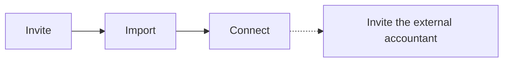
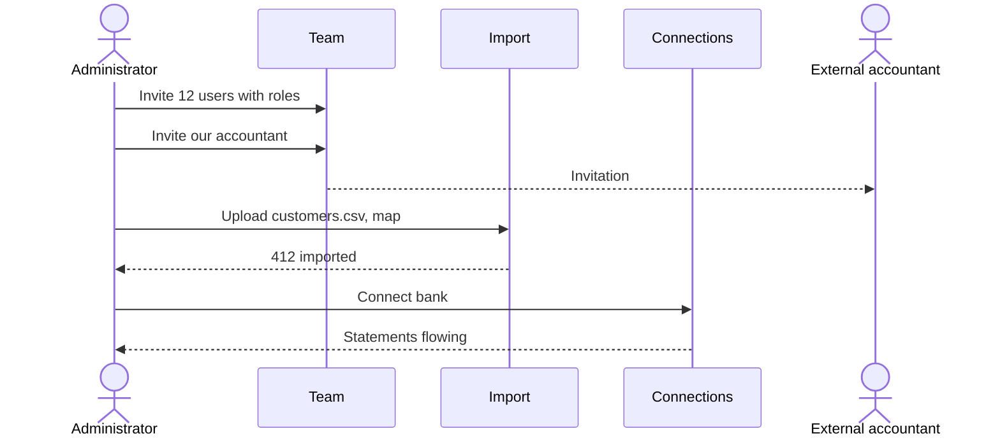

🏠 [Specs](../../../README.md) › 🧩 [Functional capabilities](../../README.md) ›
🧭 [F21 Onboarding and module activation](../README.md) › 🔀 [Flows](README.md) › 🔀 FL-F21-03 Team and data

# 🔀 FL-F21-03 Team and data

**Status:** ✅ specified

## Summary

The administrator brings the team and the data: invites users with their roles (UC-F21-08), invites the external
accountant (UC-F21-23), imports existing data with a mapping or from a named tool (UC-F21-09, FL-F21-05), and connects
email, calendar and bank (UC-F21-10); every step can be left and resumed (BR-F21-06), and the AI assistant helps at each
one (BR-F21-09).

## Personas

- [U07 Administrator](../../../01-users/personas/u07-administrator.md)
- [U08 External accountant](../../../01-users/personas/u08-external-accountant.md)
- [U13 Owner](../../../01-users/personas/u13-owner.md)

## Flowchart

## Sequence diagram

## Steps

| Step | Persona | Screen | Use case | What happens |
|---|---|---|---|---|
| 1 | U07 | [S-F21-08](../screens/03-team-and-data/s-f21-08-team.md) | [UC-F21-08](../use-cases/03-team-and-data/uc-f21-08-invite-users-and-give-roles.md) | Invite users and give roles |
| 2 | U07 | [S-F21-09](../screens/03-team-and-data/s-f21-09-import.md) | [UC-F21-09](../use-cases/03-team-and-data/uc-f21-09-import-existing-data.md) | Import existing data |
| 3 | U07 | [S-F21-10](../screens/03-team-and-data/s-f21-10-connections.md) | [UC-F21-10](../use-cases/03-team-and-data/uc-f21-10-connect-email-calendar-and-bank.md) | Connect email, calendar and bank |
| 4 | U13, U08 | [S-F21-23](../screens/03-team-and-data/s-f21-23-invite-your-accountant.md) | [UC-F21-23](../use-cases/03-team-and-data/uc-f21-23-invite-the-external-accountant.md) | Invite the external accountant |

### Entities and screens

| Entity | States in this flow | Shown at step and screen | Aggregated view |
|---|---|---|---|
| [E-F21-07 Import job](../data/e-f21-07-import-job.md) | Active | 2 [S-F21-09](../screens/03-team-and-data/s-f21-09-import.md) | Import jobs |

## Errors

E1: an invitation bounces: it shows "not delivered" with the reason and can be resent (step 1). E2: the accountant
already has an account in another company: the invitation links it to this company with the accountant role (step 2).
E3: an import file has errors: the rows in error are listed and the rest can be imported or the file fixed and uploaded
again (step 3). E4: a bank connection is refused by the bank: the reason is shown and statements can be uploaded by hand
meanwhile (step 4).

## Images

Every step and error, for each persona taking part, in light and dark mode (D120). Steps are numbered as in the Steps
table; E rows are the error cases.

| Step | Persona | Device | Light | Dark |
|---|---|---|---|---|
| 1 | U07 | desktop | [light](../images/03-team-and-data/u07-administrator/1-invite-desktop-light.png) | [dark](../images/03-team-and-data/u07-administrator/1-invite-desktop-dark.png) |
| 2 | U07 | desktop | [light](../images/03-team-and-data/u07-administrator/2-import-desktop-light.png) | [dark](../images/03-team-and-data/u07-administrator/2-import-desktop-dark.png) |
| 3 | U07 | desktop | [light](../images/03-team-and-data/u07-administrator/3-connect-desktop-light.png) | [dark](../images/03-team-and-data/u07-administrator/3-connect-desktop-dark.png) |
| E1 | U07 | desktop | [light](../images/03-team-and-data/u07-administrator/e1-import-errors-desktop-light.png) | [dark](../images/03-team-and-data/u07-administrator/e1-import-errors-desktop-dark.png) |
| 4 | U13 | desktop | [light](../images/03-team-and-data/u13-owner/4-invite-your-accountant-desktop-light.png) | [dark](../images/03-team-and-data/u13-owner/4-invite-your-accountant-desktop-dark.png) |
| 4 | U13 | phone | [light](../images/03-team-and-data/u13-owner/4-invite-your-accountant-phone-light.png) | [dark](../images/03-team-and-data/u13-owner/4-invite-your-accountant-phone-dark.png) |
| 4 | U08 | desktop | [light](../images/03-team-and-data/u08-external-accountant/4-invite-your-accountant-desktop-light.png) | [dark](../images/03-team-and-data/u08-external-accountant/4-invite-your-accountant-desktop-dark.png) |

## Open questions

None.

---

⬅️ [FL-F21-02 Modules](fl-f21-02-modules.md) · ⬆️ [Up](README.md) ·
➡️ [FL-F21-04 Learn and improve](fl-f21-04-learn-and-improve.md)
