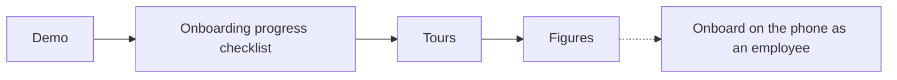

🏠 [Specs](../../../README.md) › 🧩 [Functional capabilities](../../README.md) ›
🧭 [F21 Onboarding and module activation](../README.md) › 🔀 [Flows](README.md) › 🔀 FL-F21-04 Learn and improve

# 🔀 FL-F21-04 Learn and improve

**Status:** ✅ specified

## Summary

Covers UC-F21-13, UC-F21-14, UC-F21-15, UC-F21-17, UC-F21-19, UC-F21-20.

## Personas

- [U01 Employee](../../../01-users/personas/u01-employee.md)
- [U11 IT provider administrator](../../../01-users/personas/u11-provider-admin.md)
- [U13 Owner](../../../01-users/personas/u13-owner.md)
- [U48 Hosting engineer](../../../01-users/personas/u48-hosting-engineer.md)

## Flowchart

## Sequence diagram

See each use case.

## Steps

| Step | Persona | Screen | Use case | What happens |
|---|---|---|---|---|
| 1 | U13 | [S-F21-13](../screens/04-learn-and-improve/s-f21-13-demo-data.md) | [UC-F21-13](../use-cases/04-learn-and-improve/uc-f21-13-try-with-demo-data-then-clear-it.md) | Try with demo data, then clear it |
| 2 | U13 | [S-F21-14](../screens/04-learn-and-improve/s-f21-14-checklist.md) | [UC-F21-14](../use-cases/04-learn-and-improve/uc-f21-14-follow-the-checklist-and-resume-later.md) | Follow the checklist and resume later |
| 3 | U01 | [S-F21-15](../screens/04-learn-and-improve/s-f21-15-tours.md) | [UC-F21-15](../use-cases/04-learn-and-improve/uc-f21-15-take-an-interactive-tour-of-a-screen.md) | Take an interactive tour of a screen |
| 4 | U01 | [S-F21-17](../screens/04-learn-and-improve/s-f21-17-first-sign-in.md) | [UC-F21-17](../use-cases/04-learn-and-improve/uc-f21-17-welcome-an-employee-at-first-sign-in.md) | Welcome an employee at first sign-in |
| 5 | U11 | [S-F21-19](../screens/04-learn-and-improve/s-f21-19-provider-templates.md) | [UC-F21-19](../use-cases/04-learn-and-improve/uc-f21-19-reuse-a-set-up-for-several-clients.md) | Reuse a set-up for several clients |
| 6 | U48, U13 | [S-F21-20](../screens/04-learn-and-improve/s-f21-20-onboarding-figures.md) | [UC-F21-20](../use-cases/04-learn-and-improve/uc-f21-20-measure-onboarding-and-drop-offs.md) | Measure onboarding and drop-offs |
| 7 | U01 | [S-F21-25](../screens/04-learn-and-improve/s-f21-25-phone-onboarding.md) | [UC-F21-25](../use-cases/04-learn-and-improve/uc-f21-25-onboard-on-the-phone-as-an-employee.md) | Onboard on the phone as an employee |

### Entities and screens

| Entity | States in this flow | Shown at step and screen | Aggregated view |
|---|---|---|---|
| [E-F21-09 Demo data set](../data/e-f21-09-demo-data-set.md) | Active | 1 [S-F21-13](../screens/04-learn-and-improve/s-f21-13-demo-data.md) | Demo data sets |
| [E-F21-01 Onboarding progress](../data/e-f21-01-onboarding-progress.md) | Done, Closed | 2 [S-F21-14](../screens/04-learn-and-improve/s-f21-14-checklist.md); 7 [S-F21-25](../screens/04-learn-and-improve/s-f21-25-phone-onboarding.md) | Onboarding progresses |
| [E-F21-10 Tour](../data/e-f21-10-tour.md) | Active | 3 [S-F21-15](../screens/04-learn-and-improve/s-f21-15-tours.md); 4 [S-F21-17](../screens/04-learn-and-improve/s-f21-17-first-sign-in.md) | Tours |
| [E-F21-13 Onboarding figure](../data/e-f21-13-onboarding-figure.md) | Recorded | 6 [S-F21-20](../screens/04-learn-and-improve/s-f21-20-onboarding-figures.md) | Onboarding figures |

## Errors

As each use case.

## Images

Every step and error, for each persona taking part, in light and dark mode (D120). Steps are numbered as in the Steps
table; E rows are the error cases.

| Step | Persona | Device | Light | Dark |
|---|---|---|---|---|
| 1 | U13 | desktop | [light](../images/04-learn-and-improve/u13-owner/1-demo-desktop-light.png) | [dark](../images/04-learn-and-improve/u13-owner/1-demo-desktop-dark.png) |
| 1 | U13 | phone | [light](../images/04-learn-and-improve/u13-owner/1-demo-phone-light.png) | [dark](../images/04-learn-and-improve/u13-owner/1-demo-phone-dark.png) |
| 2 | U13 | desktop | [light](../images/04-learn-and-improve/u13-owner/2-checklist-desktop-light.png) | [dark](../images/04-learn-and-improve/u13-owner/2-checklist-desktop-dark.png) |
| 2 | U13 | phone | [light](../images/04-learn-and-improve/u13-owner/2-checklist-phone-light.png) | [dark](../images/04-learn-and-improve/u13-owner/2-checklist-phone-dark.png) |
| 3 | U01 | desktop | [light](../images/04-learn-and-improve/u01-employee/3-tour-desktop-light.png) | [dark](../images/04-learn-and-improve/u01-employee/3-tour-desktop-dark.png) |
| 3 | U01 | phone | [light](../images/04-learn-and-improve/u01-employee/3-tour-phone-light.png) | [dark](../images/04-learn-and-improve/u01-employee/3-tour-phone-dark.png) |
| 4 | U01 | desktop | [light](../images/04-learn-and-improve/u01-employee/4-first-sign-in-desktop-light.png) | [dark](../images/04-learn-and-improve/u01-employee/4-first-sign-in-desktop-dark.png) |
| 4 | U01 | phone | [light](../images/04-learn-and-improve/u01-employee/4-first-sign-in-phone-light.png) | [dark](../images/04-learn-and-improve/u01-employee/4-first-sign-in-phone-dark.png) |
| 5 | U11 | desktop | [light](../images/04-learn-and-improve/u11-provider-admin/5-provider-template-desktop-light.png) | [dark](../images/04-learn-and-improve/u11-provider-admin/5-provider-template-desktop-dark.png) |
| 6 | U48 | desktop | [light](../images/04-learn-and-improve/u48-hosting-engineer/6-figures-desktop-light.png) | [dark](../images/04-learn-and-improve/u48-hosting-engineer/6-figures-desktop-dark.png) |
| 6 | U48 | phone | [light](../images/04-learn-and-improve/u48-hosting-engineer/6-figures-phone-light.png) | [dark](../images/04-learn-and-improve/u48-hosting-engineer/6-figures-phone-dark.png) |
| 6 | U13 | desktop | [light](../images/04-learn-and-improve/u13-owner/6-figures-desktop-light.png) | [dark](../images/04-learn-and-improve/u13-owner/6-figures-desktop-dark.png) |
| 6 | U13 | phone | [light](../images/04-learn-and-improve/u13-owner/6-figures-phone-light.png) | [dark](../images/04-learn-and-improve/u13-owner/6-figures-phone-dark.png) |
| E1 | U13 | desktop | [light](../images/04-learn-and-improve/u13-owner/e1-clear-failed-desktop-light.png) | [dark](../images/04-learn-and-improve/u13-owner/e1-clear-failed-desktop-dark.png) |
| E1 | U13 | phone | [light](../images/04-learn-and-improve/u13-owner/e1-clear-failed-phone-light.png) | [dark](../images/04-learn-and-improve/u13-owner/e1-clear-failed-phone-dark.png) |
| 7 | U01 | desktop | [light](../images/04-learn-and-improve/u01-employee/7-phone-onboarding-desktop-light.png) | [dark](../images/04-learn-and-improve/u01-employee/7-phone-onboarding-desktop-dark.png) |
| 7 | U01 | phone | [light](../images/04-learn-and-improve/u01-employee/7-phone-onboarding-phone-light.png) | [dark](../images/04-learn-and-improve/u01-employee/7-phone-onboarding-phone-dark.png) |

## Open questions

None.

---

⬅️ [FL-F21-03 Team and data](fl-f21-03-team-and-data.md) · ⬆️ [Up](README.md) ·
➡️ [FL-F21-05 Migration from another tool](fl-f21-05-migration-from-another-tool.md)
