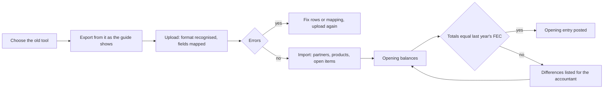
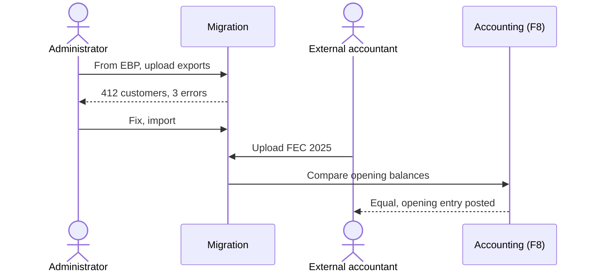

🏠 [Specs](../../../README.md) › 🧩 [Functional capabilities](../../README.md) ›
🧭 [F21 Onboarding and module activation](../README.md) › 🔀 [Flows](README.md) ›
🔀 FL-F21-05 Migration from another tool

# 🔀 FL-F21-05 Migration from another tool

**Status:** ✅ specified

## Summary

A company coming from another tool (EBP, Sage, Pennylane, Excel, QuickBooks, NetSuite, Odoo, ERPNext) brings its
customers, suppliers, products, open items and balances with the tool's known format, and its accountant checks the
opening balances against last year's FEC before the first closing (D478).

## Personas

- [U07 Administrator](../../../01-users/personas/u07-administrator.md)
- [U08 External accountant](../../../01-users/personas/u08-external-accountant.md)
- [U05 Accounting](../../../01-users/personas/u05-accounting.md)
- [U13 Owner](../../../01-users/personas/u13-owner.md)

## Flowchart

## Sequence diagram

## Steps

| Step | Persona | Screen | Use case | What happens |
|---|---|---|---|---|
| 1 | U07, U08 | [S-F21-21](../screens/05-migration-from-another-tool/s-f21-21-migration.md) | [UC-F21-21](../use-cases/05-migration-from-another-tool/uc-f21-21-migrate-from-a-named-tool.md) | Migrate from a named tool |
| 2 | U08, U05 | [S-F21-22](../screens/05-migration-from-another-tool/s-f21-22-opening-balance-check.md) | [UC-F21-22](../use-cases/05-migration-from-another-tool/uc-f21-22-check-opening-balances-against-last-years-fec.md) | Check opening balances against last year's FEC |

### Entities and screens

| Entity | States in this flow | Shown at step and screen | Aggregated view |
|---|---|---|---|
| [E-F21-14 Migration source](../data/e-f21-14-migration-source.md) | Uploaded, Mapped, Errors | 1 [S-F21-21](../screens/05-migration-from-another-tool/s-f21-21-migration.md) | Migration sources |
| [E-F21-17 Migration guide](../data/e-f21-17-migration-guide.md) | Active | 1 [S-F21-21](../screens/05-migration-from-another-tool/s-f21-21-migration.md) | Migration guides |
| [E-F21-07 Import job](../data/e-f21-07-import-job.md) | Active | 1 [S-F21-21](../screens/05-migration-from-another-tool/s-f21-21-migration.md) | Import jobs |
| [E-F6-01 Customer record](../../f06-customers-and-sales/data/e-f06-01-customer-record.md) | Accepted, Active | Shown elsewhere: [S-F6-04 Customer portal](../../f06-customers-and-sales/screens/02-quote-to-order/s-f06-04-customer-portal.md) | Customer records |
| [E-F7-06 Item](../../f07-purchasing-and-stock/data/e-f07-06-item.md) | Active | Shown elsewhere: [S-F7-21 Stock levels](../../f07-purchasing-and-stock/screens/03-replenish/s-f07-21-stock-levels.md) | Items |
| [E-F6-05 Invoice](../../f06-customers-and-sales/data/e-f06-05-invoice.md) | Sent, Received, Refused, Paid, Draft, Issued, Partly paid, Overdue | Shown elsewhere: [S-F6-06 Invoice](../../f06-customers-and-sales/screens/03-invoice-and-get-paid/s-f06-06-invoice.md) | Invoices |
| [E-F21-15 Opening balance check](../data/e-f21-15-opening-balance-check.md) | Compared, Equal, Differences | 2 [S-F21-22](../screens/05-migration-from-another-tool/s-f21-22-opening-balance-check.md) | Opening balance checks |
| [E-F8-27 FEC file](../../f08-accounting/data/e-f08-27-fec-file.md) | Active | 2 [S-F21-22](../screens/05-migration-from-another-tool/s-f21-22-opening-balance-check.md) | FEC files |
| [E-F8-03 Journal entry](../../f08-accounting/data/e-f08-03-journal-entry.md) | Posted | Shown elsewhere: [S-F8-02 Journal entries](../../f08-accounting/screens/01-set-up-and-post/s-f08-02-journal-entries.md) | Journal entries |

## Errors

E1: an export file from an unsupported version: the generic import with mapping is offered (UC-F21-09) (step 1). E2:
totals differ from the FEC: the opening entry is not posted until the accountant explains or corrects each difference
(step 2).

## Images

Every step and error, for each persona taking part, in light and dark mode (D120). Steps are numbered as in the Steps
table; E rows are the error cases.

| Step | Persona | Device | Light | Dark |
|---|---|---|---|---|
| 1 | U07 | desktop | [light](../images/05-migration-from-another-tool/u07-administrator/1-migration-desktop-light.png) | [dark](../images/05-migration-from-another-tool/u07-administrator/1-migration-desktop-dark.png) |
| 1 | U08 | desktop | [light](../images/05-migration-from-another-tool/u08-external-accountant/1-migration-desktop-light.png) | [dark](../images/05-migration-from-another-tool/u08-external-accountant/1-migration-desktop-dark.png) |
| 2 | U08 | desktop | [light](../images/05-migration-from-another-tool/u08-external-accountant/2-opening-balance-check-desktop-light.png) | [dark](../images/05-migration-from-another-tool/u08-external-accountant/2-opening-balance-check-desktop-dark.png) |
| 2 | U05 | desktop | [light](../images/05-migration-from-another-tool/u05-accounting/2-opening-balance-check-desktop-light.png) | [dark](../images/05-migration-from-another-tool/u05-accounting/2-opening-balance-check-desktop-dark.png) |
| E1 | U07 | desktop | [light](../images/05-migration-from-another-tool/u07-administrator/e1-migration-refused-desktop-light.png) | [dark](../images/05-migration-from-another-tool/u07-administrator/e1-migration-refused-desktop-dark.png) |

## Open questions

None.

---

⬅️ [FL-F21-04 Learn and improve](fl-f21-04-learn-and-improve.md) · ⬆️ [Up](README.md) ·
➡️ [FL-F21-06 Experts, cutover, parallel run and set-up from documents](fl-f21-06-experts-cutover-and-parallel-run.md)
