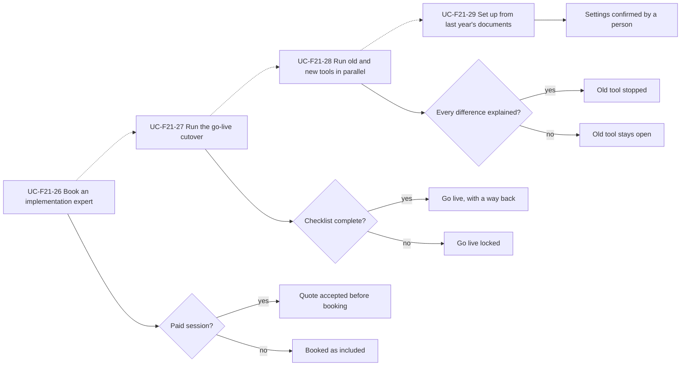
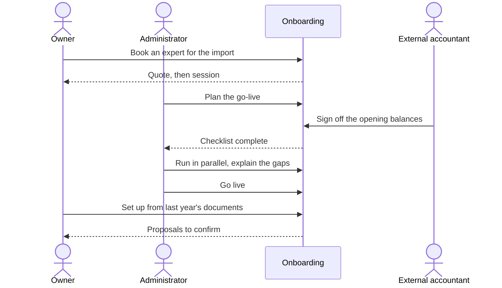

🏠 [Specs](../../../README.md) › 🧩 [Functional capabilities](../../README.md) ›
🧭 [F21 Onboarding and module activation](../README.md) › 🔀 [Flows](README.md) ›
🔀 FL-F21-06 Experts, cutover, parallel run and set-up from documents

# 🔀 FL-F21-06 Experts, cutover, parallel run and set-up from documents

**Status:** 🔄 waiting for the owner

## Summary

The owner books a session with an implementation expert at a price known before, the administrator runs the go-live only
when the checklist is complete, accounting and payroll run the old and the new tool in parallel until every difference
is explained, and the owner can start from last year's documents with the AI assistant proposing settings that a person
confirms ([D540](../../../06-decisions/f21-onboarding-and-modules/d540-benchmark-gaps-f21-onboarding-and-modules.md)).

## Personas

- [U13 Owner](../../../01-users/personas/u13-owner.md), who books experts and sets up from documents
- [U07 Administrator](../../../01-users/personas/u07-administrator.md), who runs the go-live
- [U08 External accountant](../../../01-users/personas/u08-external-accountant.md), who signs off the accounting steps
- [U05 Accounting](../../../01-users/personas/u05-accounting.md), who explains the accounting differences
- [U45 Payroll officer](../../../01-users/personas/u45-payroll-officer.md), who explains the payroll differences

## Flowchart

## Sequence diagram

## Steps

| Step | Persona | Screen | Use case | What happens |
|---|---|---|---|---|
| 1 | [U13](../../../01-users/personas/u13-owner.md) | [S-F21-26](../screens/06-experts-cutover-and-parallel-run/s-f21-26-expert-booking.md) | [UC-F21-26](../use-cases/06-experts-cutover-and-parallel-run/uc-f21-26-book-an-implementation-expert.md) | The owner books an implementation expert, with a quote first when the session is paid |
| 2 | [U07](../../../01-users/personas/u07-administrator.md) | [S-F21-27](../screens/06-experts-cutover-and-parallel-run/s-f21-27-cutover.md) | [UC-F21-27](../use-cases/06-experts-cutover-and-parallel-run/uc-f21-27-run-the-go-live-cutover.md) | The administrator runs the go-live, which unlocks only when the checklist is complete |
| 3 | [U05](../../../01-users/personas/u05-accounting.md) | [S-F21-28](../screens/06-experts-cutover-and-parallel-run/s-f21-28-parallel-run.md) | [UC-F21-28](../use-cases/06-experts-cutover-and-parallel-run/uc-f21-28-run-old-and-new-tools-in-parallel.md) | Accounting and the payroll officer run both tools in parallel and explain every difference |
| 4 | [U13](../../../01-users/personas/u13-owner.md) | [S-F21-29](../screens/06-experts-cutover-and-parallel-run/s-f21-29-setup-from-documents.md) | [UC-F21-29](../use-cases/06-experts-cutover-and-parallel-run/uc-f21-29-set-up-from-last-years-documents.md) | The owner uploads last year's documents and confirms the settings the AI assistant proposes |

### Entities and screens

| Entity | States in this flow | Shown at step and screen | Aggregated view |
|---|---|---|---|
| [E-F21-19 Expert session](../data/e-f21-19-expert-session.md) | Quoted, Booked, Declined, Held, Cancelled | 1 [S-F21-26](../screens/06-experts-cutover-and-parallel-run/s-f21-26-expert-booking.md) | Expert sessions |
| [E-F21-20 Cutover plan](../data/e-f21-20-cutover-plan.md) | Draft, Ready, Live, Rolled back, Closed | 2 [S-F21-27](../screens/06-experts-cutover-and-parallel-run/s-f21-27-cutover.md) | Cutover plans |
| [E-F21-21 Parallel run](../data/e-f21-21-parallel-run.md) | Planned, Running, Compared, Explained, Closed, Abandoned | 3 [S-F21-28](../screens/06-experts-cutover-and-parallel-run/s-f21-28-parallel-run.md) | Parallel runs |

## Errors

- **E1 The checklist is incomplete.** Go live stays locked and names each open required step and its owner
  ([BR-F21-18](../business-rules/br-f21-18-go-live-waits-for-a-complete-checklist.md), step 2).

## Images

Every step and error, for each persona taking part, in light and dark mode (D120). Steps are numbered as in the Steps
table; E rows are the error cases.

| Step | Persona | Device | Light | Dark |
|---|---|---|---|---|
| 1 | U13 | desktop | [light](../images/06-experts-cutover-and-parallel-run/u13-owner/1-expert-booking-desktop-light.png) | [dark](../images/06-experts-cutover-and-parallel-run/u13-owner/1-expert-booking-desktop-dark.png) |
| 1 | U13 | phone | [light](../images/06-experts-cutover-and-parallel-run/u13-owner/1-expert-booking-phone-light.png) | [dark](../images/06-experts-cutover-and-parallel-run/u13-owner/1-expert-booking-phone-dark.png) |
| 2 | U07 | desktop | [light](../images/06-experts-cutover-and-parallel-run/u07-administrator/2-cutover-desktop-light.png) | [dark](../images/06-experts-cutover-and-parallel-run/u07-administrator/2-cutover-desktop-dark.png) |
| 2 | U08 | desktop | [light](../images/06-experts-cutover-and-parallel-run/u08-external-accountant/2-cutover-desktop-light.png) | [dark](../images/06-experts-cutover-and-parallel-run/u08-external-accountant/2-cutover-desktop-dark.png) |
| 3 | U05 | desktop | [light](../images/06-experts-cutover-and-parallel-run/u05-accounting/3-parallel-run-desktop-light.png) | [dark](../images/06-experts-cutover-and-parallel-run/u05-accounting/3-parallel-run-desktop-dark.png) |
| 3 | U45 | desktop | [light](../images/06-experts-cutover-and-parallel-run/u45-payroll-officer/3-parallel-run-desktop-light.png) | [dark](../images/06-experts-cutover-and-parallel-run/u45-payroll-officer/3-parallel-run-desktop-dark.png) |
| 4 | U13 | desktop | [light](../images/06-experts-cutover-and-parallel-run/u13-owner/4-setup-from-documents-desktop-light.png) | [dark](../images/06-experts-cutover-and-parallel-run/u13-owner/4-setup-from-documents-desktop-dark.png) |
| 4 | U13 | phone | [light](../images/06-experts-cutover-and-parallel-run/u13-owner/4-setup-from-documents-phone-light.png) | [dark](../images/06-experts-cutover-and-parallel-run/u13-owner/4-setup-from-documents-phone-dark.png) |
| E1 | U13 | desktop | [light](../images/06-experts-cutover-and-parallel-run/u13-owner/e1-the-checklist-is-incomplete-desktop-light.png) | [dark](../images/06-experts-cutover-and-parallel-run/u13-owner/e1-the-checklist-is-incomplete-desktop-dark.png) |
| E1 | U13 | phone | [light](../images/06-experts-cutover-and-parallel-run/u13-owner/e1-the-checklist-is-incomplete-phone-light.png) | [dark](../images/06-experts-cutover-and-parallel-run/u13-owner/e1-the-checklist-is-incomplete-phone-dark.png) |

## Open questions

None.

---

⬅️ [FL-F21-05 Migration from another tool](fl-f21-05-migration-from-another-tool.md) · ⬆️ [Up](README.md)
