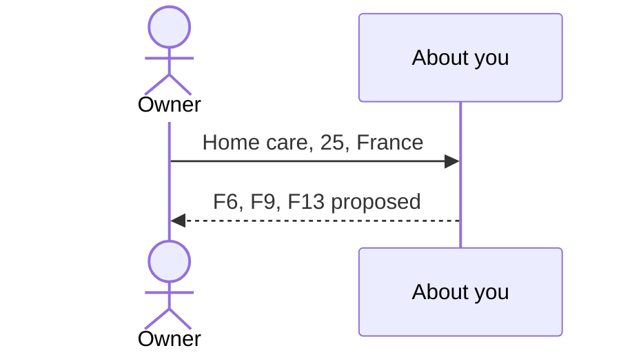

🏠 [Specs](../../../../README.md) › 🧩 [Functional capabilities](../../../README.md) ›
🧭 [F21 Onboarding and module activation](../../README.md) › 📝 [Use cases](../README.md) ›
📝 [Use cases: FL-F21-01 First run](README.md) › 📝 UC-F21-02 Describe the company

# 📝 UC-F21-02 Describe the company

**Status:** ✅ specified

## Summary

The owner describes the company (sector, size, country) and sees the proposed set-up.

## Personas

- [U13 Owner](../../../../01-users/personas/u13-owner.md)

## Goal

A set-up that fits.

## Trigger

Guide.

## Frequency

Once.

## Preconditions

- Guide started.

## Postconditions

- Success: profile saved.
- Failure: none.

## Main flow

1. Answer (S-F21-02).
2. The AI assistant fills from documents (BR-F21-09).
3. See the proposed set-up.
4. Confirm.

## Alternative flows

- 2a. From SIRENE.

## Error flows

- 2e. Unknown SIRET: typed.
- Any step: a service does not answer; the call is retried first (BR-F3-32), then the message follows the error pattern
  (D122) and what was typed stays on the screen.

## Business rules

- [BR-F21-05 Plain words with examples](../../business-rules/br-f21-05-plain-words-with-examples.md)
- [BR-F21-09 The AI assistant at every step](../../business-rules/br-f21-09-assistant-at-every-step.md)

## Entities

- [E-F21-02 Company profile](../../data/e-f21-02-company-profile.md)

## Permissions

Owner.

## Notifications

- None.

## Audit events

Answers.

## AI involvement

Fills in.

## API, MCP and A2A exposure

Through T5 and T6 with the caller's rights (BR-F3-34).

## Screens

- [S-F21-02 About you](../../screens/01-first-run/s-f21-02-about-you.md)

## Flowchart

See [FL-F21-01 First run](../../flows/fl-f21-01-first-run.md#flowchart).

## Sequence diagram

## Acceptance criteria

1. **Given** home care, 25 **when** answered **then** F6, F9, F13 proposed.
2. **Given** a SIRET **when** typed **then** filled.
3. **Given** unknown **when** typed **then** manual.

## Non-functional notes

D408's targets ([Performance](../../../../05-non-functional/performance.md)): 95 % of screens within 1 second; lists
paged on the server, the first page within 1 second; reports within 5 seconds or in the background.

## Regulatory references

Set-up rules of the France country pack:
[CR-FR-001 Company identifiers](../../../../10-country-packs/france/company/cr-fr-001-company-identifiers.md),
[CR-FR-016 Electronic invoicing](../../../../10-country-packs/france/invoicing/cr-fr-016-electronic-invoicing.md),
[CR-FR-005 Accounting entries file (FEC)](../../../../10-country-packs/france/accounting/cr-fr-005-fec-export.md),
[CR-FR-038 Personnel register](../../../../10-country-packs/france/labour/cr-fr-038-personnel-register.md),
[CR-FR-048 Record of processing activities](../../../../10-country-packs/france/data-protection/cr-fr-048-record-of-processing.md),
[CR-FR-069 Website legal notices](../../../../10-country-packs/france/consumer/cr-fr-069-website-legal-notices.md).

## Related use cases

- [UC-F21-03 Pick a sector template](uc-f21-03-pick-a-sector-template.md)

## Open questions

None.

---

⬅️ [UC-F21-01 Start the first-run guide](uc-f21-01-start-the-first-run-guide.md) · ⬆️ [Up](README.md) ·
➡️ [UC-F21-03 Pick a sector template](uc-f21-03-pick-a-sector-template.md)
