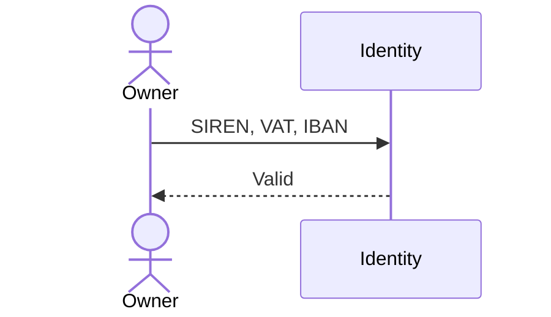

🏠 [Specs](../../../../README.md) › 🧩 [Functional capabilities](../../../README.md) ›
🧭 [F21 Onboarding and module activation](../../README.md) › 📝 [Use cases](../README.md) ›
📝 [Use cases: FL-F21-01 First run](README.md) › 📝 UC-F21-07 Set the company identity, VAT and bank

# 📝 UC-F21-07 Set the company identity, VAT and bank

**Status:** ✅ specified

## Summary

The owner sets identity, VAT and bank with checks.

## Personas

- [U13 Owner](../../../../01-users/personas/u13-owner.md)

## Goal

Legal identity.

## Trigger

Guide.

## Frequency

Once.

## Preconditions

- None.

## Postconditions

- Success: saved.
- Failure: refused.

## Main flow

1. Fill (S-F21-07).
2. Check (BR-F21-01).
3. Save.
4. Required before first invoice (BR-F21-07).

## Alternative flows

- 1a. From SIRENE.

## Error flows

- 2e. Invalid IBAN: refused.
- Any step: a service does not answer; the call is retried first (BR-F3-32), then the message follows the error pattern
  (D122) and what was typed stays on the screen.

## Business rules

- [BR-F21-01 The legal set-up comes from the country pack](../../business-rules/br-f21-01-legal-set-up-from-the-country-pack.md)
- [BR-F21-07 Required steps before the first legal document](../../business-rules/br-f21-07-required-steps-before-first-document.md)

## Entities

- [E-F21-02 Company profile](../../data/e-f21-02-company-profile.md)

## Permissions

Owner.

## Notifications

- None.

## Audit events

Changes.

## AI involvement

Fills.

## API, MCP and A2A exposure

Through T5 and T6 with the caller's rights (BR-F3-34).

## Screens

- [S-F21-07 Identity](../../screens/01-first-run/s-f21-07-identity.md)

## Flowchart

See [FL-F21-01 First run](../../flows/fl-f21-01-first-run.md#flowchart).

## Sequence diagram

## Acceptance criteria

1. **Given** a SIREN **when** checked **then** VAT number derived.
2. **Given** an invalid IBAN **when** saved **then** refused.
3. **Given** missing **when** invoicing **then** blocked.

## Non-functional notes

D408's targets ([Performance](../../../../05-non-functional/performance.md)): 95 % of screens within 1 second; lists
paged on the server, the first page within 1 second; reports within 5 seconds or in the background.

## Regulatory references

Set-up rules of the France country pack:
[CR-FR-001 Company identifiers](../../../../10-country-packs/france/company/cr-fr-001-company-identifiers.md),
[CR-FR-016 Electronic invoicing](../../../../10-country-packs/france/invoicing/cr-fr-016-electronic-invoicing.md),
[CR-FR-005 Accounting entries file (FEC)](../../../../10-country-packs/france/accounting/cr-fr-005-fec-export.md),
[CR-FR-038 Personnel register](../../../../10-country-packs/france/labour/cr-fr-038-personnel-register.md),
[CR-FR-048 Record of processing activities](../../../../10-country-packs/france/data-protection/cr-fr-048-record-of-processing.md),
[CR-FR-069 Website legal notices](../../../../10-country-packs/france/consumer/cr-fr-069-website-legal-notices.md).

## Related use cases

- [UC-F21-16 Check the legal set-up](uc-f21-16-check-the-legal-set-up.md)

## Open questions

None.

---

⬅️ [UC-F21-06 Switch a module off and keep its data](../02-modules/uc-f21-06-switch-a-module-off-and-keep-its-data.md) ·
⬆️ [Up](README.md) ·
➡️ [UC-F21-08 Invite users and give roles](../03-team-and-data/uc-f21-08-invite-users-and-give-roles.md)
