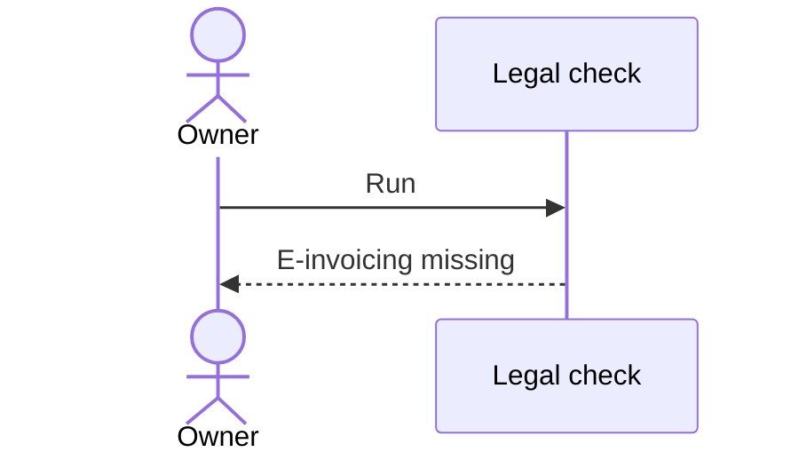

🏠 [Specs](../../../../README.md) › 🧩 [Functional capabilities](../../../README.md) ›
🧭 [F21 Onboarding and module activation](../../README.md) › 📝 [Use cases](../README.md) ›
📝 [Use cases: FL-F21-01 First run](README.md) › 📝 UC-F21-16 Check the legal set-up

# 📝 UC-F21-16 Check the legal set-up

**Status:** ✅ specified

## Summary

The owner checks the legal set-up and fixes missing items.

## Personas

- [U13 Owner](../../../../01-users/personas/u13-owner.md)

## Goal

Lawful set-up.

## Trigger

Guide.

## Frequency

Once then yearly.

## Preconditions

- Identity.

## Postconditions

- Success: all done.
- Failure: missing.

## Main flow

1. Run (S-F21-16).
2. Read.
3. Fix.
4. Run again.

## Alternative flows

- 2a. Not required yet.

## Error flows

- 3e. Missing: listed.
- Any step: a service does not answer; the call is retried first (BR-F3-32), then the message follows the error pattern
  (D122) and what was typed stays on the screen.

## Business rules

- [BR-F21-01 The legal set-up comes from the country pack](../../business-rules/br-f21-01-legal-set-up-from-the-country-pack.md)
- [BR-F21-07 Required steps before the first legal document](../../business-rules/br-f21-07-required-steps-before-first-document.md)

## Entities

- [E-F21-11 Legal check item](../../data/e-f21-11-legal-check-item.md)

## Permissions

Owner.

## Notifications

- None.

## Audit events

Checks.

## AI involvement

Explains.

## API, MCP and A2A exposure

Through T5 and T6 with the caller's rights (BR-F3-34).

## Screens

- [S-F21-16 Legal check](../../screens/01-first-run/s-f21-16-legal-check.md)

## Flowchart

See [FL-F21-01 First run](../../flows/fl-f21-01-first-run.md#flowchart).

## Sequence diagram

## Acceptance criteria

1. **Given** missing **when** run **then** listed.
2. **Given** fixed **when** run **then** ok.
3. **Given** country **when** run **then** its pack.

## Non-functional notes

D408's targets ([Performance](../../../../05-non-functional/performance.md)): 95 % of screens within 1 second; lists
paged on the server, the first page within 1 second; reports within 5 seconds or in the background.

## Regulatory references

Set-up rules of the France country pack:
[CR-FR-001 Company identifiers](../../../../10-country-packs/france/company/cr-fr-001-company-identifiers.md),
[CR-FR-016 Electronic invoicing](../../../../10-country-packs/france/invoicing/cr-fr-016-electronic-invoicing.md),
[CR-FR-005 Accounting entries file (FEC)](../../../../10-country-packs/france/accounting/cr-fr-005-fec-export.md),
[CR-FR-038 Personnel register](../../../../10-country-packs/france/labour/cr-fr-038-personnel-register.md),
[CR-FR-048 Record of processing activities](../../../../10-country-packs/france/data-protection/cr-fr-048-record-of-processing.md),
[CR-FR-069 Website legal notices](../../../../10-country-packs/france/consumer/cr-fr-069-website-legal-notices.md).

## Related use cases

- [UC-F21-07 Set the company identity, VAT and bank](uc-f21-07-set-the-company-identity-vat-and-bank.md)

## Open questions

None.

---

⬅️ [UC-F21-15](../04-learn-and-improve/uc-f21-15-take-an-interactive-tour-of-a-screen.md) · ⬆️ [Up](README.md) ·
➡️ [UC-F21-17](../04-learn-and-improve/uc-f21-17-welcome-an-employee-at-first-sign-in.md)
