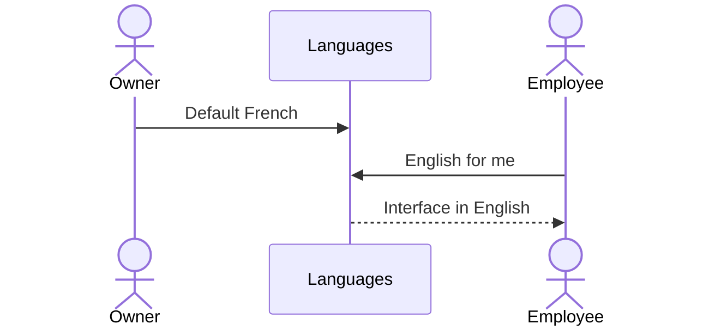

🏠 [Specs](../../../../README.md) › 🧩 [Functional capabilities](../../../README.md) ›
🧭 [F21 Onboarding and module activation](../../README.md) › 📝 [Use cases](../README.md) ›
📝 [Use cases: FL-F21-01 First run](README.md) › 📝 UC-F21-24 Choose the company's and each user's language

# 📝 UC-F21-24 Choose the company's and each user's language

**Status:** ✅ specified

## Summary

The owner sets the company's default language in the guide; each user may choose their own interface language; legal
documents follow the country pack.

## Personas

- [U13 Owner](../../../../01-users/personas/u13-owner.md)
- [U01 Employee](../../../../01-users/personas/u01-employee.md)

## Goal

Everyone works in their language.

## Trigger

The guide; a user's profile.

## Frequency

Once; rarely after.

## Preconditions

- None.

## Postconditions

- Success: languages set.
- Failure: none.

## Main flow

1. The owner picks the company's default language in the guide (S-F21-24).
2. Users get it by default.
3. A user chooses their own in the profile.
4. Legal documents stay in the country's language (BR-F21-15).

## Alternative flows

- 3a. The AI assistant answers in the user's language.

## Error flows

- 3e. A language without translation: the default with a notice.
- Any step: a service does not answer; the call is retried first (BR-F3-32), then the message follows the error pattern
  (D122) and what was typed stays on the screen.

## Business rules

- [BR-F21-15 Languages per company and per user](../../business-rules/br-f21-15-languages-per-company-and-per-user.md)

## Entities

- [E-F21-16 Language setting](../../data/e-f21-16-language-setting.md)

## Permissions

Owner sets the default; each user their own.

## Notifications

- None.

## Audit events

Changes.

## AI involvement

Answers in the user's language.

## API, MCP and A2A exposure

Through the API (T5) and as AI assistant tools (T6), with the caller's rights (BR-F3-34).

## Screens

- [S-F21-24 Languages](../../screens/01-first-run/s-f21-24-languages.md)

## Flowchart

See [FL-F21-01 First run](../../flows/fl-f21-01-first-run.md#flowchart).

## Sequence diagram

## Acceptance criteria

1. **Given** default French **when** an employee chooses English **then** their interface is English.
2. **Given** a French invoice **when** issued **then** in French.
3. **Given** a language without translation **when** chosen **then** the default with a notice.

## Non-functional notes

D408's targets ([Performance](../../../../05-non-functional/performance.md)): 95 % of screens within 1 second; lists
paged on the server, the first page within 1 second; reports within 5 seconds or in the background.

## Regulatory references

None.

## Related use cases

- [UC-F21-02 Describe the company](uc-f21-02-describe-the-company.md)
- [UC-F21-25 Onboard on the phone as an employee](../04-learn-and-improve/uc-f21-25-onboard-on-the-phone-as-an-employee.md)

## Open questions

None.

---

⬅️ [UC-F21-23 Invite the external accountant](../03-team-and-data/uc-f21-23-invite-the-external-accountant.md) ·
⬆️ [Up](README.md) · ➡️ [UC-F21-25](../04-learn-and-improve/uc-f21-25-onboard-on-the-phone-as-an-employee.md)
